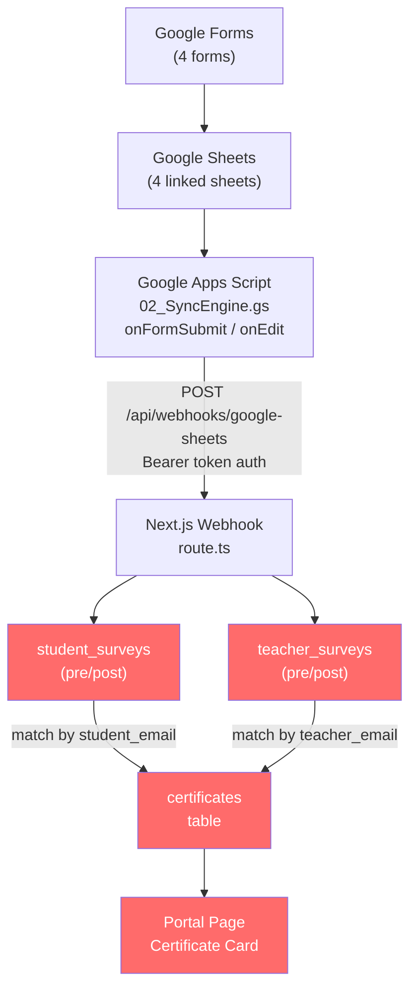
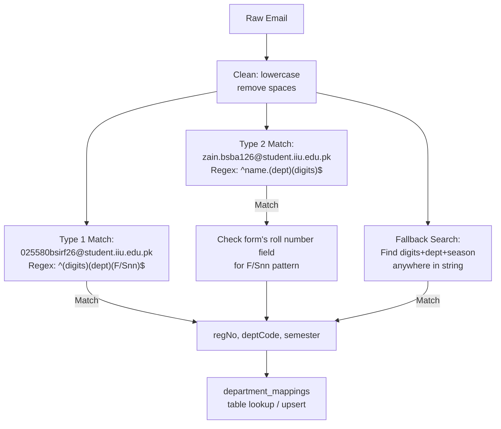
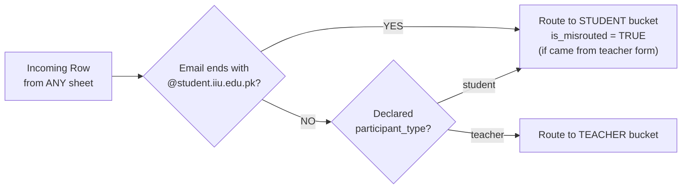
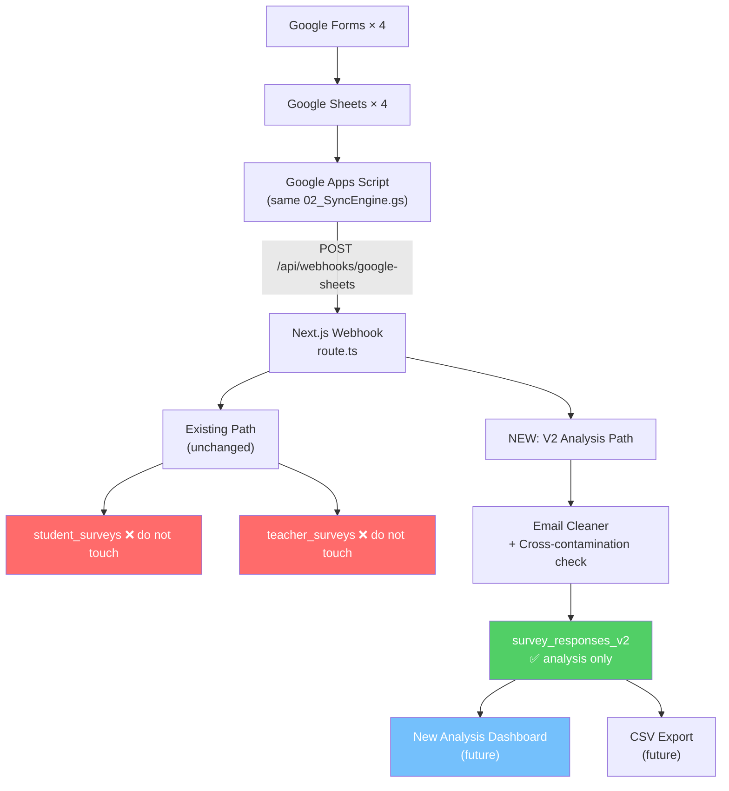

# V2 Data Pipeline — New Survey Analysis Tables
**AI Bridge | IIUI FMS**  
*Last Updated: October 2026*

---

## What Is This Document?

The **existing** `student_surveys` and `teacher_surveys` tables are wired directly into the **certification system**. Touching them = risk to certificates.

This document proposes a **new, isolated analysis pipeline** — separate tables, same webhook, zero certification risk.

---

## 1. The 4 Google Forms (Source Data)

| Form | Audience | Phase | Google Sheet |
|---|---|---|---|
| Student Pre-Survey | Students | Before training | [Sheet ↗](https://docs.google.com/spreadsheets/d/1Yl87AjralHb4vsVIZuWHcjdDzPiZeJE1kLwt1EmNO38) |
| Student Post-Survey | Students | After training | [Sheet ↗](https://docs.google.com/spreadsheets/d/1fnvJTCBScESkI5ypzWhl7_6Uhrx9rmb_XgcdbZ59dFo) |
| Teacher Pre-Survey | Teachers | Before training | [Sheet ↗](https://docs.google.com/spreadsheets/d/1JGw8SOQFtiK5rmYAelPF5aWar6LUpaZAJrJuEIjXBXk) |
| Teacher Post-Survey | Teachers | After training | [Sheet ↗](https://docs.google.com/spreadsheets/d/1ZqkLCeYgv4ETlU1-PKSdXZz8iYbre98cKl2zTFJwteU) |

### Known Issue — Cross-Contamination

> [!WARNING]
> Many **students** submitted to the **Teacher** form by mistake (using `@student.iiu.edu.pk` emails).  
> The new pipeline must detect and handle this automatically.

**Detection rule:** If email ends with `@student.iiu.edu.pk` → treat as **student**, regardless of which form it came from.

---

## 2. Column Map — What Each Form Sends

These are the column headers (questions) extracted from the existing sync engine and webhook parser.

### 2A — Student Forms (Pre & Post)

| Column in Sheet | Stored Key in `answers` JSONB | Extracted To |
|---|---|---|
| Timestamp | `Timestamp` | `match_key` (stable row ID) |
| Email Address *(Google login, auto)* | `Email address` | `login_email` |
| Student Email Address | `Student Email Address` | `student_email` ← **primary** |
| Email Address (non-iiui) | `Email Address (non-iiui)` | `student_email` ← fallback |
| Student Name / Full Name | `Student Name` or `Full Name` | `full_name` |
| Roll Number / Registration No | `Roll No` / `Registration No` | `reg_no` (also helps semester parse) |
| How many hours per week… | *hours keyword* | `hours_saved_category` |
| AI familiarity / comfort (1–5) | *familiar/rating keyword* | `ai_familiarity_rating` |
| Feedback / Suggestions | *feedback/comment keyword* | `feedback_notes` |
| *(all other answers)* | raw key | stored in `answers` JSONB |

**Email Priority (Student):**
```
Student Email Address → Email Address (non-iiui) → Email address
```

### 2B — Teacher Forms (Pre & Post)

| Column in Sheet | Stored Key in `answers` JSONB | Extracted To |
|---|---|---|
| Timestamp | `Timestamp` | `match_key` |
| Institutional Email Address | `Institutional Email Address` | `teacher_email` ← **primary** |
| Email Address (non-iiui) | `Email Address (non-iiui)` | `teacher_email` ← fallback |
| Teacher Name / Full Name | `Teacher Name` or `Full Name` | `full_name` |
| Designation / Academic Rank | `Designation` / `Designation / Academic Rank` | `designation` |
| Department | `Department` | `department_name` |
| Teaching Experience | `Teaching Experience` | `teaching_experience` |
| Hours saved per week | *hours keyword* | `hours_saved_category` |
| AI familiarity (1–5) | *familiar/rating keyword* | `ai_familiarity_rating` |
| Feedback / Comments | *feedback keyword* | `feedback_notes` |
| *(all other answers)* | raw key | stored in `answers` JSONB |

**Email Priority (Teacher):**
```
Institutional Email Address → Email Address (non-iiui) → Email Address
```

---

## 3. Existing Architecture (DO NOT TOUCH)



> [!CAUTION]
> Red = **certification-critical**. These tables must NOT be altered.

---

## 4. Decision: Update Existing vs. Create New Tables

### Option A — Extend Existing Tables (Add columns)

**Pros:**
- Single source of truth
- No changes to Apps Script or webhook needed
- Existing dashboard queries still work

**Cons:**
- ❌ High risk — one bad migration breaks certificates
- ❌ Old tables have unique constraints on `(match_key, survey_type)` — adding new survey types would clash
- ❌ `student_surveys` is 1-row-per-email (upsert). New forms might have multiple entries from same email = constraint violation
- ❌ Schema changes require downtime planning
- ❌ Cross-contamination (student emails in teacher sheets) is already baked in with wrong routing

### Option B — Create New Tables (Recommended ✅)

**Pros:**
- ✅ Zero risk to certification system
- ✅ Can store all 4 sheets separately with full raw data
- ✅ Free to change schema without migration risk
- ✅ Can handle student-in-teacher-sheet properly by routing to correct analysis bucket
- ✅ Can track **multiple responses per email** (analysis use case)
- ✅ Easy to drop or reset without touching certs

**Cons:**
- Need to extend webhook or write a second sync path
- Slightly more tables to maintain
- May have duplicate emails across old and new tables (acceptable — different purpose)

> [!IMPORTANT]
> **Recommendation: Create New Tables.**  
> The analysis use case is fundamentally different from the certification use case.  
> New forms → new tables → no risk.

---

## 5. Proposed New Schema

### 5A — Single Unified Table: `survey_responses_v2`

One table handles all 4 forms. Simple, flexible, analysis-ready.

```sql
-- ==============================================================
-- Migration 027: V2 Survey Analysis Tables (Analysis Only)
-- Does NOT touch student_surveys or teacher_surveys
-- ==============================================================

CREATE TABLE IF NOT EXISTS public.survey_responses_v2 (
    id               UUID PRIMARY KEY DEFAULT gen_random_uuid(),
    
    -- SOURCE IDENTITY
    form_source      TEXT NOT NULL, -- 'student_pre' | 'student_post' | 'teacher_pre' | 'teacher_post'
    participant_type TEXT NOT NULL CHECK (participant_type IN ('student', 'teacher')),
    survey_phase     TEXT NOT NULL CHECK (survey_phase IN ('pre', 'post')),
    match_key        TEXT NOT NULL,  -- ts:<timestamp> stable row identity
    
    -- CONTACT / IDENTITY
    email            TEXT NOT NULL,  -- resolved email (cleaned, lowercase)
    login_email      TEXT,           -- Google-login email (auto-collected, reference only)
    full_name        TEXT,
    
    -- EMAIL-DERIVED FIELDS (students only)
    reg_no           TEXT,
    dept_code        TEXT REFERENCES public.department_mappings(code) ON UPDATE CASCADE ON DELETE SET NULL,
    semester         TEXT,           -- e.g. F26, S25
    
    -- TEACHER-SPECIFIC FIELDS
    designation      TEXT,           -- Lecturer, Asst. Prof, etc.
    department_name  TEXT,           -- Free-text department from form
    teaching_experience TEXT,        -- '1-3 years', '3-5 years', '5+ years'
    
    -- CROSS-CONTAMINATION FLAG
    is_misrouted     BOOLEAN DEFAULT FALSE, -- TRUE if student email found in teacher form
    
    -- COMMON ANALYSIS FIELDS
    hours_saved_category   TEXT,     -- '0 hours', '1-2 hours', '3-5 hours', '5+ hours'
    ai_familiarity_rating  INT CHECK (ai_familiarity_rating BETWEEN 1 AND 5),
    feedback_notes         TEXT,
    
    -- RAW DATA
    answers          JSONB NOT NULL DEFAULT '{}'::jsonb,
    sheet_row_number INT,
    
    -- TIMESTAMPS
    submitted_at     TIMESTAMPTZ NOT NULL DEFAULT now(),
    synced_at        TIMESTAMPTZ NOT NULL DEFAULT now(),
    
    -- UNIQUE: one response per form + email (analysis: allow multiple? use match_key)
    CONSTRAINT uq_survey_v2_match UNIQUE (match_key, form_source)
);

-- Indexes for analysis queries
CREATE INDEX IF NOT EXISTS idx_sv2_email        ON public.survey_responses_v2(email);
CREATE INDEX IF NOT EXISTS idx_sv2_form_source  ON public.survey_responses_v2(form_source);
CREATE INDEX IF NOT EXISTS idx_sv2_dept         ON public.survey_responses_v2(dept_code);
CREATE INDEX IF NOT EXISTS idx_sv2_semester     ON public.survey_responses_v2(semester);
CREATE INDEX IF NOT EXISTS idx_sv2_phase        ON public.survey_responses_v2(survey_phase);
CREATE INDEX IF NOT EXISTS idx_sv2_misrouted    ON public.survey_responses_v2(is_misrouted);
CREATE INDEX IF NOT EXISTS idx_sv2_match        ON public.survey_responses_v2(match_key);

-- RLS
ALTER TABLE public.survey_responses_v2 ENABLE ROW LEVEL SECURITY;

CREATE POLICY "Public read v2 surveys" ON public.survey_responses_v2
    FOR SELECT USING (true);

CREATE POLICY "Admins manage v2 surveys" ON public.survey_responses_v2
    FOR ALL USING (public.get_user_role() IN ('admin', 'member'));

CREATE POLICY "Service role full access v2" ON public.survey_responses_v2
    FOR ALL WITH CHECK (true);
```

### 5B — Column Comparison: Old vs New

| Feature | `student_surveys` (old) | `survey_responses_v2` (new) |
|---|---|---|
| Purpose | Certification link | Analysis only |
| Forms covered | 2 (student pre+post) | 4 (all) |
| Multiple responses/email | No (UNIQUE email+type) | Yes (UNIQUE match_key+form) |
| Teacher data | Separate table | Same table, `participant_type=teacher` |
| Misrouted entries | Not handled | `is_misrouted=TRUE` flag |
| Raw answers | `answers` JSONB | `answers` JSONB |
| Linked to certs | ✅ Yes | ❌ No (by design) |
| Safe to reset | ❌ No | ✅ Yes |

---

## 6. Email Cleaning & Parsing Logic

### Email → Dept Code + Semester



### Cross-Contamination Routing



---

## 7. New Pipeline Architecture



> [!TIP]
> The webhook can write to **both** paths simultaneously. Old path stays unchanged. New path writes to `survey_responses_v2`.

---

## 8. Sync Engine Changes Needed

### Option 8A — Extend Webhook (Recommended)

In [`route.ts`](file:///d:/000627-BSBA-S24/Other%20Material/web%20development/AI-Bridge/src/app/api/webhooks/google-sheets/route.ts), after the existing upsert to `student_surveys`/`teacher_surveys`, add a parallel upsert to `survey_responses_v2`.

**No changes to Apps Script needed.** Same payload, dual write.

```typescript
// After existing student/teacher upsert — add this:
const isStudentEmail = email.endsWith('@student.iiu.edu.pk');
const formSource = `${isStudentEmail || participantType === 'student' ? 'student' : 'teacher'}_${surveyType}`;
const isMisrouted = participantType === 'teacher' && isStudentEmail;

await supabase.from('survey_responses_v2').upsert({
  form_source: formSource,
  participant_type: isMisrouted ? 'student' : participantType,
  survey_phase: surveyType,
  match_key: matchKey,
  email,
  login_email: loginEmail,
  full_name: fullName,
  reg_no: regNo,
  dept_code: deptCode,
  semester,
  designation: answers['Designation'] || answers['Designation / Academic Rank'] || null,
  department_name: answers['Department'] || null,
  teaching_experience: answers['Teaching Experience'] || null,
  is_misrouted: isMisrouted,
  hours_saved_category: hoursCategory,
  ai_familiarity_rating: rating,
  feedback_notes: rowData.feedback_notes || null,
  answers,
  sheet_row_number: rowData.sheet_row_number || null,
  submitted_at: new Date().toISOString(),
  synced_at: new Date().toISOString(),
}, { onConflict: 'match_key,form_source' });
```

### Option 8B — Separate Webhook Endpoint

Create `/api/webhooks/google-sheets-v2` — completely separate, no risk of breaking existing flow.

*More isolated but requires updating Apps Script to dual-post.*

---

## 9. One-Time Backfill Plan

To populate `survey_responses_v2` from existing data (without touching certs):

```sql
-- Backfill from student_surveys
INSERT INTO public.survey_responses_v2 (
    form_source, participant_type, survey_phase,
    match_key, email, login_email, full_name,
    reg_no, dept_code, semester,
    hours_saved_category, ai_familiarity_rating, feedback_notes,
    answers, sheet_row_number, submitted_at
)
SELECT
    'student_' || survey_type,   -- 'student_pre' or 'student_post'
    'student',
    survey_type,
    match_key,
    student_email,
    login_email,
    full_name,
    reg_no, dept_code, semester,
    hours_saved_category, ai_familiarity_rating, feedback_notes,
    answers, sheet_row_number, submitted_at
FROM public.student_surveys
ON CONFLICT (match_key, form_source) DO NOTHING;

-- Backfill from teacher_surveys
INSERT INTO public.survey_responses_v2 (
    form_source, participant_type, survey_phase,
    match_key, email, login_email, full_name,
    designation, department_name, teaching_experience,
    hours_saved_category, ai_familiarity_rating, feedback_notes,
    answers, sheet_row_number, submitted_at
)
SELECT
    'teacher_' || survey_type,
    'teacher',
    survey_type,
    match_key,
    teacher_email,
    login_email,
    full_name,
    designation, department_name, teaching_experience,
    hours_saved_category, ai_familiarity_rating, feedback_notes,
    answers, sheet_row_number, submitted_at
FROM public.teacher_surveys
ON CONFLICT (match_key, form_source) DO NOTHING;
```

---

## 10. Implementation Checklist

- [ ] **Step 1:** Run SQL migration to create `survey_responses_v2` table
- [ ] **Step 2:** Run backfill SQL to copy existing data
- [ ] **Step 3:** Add dual-write code to [`route.ts`](file:///d:/000627-BSBA-S24/Other%20Material/web%20development/AI-Bridge/src/app/api/webhooks/google-sheets/route.ts)
- [ ] **Step 4:** Trigger "Sync Entire Sheet" from Apps Script menu on all 4 sheets
- [ ] **Step 5:** Build new analysis dashboard using `survey_responses_v2`

> [!NOTE]
> Steps 1–3 are zero-downtime. The old tables are never touched.  
> Step 4 re-syncs all historical data into the new table automatically.

---

## 11. Summary

| What | Old Pipeline | New V2 Pipeline |
|---|---|---|
| Tables | `student_surveys`, `teacher_surveys` | `survey_responses_v2` |
| Purpose | Certification | Analysis only |
| Risk | High | Zero |
| Cross-contamination | Not handled | Detected + flagged |
| Multi-response per email | No | Yes |
| Forms covered | 2 | 4 |
| Apps Script change | Not needed | Not needed (dual-write in webhook) |
