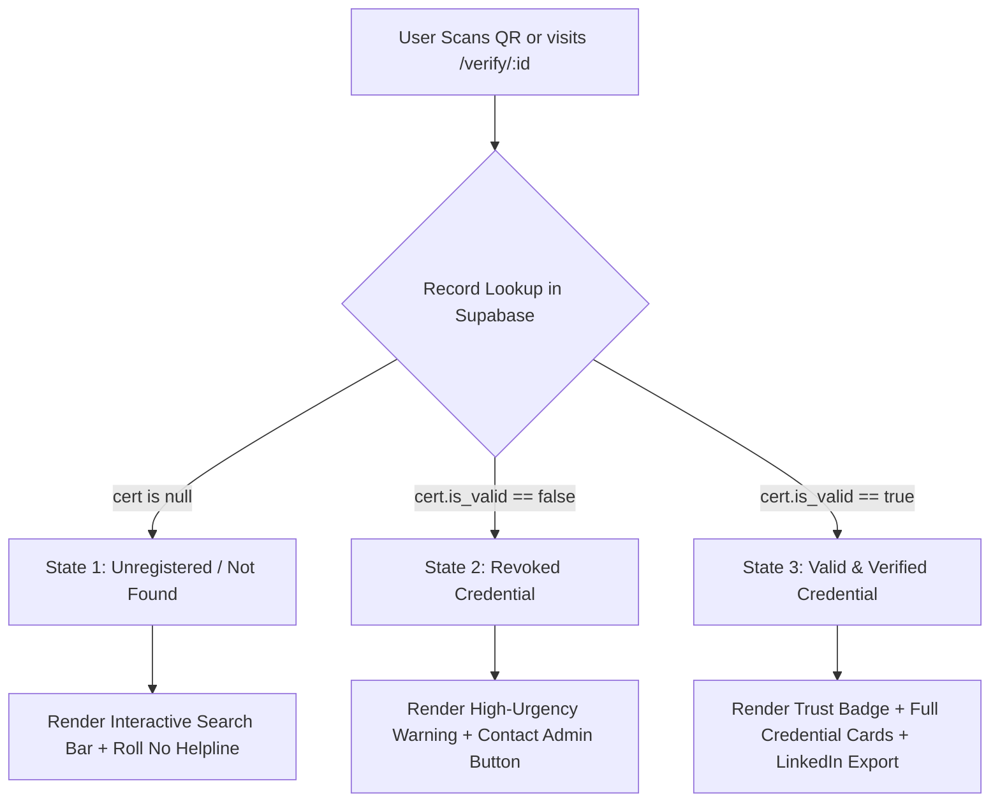

# 03: Certificate Verification Page — Comprehensive UX, UI & Data Specification

**Document Version:** 1.0  
**Project:** The AI Bridge (IIUI FMS × Hum Hain Pakistan)  
**File Target:** `src/app/verify/[id]/page.tsx`  
**Target Audience:** Engineering, Product, Academic Stakeholders  

---

## 1. Executive Summary & Core Objective

The Certificate Verification Registry (`/verify/[id]`) is the **single public-facing proof of competence** for all students, faculty, and external participants certified by **The AI Bridge** initiative at the International Islamic University Islamabad (IIUI).

When an employer, university dean, or academic admissions officer scans the physical QR code on an issued certificate, this page serves as the official legal and cryptographic validator.

### Identified Flaws in Current State:
1. **FMS Default Leak:** Non-FMS students (e.g. Computer Science `BSCS`, International Relations `BSIR`, Civil Engineering `BSCE`) and external participants are falsely labeled as *Faculty of Management Sciences (FMS)* due to legacy database defaults.
2. **Missing Search on Not Found:** When an ID is mistyped or scanned incorrectly, the page displays a dead end with no search bar or recovery suggestions.
3. **Under-utilization of Rich Learning Data:** The system tracks rigorous 3-stage evaluation metrics (Quiz score, weekly hours saved, baseline vs post-training gains) that are currently hidden from employers and verifiers.
4. **Missing Shareability:** Students cannot showcase their verified credential on LinkedIn or professional portfolios directly from the verification screen.

---

## 2. Complete Inventory of Available Data

The database contains rich telemetry across four tables that can be rendered on the verification registry:

| Table | Available Fields | Description & Privacy Sensitivity |
|---|---|---|
| `certificates` | `certificate_id`, `verification_code`, `recipient_name`, `student_id`, `department`, `course_name`, `completion_date`, `is_valid`, `issued_by`, `issued_at` | **Core Credential Fields** (Public, high authenticity value). |
| `student_surveys` | `reg_no`, `dept_code`, `semester`, `hours_saved_category`, `ai_familiarity_rating`, `feedback_notes` | **Academic Context & Impact** (Medium sensitivity, high evaluation proof). |
| `department_mappings` | `code`, `standard_dept_name`, `faculty_name` | **Normalized Hierarchy** (Maps `BSCS` → *Computer Science, Faculty of Computing & IT*). |
| `quiz_attempts` | `score`, `total_questions`, `passed_at` | **Assessment Competency** (Proves 75%+ passing score on 12-MCQ technical exam). |
| `teacher_surveys` | `designation`, `department_name`, `teaching_experience` | **Faculty Credentials** (Distinguishes educator certifications from student credentials). |

---

## 3. Data Field Display Evaluation (Pros & Cons)

Below is an analytical breakdown of potential data fields to display on the public verification view:

### 1. Recipient Full Name & Academic Identification
* **Data Source:** `certificates.recipient_name`, `certificates.student_id`
* **Example:** `Muhammad Tayyab` • `000627/BSBA/S24`
* **Pros:**
  * Fundamental requirement for credential verification.
  * Allows recruiters and university registrars to confirm candidate identity instantly.
* **Cons:**
  * Privacy concern if personal contact details (email/phone) are exposed (must stay strictly limited to name + roll no).
* **Verdict:** ✅ **Mandatory (Keep as primary title).**

---

### 2. Normalized Department & Faculty Hierarchy
* **Data Source:** `certificates.department` (joined with `department_mappings`)
* **Example:** 
  * *For IIUI Student:* `Department of Technology & Project Management` • `Faculty of Management Sciences (FMS)`
  * *For Non-IIUI / External:* `Verified Participant • Open Academic Track`
* **Pros:**
  * Eliminates the confusing "FMS Everywhere" glitch.
  * Correctly credits Computer Science (`Faculty of Computing & IT`), International Relations (`Faculty of Social Sciences`), etc.
  * Prevents external students from feeling alienated or falsely branded.
* **Cons:**
  * Some legacy or typo department codes require fallback normalization.
* **Verdict:** ✅ **Critical Fix (Dynamic resolution based on enrollment source).**

---

### 3. Competency Gate Milestones (3-Step Audit Badge)
* **Data Source:** `student_surveys` (pre + post) and `quiz_attempts`
* **Example:** 
  * `[✓] Stage 1: Pre-Training AI Readiness Assessed`
  * `[✓] Stage 2: 12-MCQ Proctored Knowledge Gate Passed (10/12 • 83%)`
  * `[✓] Stage 3: Post-Training Impact Verified (Hours Saved Documented)`
* **Pros:**
  * Differentiates The AI Bridge certificate from "attendance-only" certificates.
  * Demonstrates rigorous assessment rigor to employers.
* **Cons:**
  * Showing raw quiz scores might cause anxiety if a student passed with the minimum (9/12).
* **Verdict:** ✅ **Recommended:** Display the 3 verified milestone badges, with optional display of score as `"Passed with Distinction (11+/12)"` or simply `"Passing Score Verified (80%+)"`.

---

### 4. Verified Productivity Impact (Hours Saved Metric)
* **Data Source:** `student_surveys.hours_saved_category`
* **Example:** `Documented Impact: 3 to 5 study hours saved weekly using source-grounded NotebookLM`
* **Pros:**
  * Highly innovative: Links certification directly to measurable real-world productivity gains.
  * Great talking point in interviews for graduates.
* **Cons:**
  * Self-reported metric (though collected under academic supervision).
* **Verdict:** 🟡 **Optional / Secondary:** Include as an impact highlight pill if available.

---

### 5. Authorized Signatories & Institutional Endorsement
* **Data Source:** `certificates.issued_by` + Institutional Co-sponsors
* **Example:**
  * **Dr. Abdul Zahid Khan:** Chairperson, TPM Department, FMS, IIUI
  * **Prof. Dr. Ahmed Shuja Syed:** Vice President (Research & Enterprise), IIUI
  * **Campaign Partner:** Hum Hain Pakistan (HHP) SDG Youth Initiative
* **Pros:**
  * Provides high academic prestige and institutional authority.
  * Instills legal and academic trust.
* **Cons:**
  * Takes up visual space on mobile devices.
* **Verdict:** ✅ **Mandatory:** Maintain compact 2-column signature card grid on desktop, collapsible on mobile.

---

### 6. "Add to LinkedIn" & Social Verification Actions
* **Data Source:** Generated dynamically using LinkedIn Certification URL specification:
  * `name`: The AI Bridge: Source-Grounded AI & NotebookLM Mastery
  * `organizationName`: International Islamic University, Islamabad
  * `issueYear`/`issueMonth`: From `completion_date`
  * `certUrl`: Live `/verify/AIB-XXXXXXXX` URL
  * `certId`: `AIB-XXXXXXXX`
* **Pros:**
  * Drives viral adoption and organic university promotion.
  * Gives students a 1-click button to embed their credential directly into their LinkedIn profile.
* **Cons:**
  * Requires clean URL encoding and external window handling.
* **Verdict:** 🚀 **High Value Win (Add prominent "Add to LinkedIn" action button).**

---

### 7. Instant Official PDF Generation & Download
* **Data Source:** `/api/portal/certificate?verify_id=AIB-XXXXXXXX`
* **Pros:**
  * Allows a verifier or employer to download a fresh, uncompressed vector PDF directly from the database without asking the student to email it.
* **Cons:**
  * Serverless compute generation load (~60ms RAM execution).
* **Verdict:** ✅ **Keep and Optimize (Already integrated with RAM streaming).**

---

## 4. UI State-by-State Architecture

The page must handle three distinct logical states with clear visual distinction:



### State 1: Valid & Verified Credential (Primary Happy Path)
* **Theme:** Deep Emerald (`#064e3b`), Soft Gold Accents, Clean Slate card borders.
* **Hero Header:**
  * Pulsing Verified Shield (`ShieldCheck`).
  * Big bold text: **"Official Credential Verified & Authentic"**.
  * Registered Credential Serial: `AIB-XXXXXXXX` (with 1-click Copy ID button).
* **Recipient Profile:**
  * Recipient Full Name (Sanitized, WinAnsi normalized).
  * Academic Roll Number (e.g. `000627/BSBA/S24`).
  * Real Department Name (e.g. *Technology and Project Management*).
  * Faculty Name (e.g. *Faculty of Management Sciences* or *Faculty of Computing & IT*).
* **Evaluation Proof Card:**
  * 3 Stage Checklist: Pre-Survey Baseline Completed • 12-MCQ Examination Passed • Post-Evaluation Verified.
* **Action Bar:**
  * Primary: **"Download Official PDF"** (with download icon).
  * Secondary: **"Add to LinkedIn Profile"** (with LinkedIn brand badge).
  * Tertiary: **"Copy Verification Link"** (clipboard feedback toast).

---

### State 2: Certificate Revoked (Administrative Sanction)
* **Theme:** Crimson Rose / Deep Crimson (`#881337`).
* **Hero Header:**
  * Warning Octagon / Shield Alert icon (`ShieldAlert`).
  * Status Badge: `STATUS: REVOKED BY ADMINISTRATION`.
* **Body:**
  * Clear explanation: *"This credential reference was issued on [Date] but has been officially revoked by the IIUI FMS administration due to invalidation or reissue."*
* **Action:**
  * Primary: **"Contact Administrative Registry"** (`mailto:ai.bridge.iiui.fms@gmail.com?subject=Inquiry regarding Revoked Certificate AIB-XXXX`).

---

### State 3: Certificate Not Found (Search & Recovery)
* **Theme:** Slate Gray with Amber troubleshooting accents.
* **Hero Header:**
  * Status Badge: `STATUS: UNREGISTERED / NOT FOUND`.
* **UX Recovery Widget (NEW):**
  * **Interactive Search Box:** Allows the visitor to paste their Serial ID or Roll Number right on this page instead of leaving to home.
  * **Troubleshooting Checklist:**
    1. Confirm serial matches `AIB-XXXXXXXX` format (case-insensitive).
    2. If you completed all 3 evaluation steps today, visit the [Student Portal](/portal) to generate your record.
    3. Need assistance? Contact `ai.bridge.iiui.fms@gmail.com`.

---

## 5. Department & Academic Resolution Logic (Fixing the FMS Leak)

To resolve the issue where non-FMS students get tagged with FMS, the display logic must follow this exact cascade:

```typescript
function resolveDisplayDepartment(cert: CertificateRecord) {
  // 1. If explicit department exists and is NOT the generic default
  if (cert.department && cert.department !== 'Faculty of Management Sciences (FMS)') {
    return cert.department;
  }

  // 2. If student_id has a recognizable departmental prefix
  if (cert.student_id) {
    const match = cert.student_id.match(/([a-zA-Z]{2,6})/);
    if (match) {
      const code = match[1].toUpperCase();
      const mapped = DEPARTMENT_DICTIONARY[code];
      if (mapped) {
        return `${mapped.name} (${mapped.faculty})`;
      }
    }
  }

  // 3. For External / Non-IIUI students with no roll number
  if (!cert.student_id) {
    return 'Verified Participant • Open Track';
  }

  // 4. Default IIUI fallback
  return 'International Islamic University Islamabad (IIUI)';
}
```

---

## 6. Comparison: Current Verification Page vs. Proposed Revamp

| Feature | Current Implementation | Proposed Revamped Implementation |
|---|---|---|
| **Department Display** | Fixed fallback to `Faculty of Management Sciences (FMS)` | Dynamic resolution: Actual department & faculty; clean fallback for external users. |
| **Not Found Experience** | Static dead-end text with "Back to Home" | Interactive search bar + direct input to re-check serial or roll number. |
| **Competency Proof** | Single text line: "3-Step Evaluation Verified" | Visual 3-Stage Progress Audit Card with verified checkmarks and exam status. |
| **LinkedIn Integration** | None | 1-Click "Add to LinkedIn" button pre-configured with IIUI organization ID. |
| **Copy Credential Link** | Manual copy of browser address bar | 1-Click copy button with toast notification (`"Link copied to clipboard!"`). |
| **Revoked View** | Plain text notice | Actionable view with 1-click email button to contact admin regarding the revocation. |
| **Print / PDF Generation** | Basic text link | Stamped PDF download button with loading indicator. |

---

## 7. Implementation Roadmap & Recommended Steps

1. **Phase 1 (Immediate / Safe):** Update `src/app/verify/[id]/page.tsx` with dynamic department rendering and remove hardcoded FMS default.
2. **Phase 2 (Database Data Correction):** Execute a one-time database migration script to populate real department names from `student_surveys.dept_code` for all existing 24 certificates.
3. **Phase 3 (UX Polish):** Add LinkedIn credential integration button and the interactive search box on the "Not Found" view.
