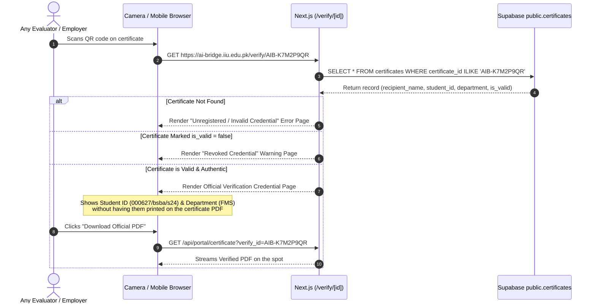

# Certificate Creation & Verification — Complete Detailed Flow
**The AI Bridge · IIUI Faculty of Management Sciences · Hum Hain Pakistan (HHP)**

---

## 1. Overview

This document specifies the exact **Certificate Creation, On-The-Spot Stamping, and Public Verification Pipeline**. It focuses exclusively on what happens **from the moment certification criteria are met to the physical PDF delivery and subsequent QR verification**.

```
┌────────────────────────────────────────────────────────────────────────┐
│                        CORE ARCHITECTURE RULE                          │
│                                                                        │
│  • ZERO FILE STORAGE: No PDFs or QR images are saved to disk or cloud. │
│  • IN-MEMORY STAMPING: Master template is read into RAM, dynamically   │
│    stamped with Clean Name + QR in ~60ms, and streamed to the user.    │
│  • ONLY TWO VARIABLE ITEMS STAMPED: Recipient Name + Dynamic QR Code.  │
│  • VERIFICATION ONLY: Student ID and Department appear on the webpage  │
│    when scanning the QR code, keeping the printed certificate clean.   │
└────────────────────────────────────────────────────────────────────────┘
```

---

## 2. End-to-End Certification Flowchart

```mermaid
flowchart TD
    classDef startEnd fill:#0a2756,stroke:#0a2756,color:#ffffff,font-weight:bold;
    classDef process fill:#f8fafc,stroke:#cbd5e1,color:#0f172a;
    classDef decision fill:#fef3c7,stroke:#f59e0b,color:#78350f,font-weight:bold;
    classDef ram fill:#ecfdf5,stroke:#10b981,color:#065f46,font-weight:bold;
    classDef client fill:#eff6ff,stroke:#3b82f6,color:#1e40af;
    classDef verify fill:#fdf4ff,stroke:#c084fc,color:#581c87;

    START(["Participant Completes Evaluation"]):::startEnd --> UNLOCK["Portal Unlocks Certificate Card\n(Pre-Survey + Passed Quiz + Post-Survey)"]:::process

    UNLOCK --> CLICK["Student Clicks 'Download PDF Certificate'"]:::client

    CLICK --> API["GET /api/portal/certificate"]:::process

    API --> AUTH{"Authenticated?"}:::decision
    AUTH -- No --> ERR401["Return 401 Unauthorized"]:::process
    AUTH -- Yes --> DB_CHECK{"Record in\npublic.certificates?"}:::decision

    DB_CHECK -- "Already Exists" --> FETCH_CERT["Retrieve Certificate Metadata\n- certificate_id (AIB-XXXXXXXX)\n- recipient_name (Sanitized)"]:::process
    DB_CHECK -- "Not Yet Created" --> RPC["Call RPC: issue_certificate_for_user()"]:::process

    RPC --> GATE_CHECK{"All 3 Gates\nCompleted in DB?"}:::decision
    GATE_CHECK -- No --> ERR400["Return 400 Prerequisites Incomplete"]:::process
    GATE_CHECK -- Yes --> CREATE_RECORD["1. Auto-generate Short ID: AIB-XXXXXXXX\n2. Sanitize Name: Strip digits from @student\n3. Extract Roll No & Dept\n4. Insert Metadata into public.certificates"]:::process

    CREATE_RECORD --> FETCH_CERT

    FETCH_CERT --> VALID_CHECK{"is_valid == true?"}:::decision
    VALID_CHECK -- No --> ERR403["Return 403 Revoked"]:::process

    VALID_CHECK -- Yes --> STAMP_ENGINE["In-Memory PDF Stamping Engine\n(src/lib/certificate/generator.ts)"]:::ram

    subgraph RAM_STAMP [" In-Memory RAM Stamping (~50-80ms) "]
        direction TB
        T1["1. Read Assets/AI_BRIDGE_Certificate_Cleaned.pdf into RAM Buffer"]:::ram
        T2["2. Generate QR Code Matrix in Memory\nTarget: https://ai-bridge.iiu.edu.pk/verify/AIB-XXXXXXXX"]:::ram
        T3["3. Normalize Recipient Name & Auto-Scale Font\n(Base: 56pt, Cap: 700pt width, Serif Bold, Navy #0a2756)"]:::ram
        T4["4. Stamp Name at (x=94.80, y=515.47) above gold rule"]:::ram
        T5["5. Draw White Backing Card at (x=1139.08, y=146.00)"]:::ram
        T6["6. Stamp QR Matrix at (x=1143.08, y=150.00) [100x100 pt]"]:::ram
        T7["7. Stamp White Sub-Labels: 'Scan to verify certificate'"]:::ram
        T1 --> T2 --> T3 --> T4 --> T5 --> T6 --> T7
    end

    STAMP_ENGINE --> RAM_STAMP
    RAM_STAMP --> STREAM["Return HTTP 200 with PDF Binary Buffer\n- Content-Type: application/pdf\n- Content-Disposition: attachment;\n  filename='The_AI_Bridge_Certificate_AIB-XXXXXXXX.pdf'"]:::ram

    STREAM --> BROWSER["Browser Downloads Official PDF Immediately\n(Zero Storage Used)"]:::client

    BROWSER -.->|Student / Employer Scans QR Code| SCAN["Scan QR Matrix with Camera"]:::client

    SCAN --> VERIFY_ROUTE["GET https://ai-bridge.iiu.edu.pk/verify/AIB-XXXXXXXX"]:::verify

    VERIFY_ROUTE --> VERIFY_DB{"Query Supabase\npublic.certificates\n(Case-Insensitive ILIKE)"}:::decision

    VERIFY_DB -- "Not Found" --> PAGE_404["Render 'Certificate Not Found'\nTroubleshooting Checklist"]:::verify
    VERIFY_DB -- "is_valid == false" --> PAGE_REVOKED["Render 'Certificate Revoked'\nWarning Badge"]:::verify
    VERIFY_DB -- "Valid & Active" --> PAGE_VALID["Render Official Verified Credential Page\n• Recipient Name\n• Student Registration Number\n• Faculty Department\n• Date of Award\n• Verified Status Badge\n• Direct Re-download PDF Button"]:::verify
```



---

## 3. Step-by-Step Technical Flow

### Phase 1: Eligibility & Metadata Registration
When a student finishes the 3 evaluation steps, the system establishes an official record in `public.certificates`:

```
Google Form Pre-Survey (Gate 1)  ─┐
12-MCQ Quiz Passed >=75% (Gate 2) ┼─► issue_certificate_for_user() ──► Record in public.certificates
Google Form Post-Survey (Gate 3) ─┘
```

1. **Gate Verification:**  
   The procedure checks that `student_surveys` (or `teacher_surveys`) has both `pre` and `post` rows for the user, and `quiz_attempts` has `passed = true`.
2. **Short Non-Guessable ID Generation:**  
   Generated cryptographically via `public.generate_short_certificate_id()`:
   $$\text{certificate\_id} = \text{"AIB-" } + \text{8 Random Base36 Alphanumeric Characters}$$
   *Example:* `AIB-K7M2P9QR`, `AIB-3J9X4T2M` (2.8 trillion possible combinations, 100% collision-free guaranteed by DB UNIQUE constraint and validation loop).
3. **Name Sanitization (IIUI Student Rule):**  
   If email is `@student.iiu.edu.pk`:
   - Raw input: `muhammad tayyab 000627/bsba/s24` or `Zain Uddin 126-FMS/BSBA/F23`
   - Regex applied: `\s*\d+.*$` stripped $\rightarrow$ Capitalized: `Muhammad Tayyab`
   - Digits preserved as: `student_id = 000627/bsba/s24`
   If email is not a student account (e.g., faculty `@iiu.edu.pk` or Gmail), the name is preserved as submitted.
4. **Metadata Saved:**  
   Stores only text and dates (`certificate_id`, `recipient_name`, `student_id`, `department`, `completion_date`, `is_valid`). **No PDF or image is stored.**

---

### Phase 2: In-Memory On-The-Spot Stamping Flow
When the user clicks **"Download PDF Certificate"** in [`/portal`](file:///d:/000627-BSBA-S24/Other%20Material/web%20development/AI-Bridge/src/app/portal/page.tsx):

```
User Click ──► GET /api/portal/certificate ──► Read Clean PDF Template into RAM
                                                      │
                       ┌──────────────────────────────┴──────────────────────────────┐
                       ▼                                                             ▼
         1. Dynamic Name Stamping                                      2. Dynamic QR Code Stamping
   • Text: clean recipient_name                                  • Generate QR buffer in RAM
   • Font: TimesRomanBold (Serif)                                • Target: https://ai-bridge.../verify/[id]
   • Dynamic size: 56pt (auto-shrink if > 700pt)                 • Size: 100x100 pt
   • Coordinates: (x=94.80, y=515.47)                            • Coordinates: (x=1143.08, y=150.00)
   • Color: Deep Navy #0a2756                                    • White card behind QR: (x=1139.08, y=146.00)
                       │                                                             │
                       └──────────────────────────────┬──────────────────────────────┘
                                                      │
                                                      ▼
                                       Stream PDF to Browser (~60ms)
                                     (Zero Disk / Zero Storage Buckets)
```

#### Detailed Canvas Geometry ($1440 \times 1018.08\text{ pt}$)
- **Page Size:** Width: $1440.0\text{ pt}$, Height: $1018.08\text{ pt}$.
- **Recipient Name Coordinates:**
  - $x = 94.80\text{ pt}$ (left-aligned with salutation).
  - $y = 515.47\text{ pt}$ (sits $13.4\text{ pt}$ above the pre-rendered gold underline rule at $y=502.08$).
  - Color: `#0a2756` $\rightarrow$ `rgb(0.0392, 0.1530, 0.3370)`.
- **QR Code Coordinates (Dark Blue Right Sidebar):**
  - White backing card: $x = 1139.08\text{ pt}, y = 146.00\text{ pt}$, size $108 \times 108\text{ pt}$ (provides high contrast).
  - QR matrix image: $x = 1143.08\text{ pt}, y = 150.00\text{ pt}$, size $100 \times 100\text{ pt}$.
  - Sub-label line 1: `"Scan to verify"` at $(x=1159.56, y=130.94)$, size $11\text{ pt}$, white text.
  - Sub-label line 2: `"certificate"` at $(x=1168.94, y=117.62)$, size $11\text{ pt}$, white text.

---

### Phase 3: Public Verification Flow
When any party scans the printed or digital QR code with a smartphone camera:



---

## 4. Key Files in the Certification Pipeline

| File Path | Role in Certification Creation |
|---|---|
| [`Assets/AI_BRIDGE_Certificate_Cleaned.pdf`](file:///d:/000627-BSBA-S24/Other%20Material/web%20development/AI-Bridge/Assets/AI_BRIDGE_Certificate_Cleaned.pdf) | Master template containing all static graphics, signatures, and pre-rendered branding. |
| [`src/lib/certificate/generator.ts`](file:///d:/000627-BSBA-S24/Other%20Material/web%20development/AI-Bridge/src/lib/certificate/generator.ts) | Stamping engine (`pdf-lib` + `qrcode`). Reads template into RAM, stamps Name & QR, returns `Uint8Array`. |
| [`src/app/api/portal/certificate/route.ts`](file:///d:/000627-BSBA-S24/Other%20Material/web%20development/AI-Bridge/src/app/api/portal/certificate/route.ts) | Streaming API route. Handles portal downloads and public verification downloads. |
| [`supabase/011_certification_issuance_engine.sql`](file:///d:/000627-BSBA-S24/Other%20Material/web%20development/AI-Bridge/supabase/011_certification_issuance_engine.sql) | SQL sequence, `sanitize_iiui_name()` regex function, and `issue_certificate_for_user()` stored procedure. |
| [`src/app/portal/page.tsx`](file:///d:/000627-BSBA-S24/Other%20Material/web%20development/AI-Bridge/src/app/portal/page.tsx) | Portal UI. Checks completion, enables download button, fires confetti on download. |
| [`src/app/verify/[id]/page.tsx`](file:///d:/000627-BSBA-S24/Other%20Material/web%20development/AI-Bridge/src/app/verify/%5Bid%5D/page.tsx) | Server-side public verification registry rendering student ID, department, and valid status. |
