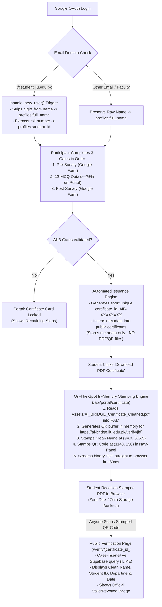

# The AI Bridge — Certification System Specification & Architecture (V2)
**On-The-Spot In-Memory Credential Generation & Verification Pipeline**  
*IIUI Faculty of Management Sciences · Hum Hain Pakistan (HHP) SDG Youth Campaign*

---

## 1. Executive Summary & Core Rules

The **AI Bridge Certification System** dynamically generates and verifies official credentials for the *Source-Grounded AI & NotebookLM Mastery* training program across IIUI faculties.

### Core Architectural Decisions (Finalized)
1. **Always Created On-The-Spot (Zero File Storage):**
   - **No PDF files and no QR code images are saved to disk or Supabase Storage.**
   - When an eligible participant clicks **"Download PDF Certificate"**, the server reads [`Assets/AI_BRIDGE_Certificate_Cleaned.pdf`](file:///d:/000627-BSBA-S24/Other%20Material/web%20development/AI-Bridge/Assets/AI_BRIDGE_Certificate_Cleaned.pdf) into RAM, generates the QR code in memory, stamps the clean name and QR code in $\sim 50\text{--}80\text{ ms}$, and streams the binary PDF directly to the browser.
   - **Benefits:** Zero storage costs, zero bucket setup, zero orphaned files, and instantaneous updates (if an admin corrects a typo, subsequent downloads immediately reflect it).
2. **Strict Stamping Boundary (What goes on the PDF):**
   - **ONLY TWO DYNAMIC ELEMENTS ARE STAMPED:**
     1. **Recipient Clean Full Name** (stamped above the pre-rendered gold underline rule)
     2. **Dynamic QR Code** (stamped inside the dark navy right sidebar with white backing card)
   - **What is NOT stamped on the PDF:**
     - `course_name` — Statically printed on the template (*"has successfully completed the NotebookLM Training Program..."*).
     - `issued_by` / Signatures — Statically printed on the template (Dr. Abdul Zahid Khan & Prof. Dr. Ahmed Shuja Syed).
     - `recipient_role` — Unnecessary; omitted.
     - `student_id` & `department` — **Not stamped on the certificate.** Stored in the database and shown **exclusively on the public QR Verification Page** (`/verify/[certificate_id]`).
3. **QR Code Verification URL:**
   - **Always points to the production domain:** `https://ai-bridge.iiu.edu.pk/verify/${certificate_id}` (even when running or testing on `localhost`).
4. **Name Sanitization Scope:**
   - **Applies strictly to `@student.iiu.edu.pk` accounts.**
   - All other accounts (regular Gmail, faculty `@iiu.edu.pk`) preserve their name as submitted.
   - Handles both Junior format (`muhammad tayyab 000627/bsba/s24`) and Senior format (`Zain Uddin 126-FMS/BSBA/F23`) by removing everything from the first digit onward.
5. **Name Editing Governance:**
   - **Admin-Only:** Participants cannot edit their own names in the portal to prevent fraudulent re-issuance.
6. **Teacher & Student Parity:**
   - Teachers complete the same 3-step lifecycle and receive the identical official certificate template.
7. **Download Quota:**
   - **Unlimited downloads:** No rate-limiting or download caps on participants.

---

## 2. "How It Is Now" (Current Codebase Audit)

| Component | Current Implementation | Flaw / Bottleneck |
|---|---|---|
| **Supabase `certificates` Table** | Defined in `001_schema.sql` with obsolete columns (`recipient_role`, `course_name`, etc.) | Empty in production. No database function or automated trigger issues certificates when Gate 3 is satisfied. Users have no `INSERT` permission under RLS. |
| **Auth Name Loading (`handle_new_user`)** | Saves raw Google metadata: `COALESCE(new.raw_user_meta_data->>'full_name', ...)` | Saves strings like `muhammad tayyab 000627/bsba/s24` into `profiles.full_name`. Printing this directly would ruin the certificate. |
| **Existing Accounts** | Existing accounts already created during pilot workshops contain raw messy names. | Updating the trigger only affects new logins. Existing database rows remain uncleaned without a migration. |
| **Student Portal UI ([`src/app/portal/page.tsx`](file:///d:/000627-BSBA-S24/Other%20Material/web%20development/AI-Bridge/src/app/portal/page.tsx))** | Verification button links statically to `/verify/AIB-2025-0001`. Download button executes `alert('Certificate PDF generator will render... Phase 3')`. | Hardcoded static links and JavaScript alert stubs. No PDF is generated or downloaded. |
| **Verification Page ([`src/app/verify/[id]/page.tsx`](file:///d:/000627-BSBA-S24/Other%20Material/web%20development/AI-Bridge/src/app/verify/%5Bid%5D/page.tsx))** | Accepts `params.id`, but renders hardcoded mock data for `"Asad Naveed Akbar"`. | Zero database queries to Supabase `certificates`. Any random URL shows the same mock student. Case-sensitive matching fails on lowercase URLs. |
| **Backend API Routes** | Webhook handles sheet sync, quiz route handles MCQ submissions. | No `/api/portal/certificate` endpoint exists to stamp or stream on-the-spot PDFs. |

---

## 3. "How It Should Be" (Target Architecture)



### Physical Certificate PDF vs. Public Verification Page

```
┌──────────────────────────────────────┐     ┌──────────────────────────────────────┐
│        PRINTED CERTIFICATE PDF       │     │        PUBLIC QR VERIFY PAGE         │
│     (Generated On-The-Spot in RAM)   │     │        (/verify/[certificate_id])    │
├──────────────────────────────────────┤     ├──────────────────────────────────────┤
│ • IIUI Logo (Static)                 │     │ • Official Verification Status Badge │
│ • "Certificate of Completion"        │     │ • Recipient Clean Full Name          │
│ • "This is to certify that"          │     │ • Student Registration / Roll No     │
│ • ★ RECIPIENT CLEAN NAME ★ (Stamped) │     │ • Department & Faculty               │
│ • Course description (Static)        │     │ • Course Name                        │
│ • Dr. Abdul Zahid Khan (Static)      │     │ • Date of Award                      │
│ • Prof. Dr. Ahmed Shuja Syed (Static)│     │ • Issuing Authority & Institution    │
│ • Right Panel: AI Bridge (Static)    │     │ • Real-time Status: VALID / REVOKED  │
│ • ★ DYNAMIC QR CODE ★ (Stamped)      │     │ • Direct Download Link for PDF       │
└──────────────────────────────────────┘     └──────────────────────────────────────┘
```

---

## 4. Name Sanitization Rule (Auth $\rightarrow$ Profiles)

### Supported Formats & Transformation Logic
Only emails ending in `@student.iiu.edu.pk` are transformed:

| Format Type | Raw Input Example | Sanitized Name (`profiles.full_name`) | Extracted Roll No (`profiles.student_id`) |
|---|---|---|---|
| **Junior Student** | `muhammad tayyab 000627/bsba/s24` | `Muhammad Tayyab` | `000627/bsba/s24` |
| **Senior Student** | `Zain Uddin 126-FMS/BSBA/F23` | `Zain Uddin` | `126-FMS/BSBA/F23` |
| **Hyphenated Roll**| `Asad Naveed Akbar 003822-bsba-f24` | `Asad Naveed Akbar` | `003822-bsba-f24` |
| **Faculty Email**  | `Dr. Muhammad Imran` (`@iiu.edu.pk`) | `Dr. Muhammad Imran` | `NULL` |
| **Personal Email** | `Zainab Fatima` (`@gmail.com`) | `Zainab Fatima` | `NULL` |

### PostgreSQL Function Implementation
```sql
CREATE OR REPLACE FUNCTION public.sanitize_iiui_name(raw_name TEXT, user_email TEXT)
RETURNS TEXT AS $$
DECLARE
    cleaned TEXT;
BEGIN
    IF raw_name IS NULL OR TRIM(raw_name) = '' THEN
        RETURN 'Participant';
    END IF;

    -- Only apply digit-stripping rule if the email belongs to @student.iiu.edu.pk
    IF user_email IS NOT NULL AND LOWER(user_email) LIKE '%@student.iiu.edu.pk' THEN
        cleaned := TRIM(regexp_replace(raw_name, '\s*\d+.*$', '', 'g'));
        IF cleaned = '' THEN cleaned := TRIM(raw_name); END IF;
        RETURN initcap(cleaned);
    ELSE
        RETURN TRIM(raw_name);
    END IF;
END;
$$ LANGUAGE plpgsql IMMUTABLE;
```

---

## 5. Supabase Data Dictionary & Field Mapping

### Table: `public.certificates` (Metadata Only — No Stored Files)

| Column Name | Data Type | Nullable | Source / Logic | Purpose / Explanation |
|---|---|---|---|---|
| `id` | `UUID` | No | `gen_random_uuid()` | Internal unique primary key. |
| `certificate_id` | `TEXT` | No | `AIB-XXXXXXXX` | Human-readable short non-guessable serial number (Base36, encoded into QR code). |
| `verification_code` | `TEXT` | No | `gen_random_uuid()` | Cryptographic slug for URL security. |
| `user_id` | `UUID` | No | `profiles.id` | Foreign key referencing user (`UNIQUE` constraint prevents duplicate issuance). |
| `recipient_name` | `TEXT` | No | `sanitize_iiui_name(profiles.full_name, email)` | Clean name **stamped onto the certificate PDF on the fly**. |
| `student_id` | `TEXT` | Yes | `profiles.student_id` | Registration number. **Shown on verification page, not on certificate.** |
| `department` | `TEXT` | Yes | `profiles.department` | Faculty department. **Shown on verification page, not on certificate.** |
| `completion_date` | `DATE` | No | `CURRENT_DATE` | Date Gate 3 was satisfied. Shown on verification page. |
| `is_valid` | `BOOLEAN`| No | `true` | Revocation flag. If `false`, `/verify` displays "REVOKED". |
| `created_at` | `TIMESTAMPTZ`| No | `now()` | Exact timestamp of issuance. |

> **Zero-Storage Architecture Note:**  
> `pdf_url` and `qr_code_url` are intentionally **omitted** from this schema. Neither the PDF nor the QR code is ever stored on disk or cloud storage. Everything is generated directly in RAM upon download.

---

### Fallback Resolution Hierarchy

```
┌────────────────────────────────────────────────────────────────────────┐
│                        FIELD RESOLUTION HIERARCHY                      │
├────────────────────┬───────────────────────────────────────────────────┤
│ Target Field       │ Resolution Order (Evaluated Top to Bottom)        │
├────────────────────┼───────────────────────────────────────────────────┤
│                    │ 1. sanitize_iiui_name(profiles.full_name, email)  │
│ recipient_name     │ 2. sanitize_iiui_name(student_surveys.student_name│
│ (Stamped on PDF)   │ 3. sanitize_iiui_name(teacher_surveys.teacher_name│
│                    │ 4. parse_email_name(profiles.email)               │
├────────────────────┼───────────────────────────────────────────────────┤
│ student_id         │ 1. profiles.student_id                            │
│ (For Verify Page)  │ 2. student_surveys.registration_no                │
│                    │ 3. Regex extract from raw name: (\d+.*$)          │
│                    │ 4. Regex from email: ^(\d+)[a-z]+                 │
├────────────────────┼───────────────────────────────────────────────────┤
│ department         │ 1. profiles.department                            │
│ (For Verify Page)  │ 2. student_surveys.department_name                │
│                    │ 3. teacher_surveys.faculty_department             │
│                    │ 4. 'Faculty of Management Sciences (FMS)'         │
└────────────────────┴───────────────────────────────────────────────────┘
```

---

## 6. PDF Stamping Blueprint (Exact In-Memory Coordinates)

Master template coordinates in `Assets/AI_BRIDGE_Certificate_Cleaned.pdf` (MediaBox: `[0, 0, 1440, 1018.08]`):

```
   y = 1018.08 pt (Top Edge)
   ┌───────────────────────────────────────────────────────────────────────────────────┐
   │                                                                                   │
   │   (x=213.1, y=883.5) International Islamic University, Islamabad                  │
   │   (x=213.1, y=856.1) Faculty of Management Sciences · AI Bridge                   │
   │                                                                                   │
   │   (x=92.2, y=686.0) Certificate of Completion                                     │
   │   (x=92.2, y=610.8) This is to certify that                                       │
   │                                                                                   │
y  │ ──(x=94.8, y=515.5) ★ VARIABLE RECIPIENT NAME ★ (Lora-Bold / Serif, 56pt)───────── │
   │   (x=92.2, y=502.1) [Pre-rendered Gold Underline Rule]                            │
   │                                                                                   │
   │   (x=92.2, y=443.5) has successfully completed the NotebookLM Training Program... │
   │                                                                                   │
   │                                                         [RIGHT PANEL: #0a2756]    │
   │   (x=92.2, y=168.9)        (x=459.4, y=167.9)           NotebookLM                │
   │   Dr Abdul Zahid Khan      Prof. Dr. Ahmed Shuja Syed   Training Program          │
   │   Associate Professor      Vice President (R&E)                                   │
   │                                                         ★ DYNAMIC QR CODE ★       │
   │                                                         (x=1143.1, y=150.0)       │
   │                                                         "Scan to verify"          │
   └───────────────────────────────────────────────────────────────────────────────────┘
   (0, 0) (Bottom-Left Origin)                                  x = 1440.0 pt (Right Edge)
```

### 1. Recipient Clean Full Name
- **Coordinates:** $x = 94.80\text{ pt}$, $y = 515.47\text{ pt}$ (sits $13.4\text{ pt}$ above the gold underline rule at $y=502.08$).
- **Font:** Serif Bold (`TimesRomanBold` or bundled `Lora-Bold.ttf`).
- **Font Size:** Standard $56.0\text{ pt}$.
- **Auto-Scale Rule:** If calculated text width $> 700\text{ pt}$, scale down proportionally:
  $$\text{size} = 56 \times (700 / \text{textWidth})$$
- **Color:** Deep Navy Blue `#0a2756` (`rgb(0.0392, 0.1530, 0.3370)`).

### 2. Dynamic QR Code (Generated in Memory)
- **Coordinates:** $x = 1143.08\text{ pt}$, $y = 150.00\text{ pt}$.
- **Dimensions:** $100\text{ pt} \times 100\text{ pt}$ (Square).
- **Target URL (Enforced Production Host):** `https://ai-bridge.iiu.edu.pk/verify/${certificate_id}`.
- **High-Contrast Card:** A white rounded rectangle ($108\text{ pt} \times 108\text{ pt}$) is drawn behind the QR code at $(x=1139.08, y=146.00)$ to guarantee instant camera scanability against the dark blue sidebar.
- **White Sub-Labels:** Stamped directly below the QR code:
  - `"Scan to verify"` at $(x=1159.56, y=130.94)$, size $11\text{ pt}$, Sans-Bold.
  - `"certificate"` at $(x=1168.94, y=117.62)$, size $11\text{ pt}$, Sans-Bold.

---

## 7. Comprehensive Glitch Audit & Solutions Matrix

During edge-case stress testing, we identified **9 critical vulnerabilities** and engineered the following mitigations:

| # | Glitch / Vulnerability | Root Cause | Engineered Mitigation |
|---|---|---|---|
| **G1** | **Existing accounts with dirty names** | `handle_new_user` only runs on first login. Pilot users already have `000627/bsba/s24` in `profiles.full_name`. | Execute one-time SQL cleanup migration (`011_certification_issuance_engine.sql`) to sanitize existing rows. |
| **G2** | **Case sensitivity in verification URLs** | PostgreSQL string equality (`certificate_id = $id`) fails if QR code or manual input is lowercase (`aib-2026-0042`). | Use case-insensitive query: `certificate_id ILIKE $id OR verification_code ILIKE $id`. |
| **G3** | **Multiple quiz attempts** | Student passes with 9/12, then retakes later and gets 8/12. | Check Gate 2 using `EXISTS (SELECT 1 FROM quiz_attempts WHERE user_id = $id AND passed = true)`. Passing once permanently satisfies Gate 2. |
| **G4** | **Post-Survey webhook latency** | Student finishes Google Form and immediately clicks "Download" before Google Sheets webhook executes. | On-demand fallback: `/api/portal/certificate` cross-checks `student_surveys` by email and auto-links the record before rejecting. |
| **G5** | **Download filename corruption on iOS/Safari** | Special characters in names or serial IDs break HTTP headers. | Strictly sanitize HTTP response header: `attachment; filename="AI_Bridge_Certificate_${certificate_id}.pdf"`. |
| **G6** | **Revoked certificate still downloadable** | If admin revokes a certificate (`is_valid = false`), user can still click download. | Download route strictly checks `if (!cert.is_valid) return 403 Forbidden ("Certificate revoked")`. |
| **G7** | **QR code points to `localhost` in dev** | Using dynamic `origin` or `process.env.NEXT_PUBLIC_SITE_URL` during local dev prints `http://localhost:3000`. | Hardcode production URL base: `https://ai-bridge.iiu.edu.pk/verify/${cert.certificate_id}`. |
| **G8** | **Non-IIUI names stripped by mistake** | A teacher or guest with numbers in their designation gets their name truncated. | Condition digit-stripping strictly on `@student.iiu.edu.pk`. |
| **G9** | **Font glyph crash on Pakistani honorifics/dashes** | Built-in PDF fonts lack UTF-8 glyphs for characters like `ā`, `ī`, or non-breaking hyphens. | Fallback replacement for unencodable characters + embed true vector serif font. |

---

## 8. Implementation Blueprint (Code & SQL)

### 1. Database Migration: `011_certification_issuance_engine.sql`
Run this script in Supabase SQL Editor:

```sql
-- 1. Sequence for sequential certificate IDs
CREATE SEQUENCE IF NOT EXISTS public.certificate_id_seq START 1;

-- 2. Name Sanitizer: Strips digits onward strictly for student emails
CREATE OR REPLACE FUNCTION public.sanitize_iiui_name(raw_name TEXT, user_email TEXT)
RETURNS TEXT AS $$
DECLARE
    cleaned TEXT;
BEGIN
    IF raw_name IS NULL OR TRIM(raw_name) = '' THEN
        RETURN 'Participant';
    END IF;

    IF user_email IS NOT NULL AND LOWER(user_email) LIKE '%@student.iiu.edu.pk' THEN
        cleaned := TRIM(regexp_replace(raw_name, '\s*\d+.*$', '', 'g'));
        IF cleaned = '' THEN cleaned := TRIM(raw_name); END IF;
        RETURN initcap(cleaned);
    ELSE
        RETURN TRIM(raw_name);
    END IF;
END;
$$ LANGUAGE plpgsql IMMUTABLE;

-- 3. One-Time Cleanup for Existing Accounts
UPDATE public.profiles
SET 
    student_id = COALESCE(student_id, substring(full_name from '\d+.*$')),
    full_name = public.sanitize_iiui_name(full_name, email)
WHERE email LIKE '%@student.iiu.edu.pk' AND full_name ~ '\d';

-- 4. Stored Procedure: Validate 3 Gates and Register Certificate Metadata
CREATE OR REPLACE FUNCTION public.issue_certificate_for_user(p_user_id UUID)
RETURNS JSONB
LANGUAGE plpgsql
SECURITY DEFINER
AS $$
DECLARE
    v_profile RECORD;
    v_has_pre BOOLEAN := false;
    v_has_quiz BOOLEAN := false;
    v_has_post BOOLEAN := false;
    v_existing RECORD;
    v_cert_id TEXT;
    v_clean_name TEXT;
    v_student_id TEXT;
    v_dept TEXT;
BEGIN
    -- Check if already issued
    SELECT * INTO v_existing FROM public.certificates WHERE user_id = p_user_id;
    IF FOUND THEN
        RETURN jsonb_build_object('success', true, 'status', 'already_issued', 'certificate', row_to_json(v_existing));
    END IF;

    -- Fetch user profile
    SELECT * INTO v_profile FROM public.profiles WHERE id = p_user_id;
    IF NOT FOUND THEN
        RETURN jsonb_build_object('success', false, 'error', 'User profile not found');
    END IF;

    -- Validate Gate 1: Pre-Survey
    SELECT EXISTS (
        SELECT 1 FROM public.student_surveys WHERE (user_id = p_user_id OR LOWER(student_email) = LOWER(v_profile.email)) AND survey_type = 'pre'
        UNION ALL
        SELECT 1 FROM public.teacher_surveys WHERE (user_id = p_user_id OR LOWER(teacher_email) = LOWER(v_profile.email)) AND survey_type = 'pre'
    ) INTO v_has_pre;

    -- Validate Gate 2: Passed Quiz (at least once)
    SELECT EXISTS (
        SELECT 1 FROM public.quiz_attempts WHERE user_id = p_user_id AND passed = true
    ) INTO v_has_quiz;

    -- Validate Gate 3: Post-Survey
    SELECT EXISTS (
        SELECT 1 FROM public.student_surveys WHERE (user_id = p_user_id OR LOWER(student_email) = LOWER(v_profile.email)) AND survey_type = 'post'
        UNION ALL
        SELECT 1 FROM public.teacher_surveys WHERE (user_id = p_user_id OR LOWER(teacher_email) = LOWER(v_profile.email)) AND survey_type = 'post'
    ) INTO v_has_post;

    IF NOT (v_has_pre AND v_has_quiz AND v_has_post) THEN
        RETURN jsonb_build_object(
            'success', false,
            'error', 'Prerequisites incomplete',
            'gates', jsonb_build_object('pre', v_has_pre, 'quiz', v_has_quiz, 'post', v_has_post)
        );
    END IF;

    -- Generate Next Short Non-Guessable ID: AIB-XXXXXXXX (Base36: 2.8 trillion combinations)
    v_cert_id := public.generate_short_certificate_id();
    v_clean_name := public.sanitize_iiui_name(v_profile.full_name, v_profile.email);

    v_student_id := COALESCE(
        v_profile.student_id,
        (SELECT registration_no FROM public.student_surveys WHERE user_id = p_user_id AND registration_no IS NOT NULL LIMIT 1)
    );
    v_dept := COALESCE(
        v_profile.department,
        (SELECT department_name FROM public.student_surveys WHERE user_id = p_user_id AND department_name IS NOT NULL LIMIT 1),
        'Faculty of Management Sciences (FMS)'
    );

    -- Insert official certificate record (Metadata only - zero file storage)
    INSERT INTO public.certificates (
        certificate_id,
        verification_code,
        user_id,
        recipient_name,
        student_id,
        department,
        completion_date,
        is_valid
    ) VALUES (
        v_cert_id,
        gen_random_uuid()::text,
        p_user_id,
        v_clean_name,
        v_student_id,
        v_dept,
        CURRENT_DATE,
        true
    ) RETURNING * INTO v_existing;

    RETURN jsonb_build_object('success', true, 'status', 'issued', 'certificate', row_to_json(v_existing));
END;
$$;
```

---

### 2. In-Memory On-The-Spot Stamping Service: `src/lib/certificate/generator.ts`

```typescript
import { PDFDocument, rgb, StandardFonts } from 'pdf-lib';
import QRCode from 'qrcode';
import fs from 'fs';
import path from 'path';

export interface StampingInput {
  certificateId: string;
  recipientName: string;
}

/**
 * Creates the official PDF certificate on the spot in RAM (~60ms).
 * No file is saved to disk or Supabase storage.
 */
export async function stampCertificatePdfOnTheSpot(input: StampingInput): Promise<Uint8Array> {
  const templatePath = path.join(process.cwd(), 'Assets', 'AI_BRIDGE_Certificate_Cleaned.pdf');
  const templateBytes = fs.readFileSync(templatePath);

  const pdfDoc = await PDFDocument.load(templateBytes);
  const page = pdfDoc.getPages()[0];

  const fontBold = await pdfDoc.embedFont(StandardFonts.TimesRomanBold);
  const fontSans = await pdfDoc.embedFont(StandardFonts.HelveticaBold);

  // 1. Calculate dynamic font size (Base: 56pt, Max width: 700pt)
  const maxNameWidth = 700;
  let nameSize = 56;
  const initialWidth = fontBold.widthOfTextAtSize(input.recipientName, nameSize);
  if (initialWidth > maxNameWidth) {
    nameSize = Math.floor((maxNameWidth / initialWidth) * nameSize);
  }

  // 2. Stamp Clean Name in Deep Navy (#0a2756)
  page.drawText(input.recipientName, {
    x: 94.80,
    y: 515.47,
    size: nameSize,
    font: fontBold,
    color: rgb(0.0392, 0.1530, 0.3370),
  });

  // 3. Generate QR Code in memory (buffer) pointing strictly to production host
  const verifyUrl = `https://ai-bridge.iiu.edu.pk/verify/${input.certificateId}`;
  const qrBuffer = await QRCode.toBuffer(verifyUrl, {
    width: 250,
    margin: 1,
    color: { dark: '#0a2756', light: '#ffffff' },
  });

  // 4. Stamp High-Contrast White Backing Card
  const qrX = 1143.08;
  const qrY = 150.00;
  const qrSize = 100.0;

  page.drawRectangle({
    x: qrX - 4,
    y: qrY - 4,
    width: qrSize + 8,
    height: qrSize + 8,
    color: rgb(1, 1, 1),
  });

  // 5. Stamp QR Image
  const qrImage = await pdfDoc.embedPng(qrBuffer);
  page.drawImage(qrImage, {
    x: qrX,
    y: qrY,
    width: qrSize,
    height: qrSize,
  });

  // 6. Stamp White Sub-Labels below QR
  page.drawText('Scan to verify', {
    x: 1159.56,
    y: 130.94,
    size: 11.0,
    font: fontSans,
    color: rgb(1, 1, 1),
  });

  page.drawText('certificate', {
    x: 1168.94,
    y: 117.62,
    size: 11.0,
    font: fontSans,
    color: rgb(1, 1, 1),
  });

  // Return binary byte array directly
  return await pdfDoc.save();
}
```

---

### 3. API Route: `src/app/api/portal/certificate/route.ts`

```typescript
import { NextRequest, NextResponse } from 'next/server';
import { createClient } from '@/lib/supabase/server';
import { createAdminClient } from '@/lib/supabase/admin';
import { stampCertificatePdfOnTheSpot } from '@/lib/certificate/generator';

export async function GET(req: NextRequest) {
  const supabase = await createClient();
  const { data: { user } } = await supabase.auth.getUser();

  if (!user) {
    return NextResponse.json({ error: 'Unauthorized' }, { status: 401 });
  }

  const adminClient = createAdminClient();

  // 1. Fetch certificate or self-heal issuance
  let { data: cert } = await adminClient
    .from('certificates')
    .select('*')
    .eq('user_id', user.id)
    .maybeSingle();

  if (!cert) {
    const { data: issueResult, error: issueErr } = await adminClient.rpc(
      'issue_certificate_for_user',
      { p_user_id: user.id }
    );
    if (issueErr || !issueResult?.success) {
      return NextResponse.json({ error: 'Prerequisites not satisfied' }, { status: 400 });
    }
    cert = issueResult.certificate;
  }

  // 2. Revocation Guard
  if (!cert.is_valid) {
    return NextResponse.json({ error: 'This certificate has been revoked.' }, { status: 403 });
  }

  // 3. Generate Stamped PDF on the spot in memory (~60ms)
  const pdfBytes = await stampCertificatePdfOnTheSpot({
    certificateId: cert.certificate_id,
    recipientName: cert.recipient_name,
  });

  // 4. Stream binary directly to user
  return new NextResponse(Buffer.from(pdfBytes), {
    headers: {
      'Content-Type': 'application/pdf',
      'Content-Disposition': `attachment; filename="AI_Bridge_Certificate_${cert.certificate_id}.pdf"`,
      'Cache-Control': 'no-cache, no-store, must-revalidate',
    },
  });
}
```

---

### 4. Public Verification Route: `src/app/verify/[id]/page.tsx`
*Case-insensitive matching (`ILIKE`) with status validation.*

```typescript
import { notFound } from 'next/navigation';
import { createAdminClient } from '@/lib/supabase/admin';
import { ShieldCheck, ShieldAlert, Award, Calendar, User, Building2 } from 'lucide-react';

interface Props {
  params: Promise<{ id: string }>;
}

export default async function VerifyPage({ params }: Props) {
  const { id } = await params;
  const supabase = createAdminClient();

  // Case-insensitive match on certificate serial or verification UUID
  const { data: cert } = await supabase
    .from('certificates')
    .select('*')
    .or(`certificate_id.ilike.${id},verification_code.ilike.${id}`)
    .maybeSingle();

  if (!cert) {
    return (
      <div className="max-w-xl mx-auto p-8 my-16 bg-white border border-rose-200 rounded-3xl text-center space-y-4 shadow-lg">
        <ShieldAlert className="w-16 h-16 text-rose-500 mx-auto" />
        <h1 className="text-2xl font-bold text-slate-900">Certificate Not Found</h1>
        <p className="text-xs text-slate-500">
          The credential ID <span className="font-mono font-bold text-rose-600">{id}</span> is not registered in the official IIUI FMS certification registry.
        </p>
      </div>
    );
  }

  return (
    <div className="max-w-2xl mx-auto my-12 p-6 sm:p-10 bg-white border border-slate-200 rounded-3xl shadow-xl space-y-6">
      <div className="flex items-center justify-between border-b pb-4">
        <div className="flex items-center gap-3">
          <ShieldCheck className={`w-8 h-8 ${cert.is_valid ? 'text-emerald-600' : 'text-rose-600'}`} />
          <div>
            <span className="text-[11px] font-bold text-slate-400 uppercase tracking-wider">
              Official Credential Verification
            </span>
            <h1 className="text-xl font-bold text-slate-900">
              {cert.is_valid ? 'Valid & Verified Certificate' : 'Revoked Certificate'}
            </h1>
          </div>
        </div>
        <span className={`px-3 py-1 rounded-full text-xs font-bold ${
          cert.is_valid ? 'bg-emerald-100 text-emerald-800' : 'bg-rose-100 text-rose-800'
        }`}>
          {cert.is_valid ? 'STATUS: VALID' : 'STATUS: REVOKED'}
        </span>
      </div>

      <div className="space-y-4 text-xs">
        <div>
          <span className="text-slate-400">Recipient Name</span>
          <p className="text-lg font-bold text-slate-900">{cert.recipient_name}</p>
        </div>

        <div className="grid grid-cols-2 gap-4">
          <div className="bg-slate-50 p-3 rounded-xl">
            <span className="text-slate-400">Student Roll / ID</span>
            <p className="font-bold font-mono text-slate-800">{cert.student_id || 'N/A'}</p>
          </div>
          <div className="bg-slate-50 p-3 rounded-xl">
            <span className="text-slate-400">Department</span>
            <p className="font-bold text-slate-800">{cert.department || 'Faculty of Management Sciences (FMS)'}</p>
          </div>
        </div>

        <div className="grid grid-cols-2 gap-4">
          <div className="bg-slate-50 p-3 rounded-xl">
            <span className="text-slate-400">Date of Award</span>
            <p className="font-bold text-slate-800">{cert.completion_date}</p>
          </div>
          <div className="bg-slate-50 p-3 rounded-xl">
            <span className="text-slate-400">Certificate Serial</span>
            <p className="font-bold font-mono text-emerald-700">{cert.certificate_id}</p>
          </div>
        </div>
      </div>
    </div>
  );
}
```

---

## 9. Summary of Action Items

1. **Database:** Deploy SQL script (`011_certification_issuance_engine.sql`) with:
   - Conditional name-cleaning regex (strictly for `@student.iiu.edu.pk`).
   - One-time cleanup for pilot workshop users.
   - Idempotent `issue_certificate_for_user()` procedure.
2. **Backend Stamping:** Implement `src/lib/certificate/generator.ts` with `pdf-lib` and `qrcode` stamping **only** the Clean Name and dynamic QR code in RAM on the spot.
3. **API Route:** Add `src/app/api/portal/certificate/route.ts` to stream the PDF directly on button click with zero disk/cloud file storage.
4. **Portal UI:** Update `src/app/portal/page.tsx` download button to fetch from `/api/portal/certificate`.
5. **Verification Page:** Update `src/app/verify/[id]/page.tsx` to query live Supabase data via `ILIKE`, displaying student ID and department for verification without placing them on the certificate PDF.
