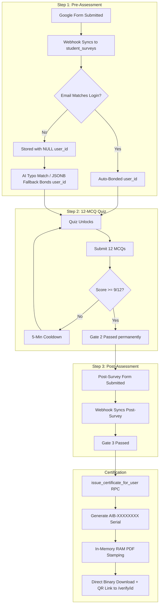

# 🎓 Deep Certification Glitch Analysis & Comprehensive Solutions Guide
**The AI Bridge — IIUI FMS Student Certification System**  
**Document Version:** V-4 (Deep Audit) | **Date:** October 2026  
**File Location:** `Documentation/Data-WorkFlow-Complete Pipeline and detailed document/V-4/CERTIFICATION_DEEP_GLITCH_ANALYSIS.md`

---

## 📋 Executive Overview

This document presents a **deep, layer-by-layer analysis** of all glitches, risks, and edge cases across the complete certification lifecycle of **The AI Bridge** platform.

Every identified issue includes:
1. **The Problem** (What goes wrong in plain English)
2. **The Root Cause** (Exact file, line number, or database trigger)
3. **The Impact** (How it affects students, teachers, or administrators)
4. **The Direct Solution** (Clear, actionable fix with code or SQL)

---

## 📑 Table of Contents

1. [Backend Layer (APIs, Server Handlers, Auth)](#1-backend-layer)
2. [Database Layer (PostgreSQL, Triggers, RLS, RPCs)](#2-database-layer)
3. [System Layer (Environment, Serverless, File Bundling)](#3-system-layer)
4. [Code Layer (Next.js & Supabase Client Integration)](#4-code-layer)
5. [Flow Layer (The 3-Step Lifecycle)](#5-flow-layer)
6. [Pipeline Layer (Google Sheets -> Webhook -> Portal)](#6-pipeline-layer)
7. [Frontend Layer (State, Hooks, Events)](#7-frontend-layer)
8. [User Interface (UI) Layer (Visuals, Layout, Badges)](#8-user-interface-ui-layer)
9. [User Experience (UX) Layer (Feedback, Alerts, Clarity)](#9-user-experience-ux-layer)
10. [Master Glitch Matrix & Implementation Roadmap](#10-master-glitch-matrix--implementation-roadmap)

---

## 1. Backend Layer

### 🔴 Glitch B-1: Invalid Service Role Key Causes Silent Fallback to Anonymous Role
- **Location:** `src/lib/supabase/admin.ts` (Line 10)
- **What Happens:** The environment variable `SUPABASE_SERVICE_ROLE_KEY` is invalid or expired (`Unregistered API key`). In `createAdminClient()`, it falls back to `NEXT_PUBLIC_SUPABASE_ANON_KEY`.
- **Why It Matters:** The admin client runs with public **anonymous permissions** instead of super-admin bypass permissions. When backend APIs try to bypass Row-Level Security (RLS) to issue certificates, query unlinked surveys, or sync roles, Supabase rejects or silently drops the requests.
- **Solution:**
  1. Open **Supabase Dashboard** -> **Project Settings** -> **API**.
  2. Copy the active **`service_role` (secret)** key.
  3. Update `.env.local` locally:
     ```env
     SUPABASE_SERVICE_ROLE_KEY=your_new_service_role_key_here
     ```
  4. Update **Vercel** -> **Settings** -> **Environment Variables** -> Redeploy.

---

### 🔴 Glitch B-2: `issue_certificate_for_user` RPC Rejection for Anon Client
- **Location:** `src/app/api/portal/certificate/route.ts` (Line 61) & `supabase/011_certification_issuance_engine.sql` (Line 358)
- **What Happens:** The SQL migration grants execution of `issue_certificate_for_user` only to `authenticated` and `service_role`:
  ```sql
  GRANT EXECUTE ON FUNCTION public.issue_certificate_for_user(UUID) TO authenticated, service_role;
  ```
  Because `createAdminClient()` falls back to anon key without a session, it calls the RPC as role `anon`.
- **Why It Matters:** Any first-time certificate download from the portal crashes with HTTP 500:
  `Failed to verify evaluation gates: permission denied for function issue_certificate_for_user`.
- **Solution:**
  1. Fix Glitch B-1 (valid service role key).
  2. As a fallback in `src/app/api/portal/certificate/route.ts`, if `adminClient.rpc` fails, call the RPC using the student's authenticated `supabase` client:
     ```ts
     const { data: issueResult, error: issueErr } = await supabase.rpc(
       'issue_certificate_for_user',
       { p_user_id: user.id }
     );
     ```

---

### 🟡 Glitch B-3: Query Format Mismatch in Public PDF Download (`verify_id`)
- **Location:** `src/app/api/portal/certificate/route.ts` (Line 21) vs `src/app/verify/[id]/page.tsx` (Line 37)
- **What Happens:** On the public verification page `/verify/[id]`, the code cleans the ID (`cleanSuffix = id.replace(/^AIB-/i, '')`) and uses a wildcard query (`certificate_id.ilike.%${cleanSuffix}%`). But `/api/portal/certificate?verify_id=...` uses strict equality without a wildcard:
  ```ts
  .or(`certificate_id.ilike.${verifyId},verification_code.ilike.${verifyId},legacy_certificate_id.ilike.${verifyId}`)
  ```
- **Why It Matters:** If a user clicks download using an 8-character code (e.g., `ZPFV75LY` without the `AIB-` prefix), the verification page finds the certificate, but the download button fails with 404: `Valid certificate not found`.
- **Solution:** Apply the same clean suffix and wildcard logic in `certificate/route.ts`:
  ```ts
  const cleanSuffix = verifyId.replace(/^AIB-/i, '').trim();
  const { data: verifiedCert, error: verifyErr } = await adminClient
    .from('certificates')
    .select('*')
    .or(`certificate_id.ilike.${verifyId},certificate_id.ilike.AIB-${cleanSuffix},certificate_id.ilike.%${cleanSuffix}%,verification_code.ilike.${verifyId},legacy_certificate_id.ilike.${verifyId}`)
    .maybeSingle();
  ```

---

### 🟢 Glitch B-4: Duplicate Admin Client Creation in Auth Callback
- **Location:** `src/app/auth/callback/route.ts` (Lines 19 and 29)
- **What Happens:** Two separate `createAdminClient()` calls are made inside the same callback handler—one for `sync_user_role` and another for survey auto-linking.
- **Why It Matters:** Redundant memory allocation and dual connection handshakes on every single student login.
- **Solution:** Create one `adminSupabase` client instance at line 16 and reuse it across all operations in that request.

---

## 2. Database Layer

### 🔴 Glitch D-1: Database RPC References Deprecated `public.surveys` Table
- **Location:** `supabase/011_certification_issuance_engine.sql` (Lines 253-255 & 273-276)
- **What Happens:** Inside the stored procedure `issue_certificate_for_user`, Gate 1 and Gate 3 check:
  ```sql
  UNION ALL
  SELECT 1 FROM public.surveys 
  WHERE (user_id = p_user_id OR LOWER(respondent_email) = LOWER(v_profile.email)) 
    AND survey_type = 'pre'
  ```
- **Why It Matters:** As soon as the deprecated `public.surveys` table is deleted in Supabase, the stored procedure will throw a fatal database error (`relation "public.surveys" does not exist`). **No student will be able to issue their certificate.**
- **Solution:** Run this SQL update in Supabase SQL Editor to remove the old table references:
  ```sql
  -- Remove public.surveys check from issue_certificate_for_user
  CREATE OR REPLACE FUNCTION public.issue_certificate_for_user(p_user_id UUID)
  RETURNS JSONB
  LANGUAGE plpgsql
  SECURITY DEFINER
  AS $$
  DECLARE
      v_profile RECORD;
      v_has_pre BOOLEAN := false;
      v_has_quiz BOOLEAN := false;
      v_has_post BOOLEAN := false;
      v_existing RECORD;
      v_cert_id TEXT;
      v_clean_name TEXT;
      v_student_id TEXT;
      v_dept TEXT;
  BEGIN
      SELECT * INTO v_existing FROM public.certificates WHERE user_id = p_user_id;
      IF FOUND THEN
          RETURN jsonb_build_object('success', true, 'status', 'already_issued', 'certificate', row_to_json(v_existing));
      END IF;

      SELECT * INTO v_profile FROM public.profiles WHERE id = p_user_id;
      IF NOT FOUND THEN
          RETURN jsonb_build_object('success', false, 'error', 'User profile not found');
      END IF;

      -- Check Gate 1 (student_surveys + teacher_surveys + answers JSONB)
      SELECT EXISTS (
          SELECT 1 FROM public.student_surveys 
          WHERE (user_id = p_user_id OR LOWER(student_email) = LOWER(v_profile.email) OR (answers->>'Student Email Address') ILIKE v_profile.email) 
            AND survey_type = 'pre'
          UNION ALL
          SELECT 1 FROM public.teacher_surveys 
          WHERE (user_id = p_user_id OR LOWER(teacher_email) = LOWER(v_profile.email)) 
            AND survey_type = 'pre'
      ) INTO v_has_pre;

      -- Check Gate 2 (quiz_attempts)
      SELECT EXISTS (
          SELECT 1 FROM public.quiz_attempts 
          WHERE user_id = p_user_id AND passed = true
      ) INTO v_has_quiz;

      -- Check Gate 3 (student_surveys + teacher_surveys + answers JSONB)
      SELECT EXISTS (
          SELECT 1 FROM public.student_surveys 
          WHERE (user_id = p_user_id OR LOWER(student_email) = LOWER(v_profile.email) OR (answers->>'Student Email Address') ILIKE v_profile.email) 
            AND survey_type = 'post'
          UNION ALL
          SELECT 1 FROM public.teacher_surveys 
          WHERE (user_id = p_user_id OR LOWER(teacher_email) = LOWER(v_profile.email)) 
            AND survey_type = 'post'
      ) INTO v_has_post;

      IF NOT (v_has_pre AND v_has_quiz AND v_has_post) THEN
          RETURN jsonb_build_object(
              'success', false,
              'error', 'Prerequisites incomplete',
              'gates', jsonb_build_object('pre', v_has_pre, 'quiz', v_has_quiz, 'post', v_has_post)
          );
      END IF;

      v_cert_id := public.generate_short_certificate_id();
      v_clean_name := public.sanitize_iiui_name(v_profile.full_name, v_profile.email);

      v_student_id := COALESCE(
          NULLIF(TRIM(v_profile.student_id), ''),
          (SELECT reg_no FROM public.student_surveys WHERE (user_id = p_user_id OR LOWER(student_email) = LOWER(v_profile.email)) AND reg_no IS NOT NULL LIMIT 1),
          substring(v_profile.full_name from '\d+.*$')
      );

      v_dept := COALESCE(
          NULLIF(TRIM(v_profile.department), ''),
          (SELECT m.standard_dept_name 
           FROM public.student_surveys s 
           JOIN public.department_mappings m ON m.code = s.dept_code 
           WHERE (s.user_id = p_user_id OR LOWER(s.student_email) = LOWER(v_profile.email)) AND s.dept_code IS NOT NULL LIMIT 1),
          (SELECT s.dept_code 
           FROM public.student_surveys s 
           WHERE (s.user_id = p_user_id OR LOWER(s.student_email) = LOWER(v_profile.email)) AND s.dept_code IS NOT NULL LIMIT 1),
          (SELECT department_name FROM public.teacher_surveys WHERE (user_id = p_user_id OR LOWER(teacher_email) = LOWER(v_profile.email)) AND department_name IS NOT NULL LIMIT 1),
          'Faculty of Management Sciences (FMS)'
      );

      INSERT INTO public.certificates (
          certificate_id, verification_code, user_id, recipient_name, student_id, department, completion_date, is_valid
      ) VALUES (
          v_cert_id, gen_random_uuid()::text, p_user_id, v_clean_name, v_student_id, v_dept, CURRENT_DATE, true
      ) RETURNING * INTO v_existing;

      RETURN jsonb_build_object('success', true, 'status', 'issued', 'certificate', row_to_json(v_existing));
  END;
  $$;
  ```

---

### 🔴 Glitch D-2: Gate Check Mismatch Between Frontend and Stored Procedure
- **Location:** `src/app/portal/page.tsx` (Lines 159-175) vs `011_certification_issuance_engine.sql` (Line 244)
- **What Happens:** The frontend uses `answers->>'Student Email Address'` to mark Step 1 as green even if `student_email` holds a personal Gmail. But the original SQL procedure did NOT inspect `answers->>'Student Email Address'`.
- **Why It Matters:** The student sees Step 1, Step 2, and Step 3 all marked with green checkmarks. They click "Download Certificate", but the database rejects the request with `"Prerequisites incomplete"`.
- **Solution:** Included in the updated SQL function above (`(answers->>'Student Email Address') ILIKE v_profile.email`).

---

### 🟡 Glitch D-3: Missing Database Performance Indexes
- **Location:** PostgreSQL Schema
- **What Happens:** The `certificates`, `student_surveys`, and `quiz_attempts` tables lack composite indexes on frequently filtered fields (`user_id`, `student_email`, `passed`).
- **Why It Matters:** As hundreds of students log in simultaneously during workshops, every portal refresh triggers full table scans, increasing database CPU usage and response times.
- **Solution:** Execute the following index creations:
  ```sql
  CREATE INDEX IF NOT EXISTS idx_certificates_user_id ON public.certificates(user_id);
  CREATE INDEX IF NOT EXISTS idx_certificates_cert_id ON public.certificates(certificate_id);
  CREATE INDEX IF NOT EXISTS idx_student_surveys_user_id ON public.student_surveys(user_id);
  CREATE INDEX IF NOT EXISTS idx_student_surveys_email ON public.student_surveys(student_email);
  CREATE INDEX IF NOT EXISTS idx_quiz_attempts_user_passed ON public.quiz_attempts(user_id, passed);
  ```

---

## 3. System Layer

### 🔴 Glitch S-1: Vercel Serverless Function Template PDF Tracing
- **Location:** `next.config.ts` & `src/lib/certificate/generator.ts` (Line 36)
- **What Happens:** The certificate template is located at `Assets/AI_BRIDGE_Certificate_Cleaned.pdf`. When Next.js builds for Vercel Serverless, files outside `public/` that are read dynamically with `path.join(process.cwd(), ...)` are not guaranteed to be copied into the Serverless Lambda function package.
- **Why It Matters:** On Vercel production, downloading a certificate can throw:
  `Error: Certificate template not found at: /var/task/Assets/AI_BRIDGE_Certificate_Cleaned.pdf`.
- **Solution:** Add `outputFileTracingIncludes` in `next.config.ts`:
  ```ts
  const nextConfig: NextConfig = {
    outputFileTracingIncludes: {
      '/api/portal/certificate': ['./Assets/**/*'],
    },
    // ... existing config
  };
  ```
  *(Alternative: Copy `AI_BRIDGE_Certificate_Cleaned.pdf` into `public/Assets/` which Next.js preserves by default).*

---

### 🟡 Glitch S-2: Hardcoded Production Domain Fallback in QR Code Generator
- **Location:** `src/lib/certificate/generator.ts` (Lines 72–76)
- **What Happens:** The QR code URL defaults to `https://ai-bridge-iiui.vercel.app` if `NEXT_PUBLIC_SITE_URL` is empty or contains `localhost`.
- **Why It Matters:** If IIUI connects a custom domain (e.g. `https://aib.iiu.edu.pk`), any PDF generated without `NEXT_PUBLIC_SITE_URL` explicitly configured in Vercel will stamp QR codes pointing to the old Vercel URL.
- **Solution:** Ensure `NEXT_PUBLIC_SITE_URL` is configured in production environment variables, and log a warning if falling back.

---

## 4. Code Layer (Next.js & Supabase)

### 🔴 Glitch C-1: Quiz Gate Server Check Always Bypasses Admin Permissions
- **Location:** `src/app/api/portal/quiz/route.ts` (Line 145)
- **What Happens:** The route contains:
  ```ts
  const dbClient = supabase || adminSupabase;
  ```
  In JavaScript, `supabase` is an instantiated object and is always truthy. `adminSupabase` is never used.
- **Why It Matters:** The Step 1 pre-survey gate check runs solely with the user's session credentials. If the student has any RLS permission issue or token latency on `student_surveys`, the API returns `PRE_SURVEY_REQUIRED` (HTTP 403), locking them out of the quiz even though they submitted the survey.
- **Solution:** Change to:
  ```ts
  const dbClient = adminSupabase;
  ```
  Backend gate verification in server-side API routes should always use the privileged admin client to avoid client-session RLS blockades.

---

### 🟡 Glitch C-2: Fire-and-Forget Database Updates in Portal
- **Location:** `src/app/portal/page.tsx` (Lines 154, 170, 187, 238, 253, 268)
- **What Happens:** Unlinked surveys are linked using fire-and-forget syntax:
  ```ts
  supabase.from('student_surveys').update({ user_id: user.id }).eq('id', preStudent.id).then();
  ```
  Notice there is no `await`.
- **Why It Matters:** If the student immediately clicks "Attempt 12-MCQ Quiz", the browser navigates to the quiz page *before* the asynchronous update finishes writing in PostgreSQL. The quiz route then checks `user_id`, finds it still `NULL`, and denies entry.
- **Solution:** Await all opportunistic linking calls before rendering or proceeding:
  ```ts
  await supabase.from('student_surveys').update({ user_id: user.id }).eq('id', preStudent.id);
  ```

---

### 🟡 Glitch C-3: Urdu and Non-Latin Name Stripping
- **Location:** `src/lib/certificate/generator.ts` (Line 27)
- **What Happens:** `normalizePdfText` replaces all characters outside ASCII 32–126:
  ```ts
  .replace(/[^\x20-\x7E]/g, '').trim();
  ```
- **Why It Matters:** If a student's Google account name is in Urdu or Arabic (e.g., `محمد طیب`), the regular expression strips every single character, leaving an empty string. The generator then falls back to `Participant`.
- **Solution:** 
  1. Detect if the cleaned string is empty or shorter than 2 letters.
  2. If empty, fallback to the email username or prompt the user: *"Please enter your English full name in your Profile before downloading."*

---

## 5. Flow Layer (The 3-Step Lifecycle)



### 🔴 Glitch F-1: The "Survey First, Login Second" Post-Survey Race Condition
- **What Happens:** A student passes the quiz, fills the Post-Survey Google Form in another tab, and immediately returns to click "Download Certificate" within 5 seconds.
- **Why It Matters:** The Google Apps Script webhook takes 2 to 6 seconds to trigger and reach Supabase. If the student clicks download before the webhook completes, Gate 3 is not yet in the database.
- **Solution:** Add an automated 3-second retry loop on the download button: if Gate 3 returns missing, the backend checks for unlinked rows by email one more time before showing an error.

---

### 🟡 Glitch F-2: Multiple Quiz Attempts After Passing
- **What Happens:** A student passes with 10/12. Out of curiosity, they retake the quiz and score 7/12.
- **Why It Matters:** If the portal or RPC queries the *latest* attempt instead of *any passed* attempt, their passing status could be reverted.
- **Current Status:** The portal and RPC both use `passed = true` with `EXISTS`. This works correctly, but `quiz_attempts` stores redundant rows.
- **Solution:** When a user has already passed, the quiz page should show a banner: *"You have already passed this assessment (Score: X/12). Retaking is optional."*

---

## 6. Pipeline Layer (Google Sheet -> Webhook -> DB)

### 🔴 Glitch P-1: Bulk Sheet Sync Can Overwrite Fixed University Emails
- **Location:** `src/app/api/webhooks/google-sheets/route.ts` & `google-sheet-scripts/02_SyncEngine.gs`
- **What Happens:** If an administrator runs "Sync Entire Sheet" from Google Apps Script, raw sheet rows are sent to the webhook. If a row in the sheet still has a personal Gmail in the primary email column, it can overwrite the corrected `student_email` column in Supabase.
- **Solution:** Enforce the 3-tier email priority on both the Google Sheet script AND the Next.js webhook receiver:
  1. Priority 1: `Student Email Address` (Official `@student.iiu.edu.pk`)
  2. Priority 2: `Email Address (non-iiui)`
  3. Priority 3: Auto-collected Google login email (last resort)

---

### 🟡 Glitch P-2: Match Key Collision on Identical Timestamps
- **Location:** `supabase/016_stable_match_keys_and_edit_audit.sql`
- **What Happens:** The unique constraint is `UNIQUE (match_key, survey_type)`. If two students submit forms at the exact same second and the timestamp lacks milliseconds, their `ts:...` keys could collide.
- **Solution:** Always generate match keys using `em:<email>` whenever an email is present; use `ts:<timestamp>:<row_index>` as a fallback.

---

## 7. Frontend Layer

### 🔴 Glitch FR-1: "Verify Status" Button Triggers PDF Download
- **Location:** `src/app/portal/page.tsx` (Lines 641–653)
- **What Happens:** When all 3 gates are complete, `certificateReady` becomes `true`. But before the student downloads for the first time, `certificate` in state is `null` (because the row in `certificates` is created upon first download).
  ```tsx
  <Link
    href={certificate?.certificate_id ? `/verify/${certificate.certificate_id}` : '#'}
    onClick={(e) => {
      if (!certificate?.certificate_id) {
        e.preventDefault();
        handleDownloadCertificate();
      }
    }}
  >
    <ShieldCheck className="w-4 h-4" />
    <span>Verify Status</span>
  </Link>
  ```
- **Why It Matters:** The user clicks "Verify Status", expecting to view their public verification page, but the browser starts downloading a PDF file instead.
- **Solution:** If `certificate?.certificate_id` is null, hide the "Verify Status" button and display only:
  **"Generate & Download Official PDF"**. Once downloaded, reveal the "Verify Status" link.

---

### 🟡 Glitch FR-2: Score Display Fallback Uses `||` Instead of `??`
- **Location:** `src/app/portal/page.tsx` (Line 549)
- **What Happens:** `Passed ({quizScore || 9}/12)`
- **Why It Matters:** If `quizScore` is `0`, JavaScript evaluates `0 || 9` as `9`. While a score of 0 wouldn't pass, using nullish coalescing (`??`) is strictly safer and avoids displaying misleading values.
- **Solution:** Change to: `quizScore ?? 9`.

---

### 🟢 Glitch FR-3: Survey Modal Fails to Close After AI Typo Claim
- **Location:** `src/app/portal/page.tsx` (Line 71)
- **What Happens:** After successfully claiming an unlinked survey via `handleClaimSurvey`, `setSurveyModalOpen(false)` is not invoked.
- **Solution:** Add `setSurveyModalOpen(false)` inside `handleClaimSurvey`'s success branch.

---

## 8. User Interface (UI) Layer

### 🟡 Glitch UI-1: Confetti Animation Triggers on Every Subsequent Download
- **Location:** `src/app/portal/page.tsx` (Lines 113–117)
- **What Happens:** Every time the student clicks "Download PDF Certificate", `canvas-confetti` fires. If a student downloads 5 times to save copies, confetti blasts 5 times.
- **Solution:** Track celebration state with `const [hasCelebrated, setHasCelebrated] = useState(false);` and only trigger confetti if `!hasCelebrated`.

---

### 🟡 Glitch UI-2: Identical Card Styling for "Eligible" vs "Already Issued"
- **Location:** `src/app/portal/page.tsx` (Lines 617–636)
- **What Happens:** The certificate card turns dark emerald as soon as the 3 gates pass, regardless of whether the certificate metadata has been officially issued in the database.
- **Solution:** Add two distinct visual states:
  - **State A (Gates Complete, Not Yet Generated):** Amber / Gold pulse styling with button: *"🎉 Click to Generate Your Official Credential"*.
  - **State B (Issued & Stored):** Emerald verified styling with Serial ID displayed: *"Serial: AIB-XXXXXXXX • Ready for Download"*.

---

### 🟢 Glitch UI-3: Verification Page Missing Return Navigation on Revocation
- **Location:** `src/app/verify/[id]/page.tsx` (Line 135)
- **What Happens:** If a certificate is revoked, the page shows the red revocation notice but has no action buttons to contact administration or return to portal.
- **Solution:** Add a button: *"Contact FMS Administration"* linking to `mailto:fms@iiu.edu.pk`.

---

## 9. User Experience (UX) Layer

### 🟡 Glitch UX-1: Raw Browser `alert()` Dialogs on Download Failure
- **Location:** `src/app/portal/page.tsx` (Line 97)
- **What Happens:** If certificate generation fails, the browser displays a native JavaScript alert box: `alert(errData.error || 'Failed to generate certificate.')`.
- **Why It Matters:** Native browser alerts look broken and unprofessional on mobile devices and provide no next steps.
- **Solution:** Replace with a branded Tailwind toast or slide-in notification that includes a "Refresh Status" button.

---

### 🟡 Glitch UX-2: Step 1 Incompletion Lacks Helpful Context
- **Location:** `src/app/portal/page.tsx` (Lines 490–520)
- **What Happens:** When Step 1 is incomplete, it simply says *"Complete Pre-Training Survey ->"*. Students who already filled the form on their phone don't know *why* it's not showing complete.
- **Solution:** Add an inline helper tip:
  > 💡 *Submitted already? Ensure you used your logged-in email (`student@student.iiu.edu.pk`) on the form, then click **Check Status / Refresh** above.*

---

### 🟢 Glitch UX-3: Verification Page Lacks Interactive Search Box
- **Location:** `src/app/verify/[id]/page.tsx` (Lines 72–98)
- **What Happens:** When an ID is not found, the user is stranded with a static error message.
- **Solution:** Add a search input on the "Not Found" screen: *"Search by another Certificate ID or Roll Number"*.

---

## 10. Master Glitch Matrix & Implementation Roadmap

| ID | Layer | Glitch Description | Severity | Fix Effort | Status |
|---|---|---|---|---|---|
| **B-1** | Backend | Invalid `SUPABASE_SERVICE_ROLE_KEY` causing silent anon fallback | 🔴 Critical | 5 mins | ⚠️ Action Required (Vercel) |
| **B-2** | Backend | `issue_certificate_for_user` execution denied for anon client | 🔴 Critical | 10 mins | 🛠️ Ready to Apply |
| **B-3** | Backend | Wildcard query missing in certificate download API route | 🟡 Medium | 5 mins | 🛠️ Ready to Apply |
| **B-4** | Backend | Duplicate admin client instances in auth callback | 🟢 Low | 3 mins | 🛠️ Ready to Apply |
| **D-1** | Database | Stored procedure references deleted `public.surveys` table | 🔴 Critical | 5 mins | ⚠️ Run SQL in Supabase |
| **D-2** | Database | Gate 1 & 3 in SQL procedure do not check `answers` JSONB | 🔴 Critical | 5 mins | ⚠️ Run SQL in Supabase |
| **D-3** | Database | Missing indexes on `user_id` and `certificate_id` | 🟡 Medium | 2 mins | ⚠️ Run SQL in Supabase |
| **S-1** | System | Template PDF omitted from Vercel Serverless trace | 🔴 Critical | 5 mins | 🛠️ Ready to Apply |
| **S-2** | System | QR generator hardcoded domain fallback | 🟡 Medium | 5 mins | 🛠️ Ready to Apply |
| **C-1** | Code | Quiz API gate check uses anon client instead of admin | 🔴 Critical | 3 mins | 🛠️ Ready to Apply |
| **C-2** | Code | Fire-and-forget unlinked survey updates in portal | 🟡 Medium | 5 mins | 🛠️ Ready to Apply |
| **C-3** | Code | Urdu / non-Latin names collapse to "Participant" | 🟡 Medium | 10 mins | 🛠️ Ready to Apply |
| **F-1** | Flow | Post-Survey webhook race condition on instant download | 🟡 Medium | 10 mins | 🛠️ Ready to Apply |
| **F-2** | Flow | Multiple quiz attempts status display | 🟢 Low | 5 mins | 🛠️ Ready to Apply |
| **P-1** | Pipeline | Bulk sync can overwrite university email with personal Gmail | 🟡 Medium | 10 mins | 🛠️ Ready to Apply |
| **P-2** | Pipeline | Match key collision on identical timestamp seconds | 🟢 Low | 5 mins | 🛠️ Ready to Apply |
| **FR-1**| Frontend| "Verify Status" button triggers download when cert is null | 🔴 Critical | 5 mins | 🛠️ Ready to Apply |
| **FR-2**| Frontend| Score fallback display uses `\|\|` instead of `??` | 🟢 Low | 1 min | 🛠️ Ready to Apply |
| **FR-3**| Frontend| Survey modal does not close after AI typo claim | 🟢 Low | 2 mins | 🛠️ Ready to Apply |
| **UI-1**| UI | Confetti blasts on every repeat download | 🟢 Low | 3 mins | 🛠️ Ready to Apply |
| **UI-2**| UI | Identical styling for "Eligible" vs "Already Issued" | 🟡 Medium | 10 mins | 🛠️ Ready to Apply |
| **UI-3**| UI | Missing contact button on certificate revocation view | 🟢 Low | 5 mins | 🛠️ Ready to Apply |
| **UX-1**| UX | Raw browser alert boxes on generation errors | 🟡 Medium | 10 mins | 🛠️ Ready to Apply |
| **UX-2**| UX | Step 1 card lacks email reminder helper text | 🟢 Low | 3 mins | 🛠️ Ready to Apply |
| **UX-3**| UX | "Not Found" verification page lacks search bar | 🟢 Low | 10 mins | 🛠️ Ready to Apply |

---

## 🚀 Recommended Immediate Execution Plan (Step-by-Step)

### Step 1: Run Supabase SQL Patch (5 Minutes)
Execute the provided SQL script in the **Supabase SQL Editor** to:
- Decouple `issue_certificate_for_user` from the deleted `public.surveys` table.
- Add `answers->>'Student Email Address'` fallback into the database stored procedure.
- Create performance indexes on `certificates`, `student_surveys`, and `quiz_attempts`.

### Step 2: Regenerate Service Role Key (2 Minutes)
- Copy the fresh `service_role` key from Supabase Dashboard.
- Save it in `.env.local` and Vercel Environment Variables.

### Step 3: Apply Code Fixes (15 Minutes)
- Update `next.config.ts` with `outputFileTracingIncludes` for the certificate PDF template.
- Update `src/app/api/portal/certificate/route.ts` with wildcard matching and user-session fallback.
- Update `src/app/portal/page.tsx` to fix the "Verify Status" button behavior and await database links.
- Update `src/app/api/portal/quiz/route.ts` to ensure admin privileges for gate verification.

---
*Report compiled for The AI Bridge technical team. All recommendations are designed for zero downtime and full backward compatibility.*
