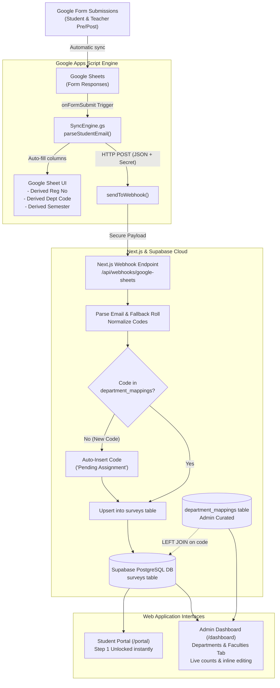

# The AI Bridge — End-to-End Data Flow & Architecture Pipeline

This document provides a comprehensive technical and operational breakdown of the data flow in **The AI Bridge** web platform: from Google Forms submissions to Google Sheets, Next.js webhook processing, Supabase relational database persistence, and Admin Dashboard management.

---

## 1. High-Level Architecture Overview



---

## 2. The 8-Step Lifecycle of a Submission

### Step 1: Participant Fills the Google Form
A student fills out the pre-assessment or post-assessment survey.
- They enter their institutional email (`Student Email Address`).
- They enter other survey feedback and self-ratings.
- They might type their roll number into the manual field (e.g. `126-FMS/BSBA/F23`).

### Step 2: Instant Interception by Google Apps Script
The Google Form instantly appends the row to Google Sheets. Google Sheets fires the `onFormSubmit(e)` event trigger defined in [`google-sheet-scripts/02_SyncEngine.gs`](file:///d:/000627-BSBA-S24/Other%20Material/web%20development/AI-Bridge/google-sheet-scripts/02_SyncEngine.gs).

### Step 3: In-Sheet Data Derivation
`SyncEngine.gs` reads the email address and executes `parseStudentEmail()`:
1. Strips internal spaces and forces lowercase.
2. Identifies whether it is **Type 1** (Modern) or **Type 2** (Senior).
3. Automatically creates and populates 3 dedicated spreadsheet columns:
   - `Derived Reg No`
   - `Derived Dept Code`
   - `Derived Semester`
4. Formats a standardized JSON payload including the raw answers and the 3 derived fields.

### Step 4: Webhook Dispatch to Next.js
`SyncEngine.gs` sends an authorized HTTP POST request to:
`https://ai-bridge-iiui.vercel.app/api/webhooks/google-sheets`
- Headers include the shared secret token `SHEETS_WEBHOOK_SECRET` (`x-webhook-secret`).

### Step 5: Server-Side Validation & Auto-Discovery
The Next.js route [`src/app/api/webhooks/google-sheets/route.ts`](file:///d:/000627-BSBA-S24/Other%20Material/web%20development/AI-Bridge/src/app/api/webhooks/google-sheets/route.ts):
1. Verifies the secret token.
2. Re-verifies the extracted `regNo`, `deptCode`, and `semester`.
3. **Auto-Discovery Check:** Runs `ensureDepartmentMappingExists()`. If the student entered a new degree code that does not exist in the `department_mappings` table (e.g. `BSAI`), the system automatically registers `BSAI` into `department_mappings` with standard name `"Pending Assignment"`.

### Step 6: Supabase Database Upsert
The server upserts the survey row into `public.surveys`:
- `respondent_email`: Normalized email (e.g. `025580bsirf26@student.iiu.edu.pk`)
- `survey_type`: `'pre'` or `'post'`
- `extracted_reg_no`: `'025580'`
- `extracted_dept_code`: `'BSIR'`
- `extracted_semester`: `'F26'`
- `answers`: Full question-and-answer JSON payload
- `hours_saved_estimate`: Numeric metric for QIP reporting
- `comprehension_self_rating`: 1 to 5 rating
- Unique constraint: `UNIQUE (respondent_email, survey_type)` ensures updates overwrite the same row without creating duplicate submissions.

### Step 7: Relational SQL Join
Analytics and reports join `public.surveys` with `public.department_mappings`:
```sql
SELECT 
    s.respondent_email,
    s.extracted_reg_no AS registration_no,
    s.extracted_semester AS semester,
    s.extracted_dept_code AS short_code,
    COALESCE(dm.standard_dept_name, 'Unassigned') AS standard_department,
    COALESCE(dm.faculty_name, 'Unassigned') AS faculty,
    COALESCE(dm.faculty_code, 'N/A') AS faculty_code
FROM public.surveys s
LEFT JOIN public.department_mappings dm ON s.extracted_dept_code = dm.code;
```

### Step 8: Real-Time Admin Management & Student Progression
- **For Students:** The web portal (`/portal`) checks Supabase for `respondent_email` and automatically marks **Step 1: Pre-Assessment Survey** as completed, unlocking the 30-MCQ test engine.
- **For Admins:** In `/dashboard` under the **Departments & Faculties** tab, admins see live counts of how many students belong to each code (e.g. `BSBA` has 20 entries) and can rename the degree or change faculty assignments with one click.

---

## 3. Email Extraction Logic (The 2 Official Types)

The system parses two distinct institutional email structures:

| Attribute | Type 1: Modern Format (~86%) | Type 2: Senior / Name Prefix (~14%) |
| :--- | :--- | :--- |
| **Email Pattern** | `[RegNumber][DeptCode][Semester]@student.iiu.edu.pk` | `[FirstName].[DeptCode][RegNumber]@student.iiu.edu.pk` |
| **Example** | `025580bsirf26@student.iiu.edu.pk` | `zain.bsba126@student.iiu.edu.pk` |
| **Registration No** | Extracted from prefix: `025580` | Extracted from suffix: `126` |
| **Department Code** | Extracted from middle: `BSIR` | Extracted after dot: `BSBA` |
| **Semester** | Extracted from end: `F26` | Derived via **Fallback** from roll number field |
| **Fallback Rule** | Not needed (contained directly in email) | Scans manual roll entry for `F23`, `S24`, `S23` |

---

## 4. Admin Management Features (`/dashboard`)

The **Departments & Faculties** tab in the Admin Dashboard provides:
1. **Live Entry Count Badges:** Shows live counts (e.g. `BSBA` $\to$ `20 entries`, `BSIR` $\to$ `48 entries`).
2. **Inline Editing:** Click the edit icon to modify the **Standard Department Name** (e.g. changing `BSBA` $\to$ `Business Analytics`) or the **Faculty Name** (`Faculty of Management Sciences`).
3. **Instant Global Update:** Because of the relational foreign key, saving the name once updates all students, charts, and reports throughout the application.
4. **Program Code Creator:** Register new academic degree codes manually via modal.
5. **Search & Faculty Filter:** Quickly filter by faculty (FMS, FSS, FBAS, FCIT, FLL, FSL).

---

## 5. Database Schema Reference

### `public.department_mappings`
```sql
CREATE TABLE public.department_mappings (
    code TEXT PRIMARY KEY,                       -- e.g. 'BSBA', 'BSIR'
    standard_dept_name TEXT NOT NULL,            -- e.g. 'Business Analytics'
    faculty_name TEXT NOT NULL,                  -- e.g. 'Faculty of Management Sciences'
    faculty_code TEXT,                           -- e.g. 'FMS'
    created_at TIMESTAMPTZ DEFAULT now(),
    updated_at TIMESTAMPTZ DEFAULT now()
);
```

### `public.surveys` (Relevant Columns)
```sql
ALTER TABLE public.surveys 
    ADD COLUMN extracted_reg_no TEXT,
    ADD COLUMN extracted_dept_code TEXT REFERENCES public.department_mappings(code) ON UPDATE CASCADE ON DELETE SET NULL,
    ADD COLUMN extracted_semester TEXT;
```

---

## 6. Project Files Map

| File Path | Role in Pipeline |
| :--- | :--- |
| [`supabase/008_department_mappings.sql`](file:///d:/000627-BSBA-S24/Other%20Material/web%20development/AI-Bridge/supabase/008_department_mappings.sql) | Database migration, seed data, RLS security policies, and analytics function. |
| [`google-sheet-scripts/01_Config.gs`](file:///d:/000627-BSBA-S24/Other%20Material/web%20development/AI-Bridge/google-sheet-scripts/01_Config.gs) | Apps Script webhook target URL and security token configuration. |
| [`google-sheet-scripts/02_SyncEngine.gs`](file:///d:/000627-BSBA-S24/Other%20Material/web%20development/AI-Bridge/google-sheet-scripts/02_SyncEngine.gs) | Apps Script triggers, email parsing engine, and sheet column population. |
| [`src/app/api/webhooks/google-sheets/route.ts`](file:///d:/000627-BSBA-S24/Other%20Material/web%20development/AI-Bridge/src/app/api/webhooks/google-sheets/route.ts) | Next.js API webhook: validates token, normalizes data, auto-discovers codes, and upserts to Supabase. |
| [`src/app/api/admin/departments/route.ts`](file:///d:/000627-BSBA-S24/Other%20Material/web%20development/AI-Bridge/src/app/api/admin/departments/route.ts) | Admin REST API for listing, updating, creating, and deleting department mappings with live counts. |
| [`src/app/dashboard/page.tsx`](file:///d:/000627-BSBA-S24/Other%20Material/web%20development/AI-Bridge/src/app/dashboard/page.tsx) | Admin dashboard interface featuring the "Departments & Faculties" management tab. |


                          ┌────────────────────────┐
                          │   Participant fills    │
                          │      Google Form       │
                          └───────────┬────────────┘
                                      │
                                      ▼
                          ┌────────────────────────┐
                          │     Google Sheets      │
                          │  (Form Responses Tab)  │
                          └───────────┬────────────┘
                                      │
                 ┌────────────────────┴────────────────────┐
                 │                                         │
                 ▼                                         ▼
   ┌───────────────────────────┐             ┌───────────────────────────┐
   │    SyncEngine.gs (GAS)    │             │   Google Sheet Columns    │
   │  parseStudentEmail(email) │ ──────────> │   - Derived Reg No        │
   │  Type 1 & Type 2 Parser   │             │   - Derived Dept Code     │
   └─────────────┬─────────────┘             │   - Derived Semester      │
                 │                           └───────────────────────────┘
                 │ (HTTP POST with Secret)
                 ▼
   ┌────────────────────────────────────────────────────────┐
   │      Next.js Webhook (/api/webhooks/google-sheets)     │
   │  - Validates webhook secret token                      │
   │  - Normalizes email, reg_no, dept_code, semester       │
   │  - Auto-inserts unknown code to department_mappings    │
   └─────────────────────────────┬──────────────────────────┘
                                 │
                                 ▼
   ┌────────────────────────────────────────────────────────┐
   │                     Supabase DB                        │
   │                                                        │
   │   surveys Table                  department_mappings   │
   │   - extracted_reg_no             - code (PK)           │
   │   - extracted_semester           - standard_dept_name  │
   │   - extracted_dept_code ─────────> faculty_name        │
   │                                  - faculty_code        │
   └─────────────────────────────┬──────────────────────────┘
                                 │
                 ┌───────────────┴───────────────┐
                 │                               │
                 ▼                               ▼
   ┌───────────────────────────┐   ┌───────────────────────────┐
   │   Student Portal (/portal)│   │ Admin Panel (/dashboard)  │
   │   Instant Step 1 Unlock   │   │ - Live count (20 entries) │
   │   upon email match        │   │ - Inline name & faculty   │
   │                           │   │   manual management       │
   └───────────────────────────┘   └───────────────────────────┘