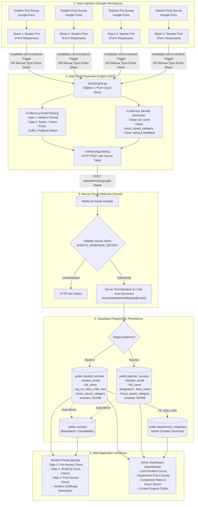

# The AI Bridge — End-to-End Data Flow Pipeline & Deep Technical Architecture

> **Authoritative Technical Specification & Operational Manual**  
> **Platform:** The AI Bridge (IIUI FMS — Hum Hain Pakistan SDG Campaign)  
> **Stack:** Google Forms → Google Sheets (4 Data Streams) → Google Apps Script → Next.js 15 Webhook → Supabase PostgreSQL (2-Table Schema) → Participant Portal & Admin Analytics Dashboard  
> **Last Updated:** October 2026 | Architecture Version: **v3.2 (Clean Ingestion & Dedicated Identity Schema)**

---

## 1. Executive Summary & Core Architectural Principles

The AI Bridge data pipeline is designed to collect, normalize, persist, verify, and visualize academic AI adoption data across two distinct stakeholder groups: **Students** (undergraduate, graduate, research) and **Teachers** (professors, lecturers, instructors).

The system operates across two critical evaluation milestones:
1. **Pre-Training Assessment Survey:** Establishes baseline AI literacy, reading volume, study/teaching bottlenecks, and initial tool adoption.
2. **Post-Training Assessment Survey:** Measures quantitative productivity gains (hours saved per week), self-reported confidence improvements, and qualitative curriculum feedback.

### The Four Non-Negotiable Core Principles:
1. **Zero Sheet Mutation (Option 1 Pure Sync):** Google Sheets is treated strictly as an immutable raw intake queue. The Google Apps Script engine **never creates, appends, or alters spreadsheet columns** (e.g., no `Derived Reg No` or `Sync Status` written back to cells). All parsing, extraction, and normalization occur **in-memory** during webhook payload creation.
2. **High-Fidelity Original Clean Data:** Categorical choices (e.g. `"3 - 5 hours"`, `"1 - 2 hours"`, `"5+ hours"`) are preserved verbatim in dedicated text columns (`hours_saved_category`). The pipeline strictly avoids arbitrary midpoint mathematical conversions (e.g., guessing `4.0`) at ingestion time to protect academic data integrity.
3. **Dedicated 2-Table Audience Architecture:** Student and Teacher datasets possess fundamentally different academic metadata. They are segregated into dedicated tables (`public.student_surveys` and `public.teacher_surveys`) with first-class columns for participant identity (`full_name`, `student_email`, `teacher_email`, `reg_no`, `designation`).
4. **Idempotent Dual-Key Upserts:** Every survey submission is constrained by `UNIQUE(email, survey_type)`. Multiple form submissions by the same participant update their existing record cleanly without creating duplicate database rows.

---

## 2. High-Level End-to-End Architecture



---

## 3. The 4-Sheet Ingestion Topology

The AI Bridge manages **4 independent Google Forms**, each feeding a dedicated Google Sheet tab:

| Stream ID | Audience | Phase | Form Role | Sheet Name Identifier | Target Supabase Table | Key Extracted Fields |
| :--- | :--- | :--- | :--- | :--- | :--- | :--- |
| **Stream 1** | Students | Pre | Baseline AI literacy & reading volume | `Student Pre-Survey` | `public.student_surveys` | `student_email`, `full_name`, `reg_no`, `dept_code`, `semester`, `ai_familiarity_rating` |
| **Stream 2** | Students | Post | Hours saved & training impact | `Student Post-Survey` | `public.student_surveys` | `student_email`, `full_name`, `hours_saved_category`, `feedback_notes`, `answers` |
| **Stream 3** | Teachers | Pre | Baseline teaching prep bottlenecks | `Teacher Pre-Survey` | `public.teacher_surveys` | `teacher_email`, `full_name`, `designation`, `dept_code`, `teaching_experience` |
| **Stream 4** | Teachers | Post | Weekly prep hours saved & curriculum gains | `Teacher Post-Survey` | `public.teacher_surveys` | `teacher_email`, `full_name`, `hours_saved_category`, `feedback_notes`, `answers` |

### Auto-Detection Logic in Apps Script:
The script automatically detects the audience and phase from either the active sheet's name or the fallback configuration:
- **Sheet Name contains `teach`, `faculty`, or `prof`:** Target $\to$ `teacher` (`public.teacher_surveys`).
- **Sheet Name contains `student` or default:** Target $\to$ `student` (`public.student_surveys`).
- **Sheet Name contains `post`:** Survey Phase $\to$ `'post'`.
- **Sheet Name contains `pre`:** Survey Phase $\to$ `'pre'`.

---

## 4. The 8-Step Submission & Verification Lifecycle

### Step 1: Participant Submission on Google Form
- The student or faculty member fills out the Google Form.
- Critical inputs include institutional email, full name, hours saved category, self-rating, and academic details.
- Responses land as a new row in Google Sheets within 500ms.

### Step 2: Apps Script Trigger Interception
- When configured with an **Installable Trigger**, Google Sheets immediately executes `onFormSubmit(e)`.
- The event object provides the newly inserted row number and column values.

### Step 3: Pure In-Memory Parsing & Data Derivation
The script executes `parseRowData(headers, rowValues)` completely in RAM:
1. **Email Identification:** Searches for headers containing `email`, `student id`, or `respondent`. Normalizes to lowercase and trims whitespace.
2. **Dedicated Name Extraction:** Looks for headers containing `student name`, `teacher name`, `full name`, or `name`. Falls back to parsing the local email prefix if omitted.
3. **Regex Academic Parsing:** For students, executes `parseStudentEmail()` to extract Registration Number, Department Code, and Semester.
4. **Hours Saved Categorical Capture:** Locates the hours saved question and copies the verbatim option (e.g. `"3 - 5 hours"`).
5. **Rating & Feedback Extraction:** Extracts 1–5 numerical scale rating and qualitative text feedback.

### Step 4: Webhook Dispatch with Shared Secret
- `SyncEngine.gs` packages the payload and invokes `sendToWebhook(payload)` via `UrlFetchApp.fetch()`.
- Headers include `Authorization: Bearer <WEBHOOK_SECRET>` and `x-webhook-secret: <WEBHOOK_SECRET>`.
- Payload format:
  ```json
  {
    "action": "INSERT",
    "participant_type": "student",
    "survey_type": "pre",
    "email": "025580bsirf26@student.iiu.edu.pk",
    "full_name": "Muhammad Zain",
    "hours_saved_category": "3 - 5 hours",
    "ai_familiarity_rating": 4,
    "feedback_notes": "Great session on prompting.",
    "extracted_reg_no": "025580",
    "extracted_dept_code": "BSIR",
    "extracted_semester": "F26",
    "answers": { ... },
    "sheet_row_number": 42
  }
  ```

### Step 5: Webhook Authentication & Security Guard
- Next.js endpoint [`src/app/api/webhooks/google-sheets/route.ts`](file:///d:/000627-BSBA-S24/Other%20Material/web%20development/AI-Bridge/src/app/api/webhooks/google-sheets/route.ts) intercepts the request.
- Compares the received secret with server environment variable `SHEETS_WEBHOOK_SECRET`.
- Non-matching requests are rejected with `HTTP 401 Unauthorized` before any database queries execute.

### Step 6: Code Auto-Discovery & Relational Mapping
- The server checks `extracted_dept_code` against `public.department_mappings`.
- If a student enters an uncataloged program code (e.g. `BSAI`), `ensureDepartmentMappingExists()` automatically inserts the code with standard name `"BSAI"` and faculty `"Pending Assignment"`.
- This ensures foreign key constraints never trigger an ingestion error.

### Step 7: Dual-Table Upsert & Backward Compatibility Mirroring
- The webhook routes the row to the appropriate table:
  - If `participant_type === 'teacher'`: Upserts into `public.teacher_surveys` on conflict `(teacher_email, survey_type)`.
  - If `participant_type === 'student'`: Upserts into `public.student_surveys` on conflict `(student_email, survey_type)`.
- **Legacy Mirroring:** Simultaneously upserts into `public.surveys` so that legacy queries continue functioning without interruption.

### Step 8: Web Portal Verification & Certification Unlock
- When the student visits [`/portal`](file:///d:/000627-BSBA-S24/Other%20Material/web%20development/AI-Bridge/src/app/portal/page.tsx):
  1. The page queries `public.student_surveys` for `student_email = user.email` AND `survey_type = 'pre'`.
  2. If found, **Step 1 (Pre-Training Survey)** immediately displays a green checkmark `Completed`.
  3. **Step 2 (30-MCQ Exam)** unlocks, allowing the student to take the test.
  4. Upon passing the quiz with $\ge 70\%$, **Step 3 (Post-Training Survey)** unlocks.
  5. Upon completing the Post-Survey, the system sets `certificateReady = true` and generates the verified PDF certificate.

---

## 5. Email Parsing Logic & Academic Formats

The institutional email structure at IIUI provides deterministic academic intelligence:

| Format Type | Prevalence | Email Structure | Example | Extracted Reg No | Extracted Dept Code | Extracted Semester |
| :--- | :--- | :--- | :--- | :--- | :--- | :--- |
| **Type 1: Modern Format** | ~86% | `[RegNo][DeptCode][Semester]@student.iiu.edu.pk` | `025580bsirf26@student.iiu.edu.pk` | `025580` | `BSIR` | `F26` (Fall 2026) |
| **Type 2: Senior Format** | ~14% | `[FirstName].[DeptCode][RegNo]@student.iiu.edu.pk` | `zain.bsba126@student.iiu.edu.pk` | `126` | `BSBA` | Derived via Fallback from manual roll field (e.g. `F23`) |
| **Type 3: General Fallback** | Edge Cases | Messy string containing reg and dept | `126-FMS/BSBA/F23` (in form text) | `126` | `BSBA` | `F23` |

### Regex Patterns Used:
```javascript
// Type 1: Modern Regex
/^(\d+)[/_]?([a-z]+?)([fs]\d{2})$/

// Type 2: Senior Prefix Regex
/^[a-z]+\.([a-z]+?)(\d+)$/

// Semester Fallback Regex
/([fsFS][-_\s]?\d{2})/
```

---

## 6. Forensic Glitch Analysis & Known Pipeline Bottlenecks

Through comprehensive code and architecture auditing, the following **7 critical glitches and failure modes** were identified in the pipeline:

### Glitch 1: Silent Trigger Inactivity in Apps Script (Simple vs Installable Triggers)
- **Root Cause:** In Google Apps Script, a function named `onFormSubmit(e)` runs as a *Simple Trigger* by default. Under Google’s security model, simple triggers execute in a restricted sandbox and are **prohibited from calling external network services** (`UrlFetchApp.fetch`).
- **Symptom:** When a participant submits a form, the row appears in Google Sheets, but **zero webhook calls are dispatched**. The student sits at `/portal` wondering why Step 1 is locked. No error message is shown to anyone.
- **Severity:** High.
- **Fix:** Must be registered as an **Installable Trigger** under the Apps Script Triggers dashboard or programmatically via `ScriptApp.newTrigger()`.

### Glitch 2: Vercel Gateway Timeout (HTTP 504) during Bulk Sync (`SYNC_ALL`)
- **Root Cause:** In `src/app/api/webhooks/google-sheets/route.ts`, the `SYNC_ALL` handler processes rows sequentially:
  ```typescript
  for (const row of rows) {
    await syncSurveyRow(supabase, row); // 3-4 DB queries per row!
  }
  ```
  For a spreadsheet with 200 responses, this generates 600 to 800 sequential HTTP network round-trips to Supabase.
- **Symptom:** On Vercel's standard plan (10s serverless timeout), any sync with more than ~40 rows times out with `504 Gateway Timeout`. Apps Script displays `Sync Failed: HTTP 504`.
- **Severity:** High.
- **Fix:** Refactor `SYNC_ALL` into chunked bulk upserts (`supabase.from('student_surveys').upsert(batchArray)`), reducing 600 queries to 1 single network call.

### Glitch 3: Email Typo & Verification Lockout in Portal
- **Root Cause:** The portal matches respondents strictly by email (`student_email.eq.${userEmail}`). If a student makes a typo on the Google Form (e.g. `025580bsirf26@gamil.com`, or transposed digits), the survey row is stored in Supabase under the misspelled email. When the student logs in with their genuine Google account, their email does not match.
- **Symptom:** Step 1 remains permanently locked.
- **Severity:** Medium-High.
- **Fix:** (1) Generate pre-filled Google Form links that automatically lock the email field to the authenticated user's email; (2) Provide a "Check Survey Status" verification diagnostic tool in the portal.

### Glitch 4: Cross-Audience Misfiling (Student Filling Teacher Form)
- **Root Cause:** In `pre-survey/page.tsx` and `SurveySelectionModal.tsx`, students and teachers see both form buttons. If a student mistakenly clicks the Teacher form:
  - The response lands in the Teacher Google Sheet.
  - Apps Script flags it as `participant_type: "teacher"`.
  - Supabase stores it in `teacher_surveys`.
  - But `/portal` only queries `student_surveys`!
- **Symptom:** The student completed the form, but the portal reports Step 1 as incomplete.
- **Severity:** Medium.
- **Fix:** Add a cross-table fallback check in `/portal` that also queries `teacher_surveys` if `student_surveys` returns empty, and alert the user.

### Glitch 5: Zero Hours Saved in Dashboard Metric Cards
- **Root Cause:** In `src/app/api/admin/roles/route.ts`, lines 53–61 calculated average hours saved by executing:
  ```typescript
  const { data: surveyHours } = await supabase.from('surveys').select('hours_saved_estimate');
  const totalHours = surveyHours.reduce((acc, curr) => acc + (Number(curr.hours_saved_estimate) || 0), 0);
  ```
  However, in `route.ts` line 236, `hours_saved_estimate` was explicitly set to `0` because clean survey data is now stored as verbatim string categories (e.g. `"3 - 5 hours"`) in `hours_saved_category`.
- **Symptom:** The dashboard stat card "Avg. Hours Saved / Week" permanently displays `0.0 hrs`.
- **Severity:** Medium.
- **Fix:** Compute hour savings analytics from the categorical distribution of `hours_saved_category` in `student_surveys` and `teacher_surveys`.

### Glitch 6: Client-Side Page Stagnation (Missing Refresh Action)
- **Root Cause:** The portal checks survey completion on initial mount (`useEffect`). When a student opens the survey in a new tab, submits it, and switches back to `/portal`, the page has already loaded.
- **Symptom:** Step 1 remains in the `Incomplete` state until the student manually refreshes their browser. Students assume the system is broken and submit duplicate responses.
- **Severity:** Low-Medium.
- **Fix:** Add a visible `[Verify Survey Submission]` button with a loading spinner that re-executes the check on demand, or implement a Supabase Realtime subscription.

### Glitch 7: Lack of Survey Response Inspector Tab in Admin Dashboard
- **Root Cause:** The `/dashboard` console currently provides tabs for **Team Management**, **Public Profiles**, and **Department Codes**, but does **not** provide a dedicated interface to search, filter, view, or export raw survey submissions.
- **Symptom:** If a student claims their survey did not unlock Step 1, the admin cannot easily search for their email in the web dashboard and must open the raw Supabase SQL console.
- **Severity:** Medium.
- **Fix:** Add a 4th tab to `/dashboard`: **"Survey Submissions & Analytics"**.

---

## 7. Concrete Technical Recommendations & Solutions

### Recommendation 1: Automated Installable Trigger Setup in Google Apps Script
Add this one-click helper function to [`google-sheet-scripts/02_SyncEngine.gs`](file:///d:/000627-BSBA-S24/Other%20Material/web%20development/AI-Bridge/google-sheet-scripts/02_SyncEngine.gs):
```javascript
/**
 * ONE-CLICK TRIGGER SETUP:
 * Registers an Installable onFormSubmit trigger with full network permissions.
 */
function setupAutomaticTrigger() {
  const sheet = SpreadsheetApp.getActiveSpreadsheet();
  // Remove any conflicting old triggers
  const existingTriggers = ScriptApp.getProjectTriggers();
  for (let i = 0; i < existingTriggers.length; i++) {
    if (existingTriggers[i].getHandlerFunction() === 'onFormSubmit') {
      ScriptApp.deleteTrigger(existingTriggers[i]);
    }
  }
  // Create the official installable trigger
  ScriptApp.newTrigger('onFormSubmit')
    .forSpreadsheet(sheet)
    .onFormSubmit()
    .create();

  SpreadsheetApp.getUi().alert(
    "⚡ Automatic Sync Active!\n\nEvery new Google Form response will now instantly sync to Supabase in real time."
  );
}
```

### Recommendation 2: High-Performance Batch Upserts in Next.js Webhook
Refactor `SYNC_ALL` in `src/app/api/webhooks/google-sheets/route.ts` to perform bulk database operations:
```typescript
if (action === 'SYNC_ALL' && Array.isArray(rows)) {
  const studentRows = [];
  const teacherRows = [];
  const deptCodes = new Set<string>();

  for (const row of rows) {
    const email = (row.email || '').trim().toLowerCase();
    if (!email) continue;
    
    const parsed = parseStudentEmail(email, row.extracted_reg_no);
    const dept = row.extracted_dept_code || parsed.deptCode;
    if (dept) deptCodes.add(dept);

    const payload = {
      student_email: email,
      full_name: row.full_name || splitEmailName(email),
      survey_type: row.survey_type || 'pre',
      reg_no: row.extracted_reg_no || parsed.regNo,
      dept_code: dept,
      semester: row.extracted_semester || parsed.semester,
      hours_saved_category: row.hours_saved_category || null,
      ai_familiarity_rating: row.ai_familiarity_rating || 3,
      feedback_notes: row.feedback_notes || null,
      answers: row.answers || {},
      sheet_row_number: row.sheet_row_number || null,
      updated_at: new Date().toISOString()
    };

    if (row.participant_type === 'teacher') {
      teacherRows.push({ ...payload, teacher_email: email });
    } else {
      studentRows.push(payload);
    }
  }

  // 1. Batch upsert department codes
  if (deptCodes.size > 0) {
    const deptPayloads = Array.from(deptCodes).map(code => ({
      code,
      standard_dept_name: code,
      faculty_name: 'Pending Assignment',
      updated_at: new Date().toISOString()
    }));
    await supabase.from('department_mappings').upsert(deptPayloads, { onConflict: 'code', ignoreDuplicates: true });
  }

  // 2. High-speed bulk upsert into student_surveys (1 query!)
  if (studentRows.length > 0) {
    await supabase.from('student_surveys').upsert(studentRows, { onConflict: 'student_email,survey_type' });
  }

  // 3. High-speed bulk upsert into teacher_surveys (1 query!)
  if (teacherRows.length > 0) {
    await supabase.from('teacher_surveys').upsert(teacherRows, { onConflict: 'teacher_email,survey_type' });
  }

  return NextResponse.json({
    success: true,
    action: 'SYNC_ALL',
    rows_processed: rows.length,
    synced_students: studentRows.length,
    synced_teachers: teacherRows.length
  });
}
```

### Recommendation 3: Pre-filled Google Form Links in Portal
In `src/components/SurveySelectionModal.tsx` and `src/app/portal/pre-survey/page.tsx`, dynamically append the user's email as a prefilled entry parameter to the Google Form URL:
```typescript
const getPrefilledFormUrl = (baseUrl: string, userEmail?: string) => {
  if (!userEmail) return baseUrl;
  // Replace entry.XXXXX with the actual entry ID for the email question in the Google Form
  return `${baseUrl}?usp=pp_url&entry.1045781291=${encodeURIComponent(userEmail)}`;
};
```
This guarantees that respondents **never mistype their email**.

### Recommendation 4: Cross-Audience Resilient Verification in `/portal`
Update `loadData()` in `src/app/portal/page.tsx` to check all tables with fallback:
```typescript
// Check Student Surveys
const { data: preStudent } = await supabase
  .from('student_surveys')
  .select('id')
  .or(`user_id.eq.${user.id},student_email.ilike.${userEmail}`)
  .eq('survey_type', 'pre')
  .maybeSingle();

// Cross-table check: Did student mistakenly fill teacher survey?
const { data: preTeacher } = await supabase
  .from('teacher_surveys')
  .select('id')
  .or(`user_id.eq.${user.id},teacher_email.ilike.${userEmail}`)
  .eq('survey_type', 'pre')
  .maybeSingle();

// Legacy table fallback
const { data: legacyPre } = await supabase
  .from('surveys')
  .select('id')
  .or(`user_id.eq.${user.id},respondent_email.ilike.${userEmail}`)
  .eq('survey_type', 'pre')
  .maybeSingle();

const hasPre = Boolean(preStudent || preTeacher || legacyPre);
if (hasPre) setPreSurveyCompleted(true);
```

### Recommendation 5: Dedicated Survey Submissions Tab in Admin Dashboard
Add a new tab to `/dashboard`:
- **Searchable Table:** Search by email, name, or registration number.
- **Filter by Audience:** Student vs Teacher.
- **Filter by Survey Type:** Pre vs Post.
- **Visual Categorical Breakdown:** Pie chart of `hours_saved_category` (e.g. 40% `3 - 5 hours`, 30% `1 - 2 hours`, 20% `5+ hours`, 10% `0 hours`).
- **CSV / Excel Export:** One-click download of clean survey data for faculty reporting.

---

## 8. Complete Database Schema Reference

### Table 1: `public.student_surveys`
```sql
CREATE TABLE public.student_surveys (
    id UUID PRIMARY KEY DEFAULT gen_random_uuid(),
    user_id UUID REFERENCES public.profiles(id) ON DELETE SET NULL,
    student_email TEXT NOT NULL,
    full_name TEXT,                             -- Dedicated student name column
    survey_type TEXT NOT NULL CHECK (survey_type IN ('pre', 'post')),
    reg_no TEXT,                                -- Extracted roll number (e.g. 025580, 126)
    dept_code TEXT REFERENCES public.department_mappings(code) ON UPDATE CASCADE ON DELETE SET NULL,
    semester TEXT,                              -- Extracted semester (e.g. F26, S25, F24)
    hours_saved_category TEXT,                  -- Raw clean choice: '3 - 5 hours', '1 - 2 hours', '0 hours', '5+ hours'
    ai_familiarity_rating INT CHECK (ai_familiarity_rating BETWEEN 1 AND 5),
    feedback_notes TEXT,
    answers JSONB NOT NULL DEFAULT '{}'::jsonb,
    sheet_row_number INT,
    submitted_at TIMESTAMPTZ NOT NULL DEFAULT timezone('utc'::text, now()),
    updated_at TIMESTAMPTZ NOT NULL DEFAULT timezone('utc'::text, now()),
    CONSTRAINT unique_student_survey UNIQUE (student_email, survey_type)
);
```

### Table 2: `public.teacher_surveys`
```sql
CREATE TABLE public.teacher_surveys (
    id UUID PRIMARY KEY DEFAULT gen_random_uuid(),
    user_id UUID REFERENCES public.profiles(id) ON DELETE SET NULL,
    teacher_email TEXT NOT NULL,
    full_name TEXT,                             -- Dedicated teacher name column
    survey_type TEXT NOT NULL CHECK (survey_type IN ('pre', 'post')),
    designation TEXT,                           -- Lecturer, Assistant Professor, etc.
    dept_code TEXT REFERENCES public.department_mappings(code) ON UPDATE CASCADE ON DELETE SET NULL,
    department_name TEXT,                       -- Manual department name text
    teaching_experience TEXT,                   -- '1-3 years', '3-5 years', '5+ years'
    hours_saved_category TEXT,                  -- Raw clean choice: '3 - 5 hours', etc.
    ai_familiarity_rating INT CHECK (ai_familiarity_rating BETWEEN 1 AND 5),
    feedback_notes TEXT,
    answers JSONB NOT NULL DEFAULT '{}'::jsonb,
    sheet_row_number INT,
    submitted_at TIMESTAMPTZ NOT NULL DEFAULT timezone('utc'::text, now()),
    updated_at TIMESTAMPTZ NOT NULL DEFAULT timezone('utc'::text, now()),
    CONSTRAINT unique_teacher_survey UNIQUE (teacher_email, survey_type)
);
```

### Table 3: `public.department_mappings`
```sql
CREATE TABLE public.department_mappings (
    code TEXT PRIMARY KEY,                       -- e.g. 'BSBA', 'BSIR'
    standard_dept_name TEXT NOT NULL,            -- e.g. 'Bachelor of Business Administration'
    faculty_name TEXT NOT NULL,                  -- e.g. 'Faculty of Management Sciences'
    faculty_code TEXT,                           -- e.g. 'FMS'
    created_at TIMESTAMPTZ DEFAULT now(),
    updated_at TIMESTAMPTZ DEFAULT now()
);
```

---

## 9. Operational Runbook & Admin Troubleshooting

### How to Sync Existing Google Sheets Responses
1. Open any of your 4 Google Sheets.
2. In the top navigation menu, click:  
   `🤖 The AI Bridge` $\to$ `🔄 Sync Entire Sheet to Supabase (Option 1 Pure Sync)`.
3. An alert will display: `✅ Sync Complete! Successfully synced X rows to Supabase.`
4. Verify that **zero new columns** were created in your spreadsheet.

### How to Clean Up Excess Columns from Legacy Syncs
1. In the Google Sheets menu, click:  
   `🤖 The AI Bridge` $\to$ `🧹 Clean Excess Duplicate Columns (One-Click)`.
2. All legacy `Derived Reg No`, `Derived Dept Code`, and `Sync Status` columns will be cleanly removed.

### How to Troubleshoot a Student Stuck at Step 1
1. Ask the student for the email address they typed in the Google Form.
2. Compare it with their login email on `/portal`.
3. If there is a typo (e.g. `025580bsirf26@gamil.com`):
   - In Supabase SQL Editor:
     ```sql
     UPDATE public.student_surveys 
     SET student_email = '025580bsirf26@student.iiu.edu.pk' 
     WHERE student_email = '025580bsirf26@gamil.com';
     ```
   - Have the student refresh `/portal` — Step 1 will instantly turn green.

---

## 10. Summary File Map

| File Path | Functional Role in Pipeline |
| :--- | :--- |
| [`supabase/009_student_and_teacher_surveys.sql`](file:///d:/000627-BSBA-S24/Other%20Material/web%20development/AI-Bridge/supabase/009_student_and_teacher_surveys.sql) | DDL schema for `student_surveys` & `teacher_surveys` with dedicated `full_name`, RLS, and migration block. |
| [`supabase/008_department_mappings.sql`](file:///d:/000627-BSBA-S24/Other%20Material/web%20development/AI-Bridge/supabase/008_department_mappings.sql) | Relational degree code taxonomy, default seed codes, and aggregate RPC function. |
| [`google-sheet-scripts/01_Config.gs`](file:///d:/000627-BSBA-S24/Other%20Material/web%20development/AI-Bridge/google-sheet-scripts/01_Config.gs) | Apps Script global configuration (`WEBHOOK_URL`, `WEBHOOK_SECRET`, `PARTICIPANT_TYPE`). |
| [`google-sheet-scripts/02_SyncEngine.gs`](file:///d:/000627-BSBA-S24/Other%20Material/web%20development/AI-Bridge/google-sheet-scripts/02_SyncEngine.gs) | In-memory Option 1 sync engine, regex academic parsers, and cleanup utilities. |
| [`src/app/api/webhooks/google-sheets/route.ts`](file:///d:/000627-BSBA-S24/Other%20Material/web%20development/AI-Bridge/src/app/api/webhooks/google-sheets/route.ts) | Next.js API webhook: validates token, normalizes data, auto-discovers codes, and upserts to Supabase. |
| [`src/app/portal/page.tsx`](file:///d:/000627-BSBA-S24/Other%20Material/web%20development/AI-Bridge/src/app/portal/page.tsx) | Participant certification portal with 3-step progress verification and certificate unlock. |
| [`src/app/api/admin/roles/route.ts`](file:///d:/000627-BSBA-S24/Other%20Material/web%20development/AI-Bridge/src/app/api/admin/roles/route.ts) | Admin statistics aggregation (enrolled beneficiaries, quiz pass rates, certificate count). |
| [`src/app/dashboard/page.tsx`](file:///d:/000627-BSBA-S24/Other%20Material/web%20development/AI-Bridge/src/app/dashboard/page.tsx) | Administrative management console with live counts, department mappings, and team delegation. |