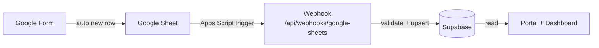
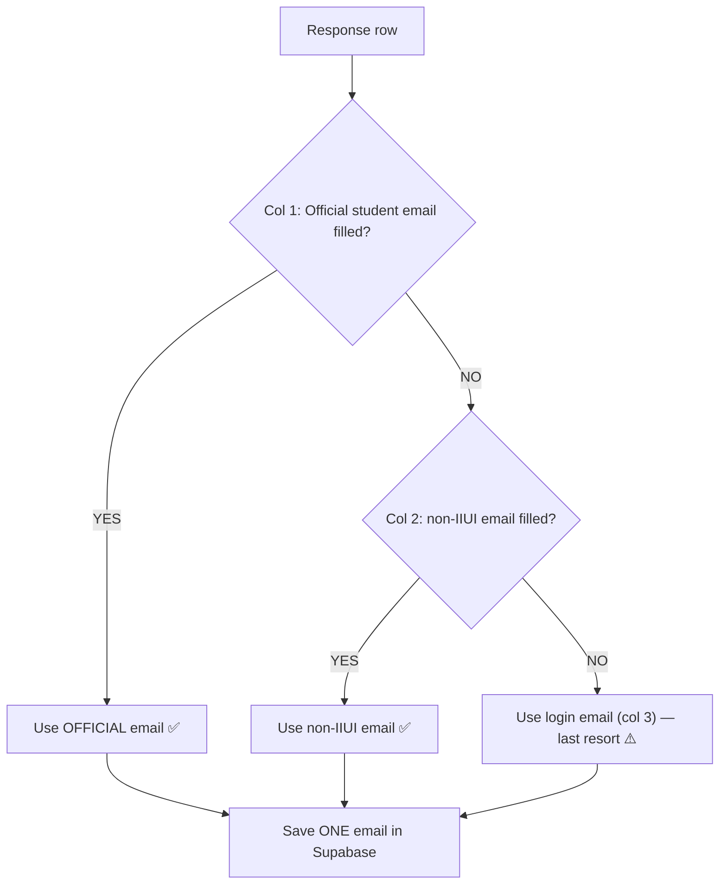
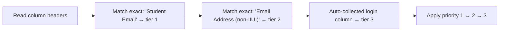
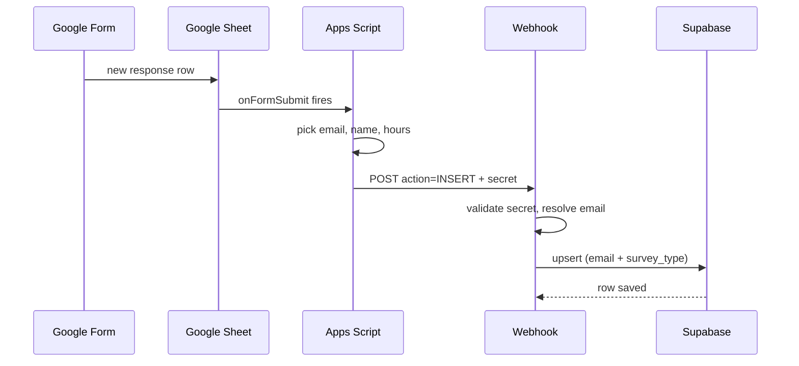
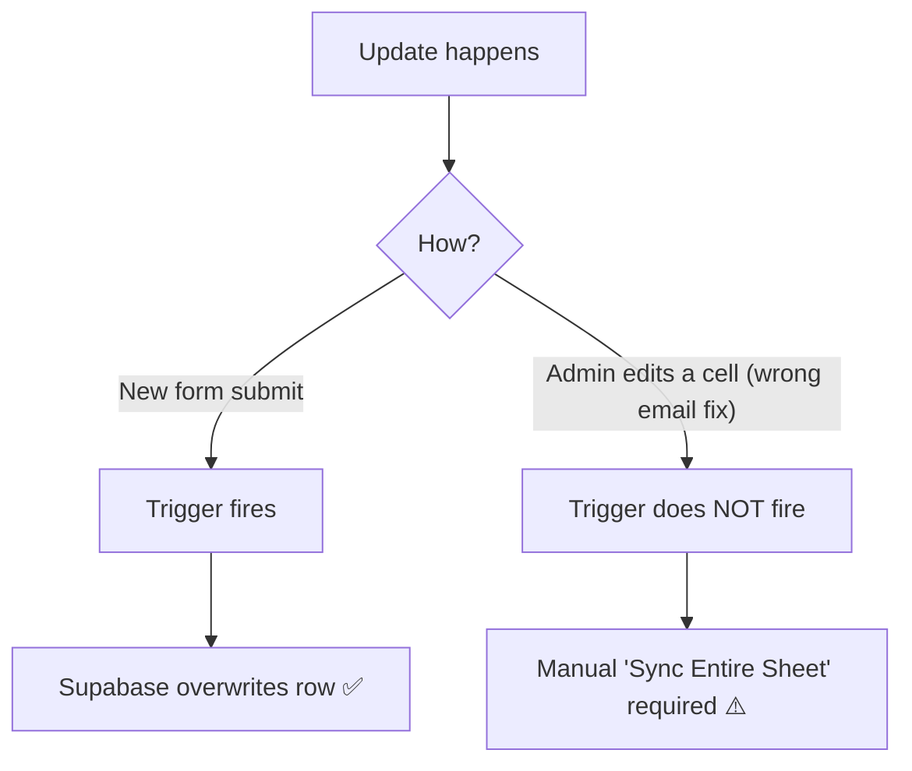
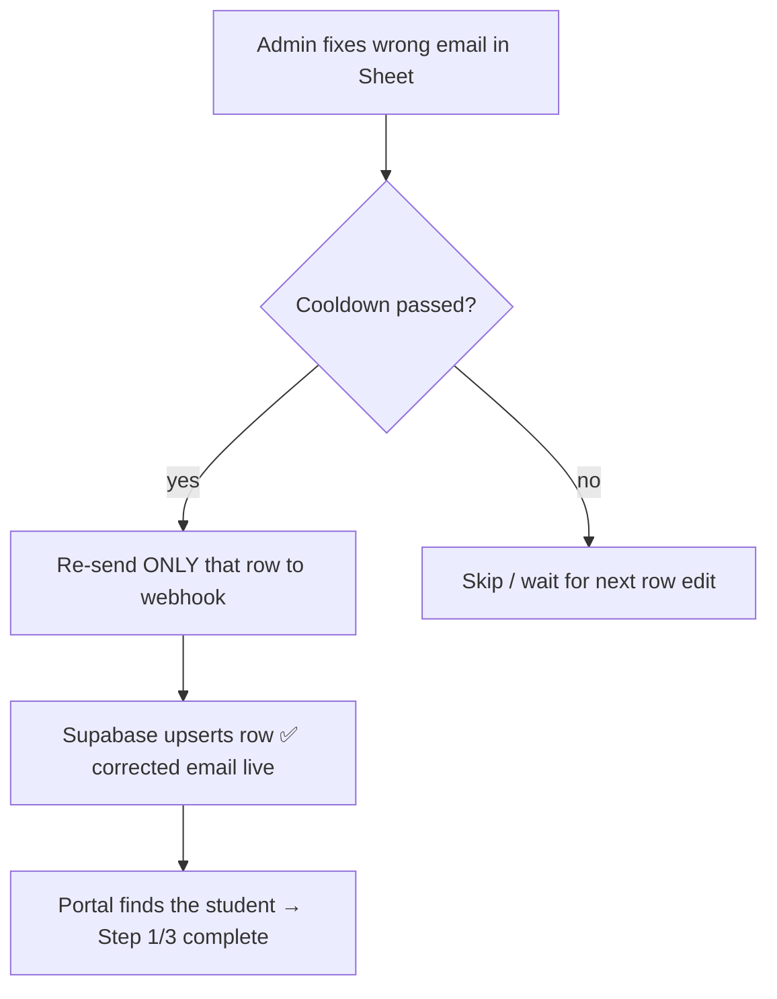
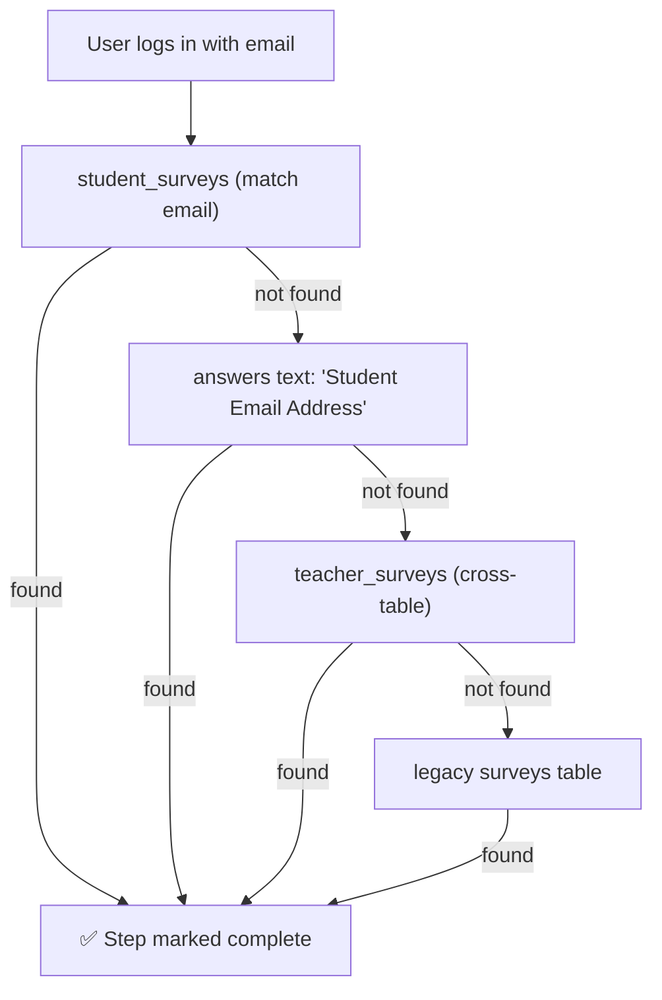

# The AI Bridge — Data Flow V3 (Simple Report + Suggestions)

**Pipeline:** Google Form → Google Sheet → Apps Script → Webhook → Supabase → Portal / Dashboard
**Version:** V3 · Audience: Team/Admin + Faculty · Length: ~4–5 pages
**Everything below matches the current code.** Suggested improvements are clearly marked as **SUGGESTION**.

---

## PART A — SIMPLE REPORT

### 1. The Big Picture (one line)

A student or teacher submits a Google Form. The response lands in a Google Sheet. An Apps Script sends that row to our webhook. Supabase saves it. The Portal and Dashboard read it.



- **Insert works fully automatically.**
- **Edit does not** — edits need a manual "Sync Entire Sheet" (suggested fix in §4: a wrong email must be pushed to Supabase).
- **Delete is not needed** — the Sheet is admin-only and users cannot delete their own entry (§5).

This report explains all three, then suggests better options.

---

### 2. The Email Columns — Student Forms Have 3

The Student **Pre** and **Post** forms collect **three** email values. Only #1 and #2 are real form questions; #3 is auto-added by Google.

| # | Column | Filled by | Example | Meaning |
| :--- | :--- | :--- | :--- | :--- |
| 1 | **Student Email** (official) | IIUI students only | `025580bsirf26@student.iiu.edu.pk` | Official identity — the form restricts it to `iiu.edu.pk` |
| 2 | **Email Address (for non-IIUI students)** | Non-IIUI students only | `someone@gmail.com` | Their only identity |
| 3 | **Email Address (Google login, auto-collected)** | Everyone (auto) | personal Gmail **or** official IIUI | The account used to **open / fill** the form |

**Designed rule:** #1 and #2 are **mutually exclusive** —
if the student is IIUI, **#1 is filled and #2 is empty**; if not IIUI, **#2 is filled and #1 is empty**. #3 is always present.

**The catch:** column 3 can be a **personal Gmail** *or* an **`@iiu.edu.pk`** account, because students fill the form from whichever account they happen to be logged into. So for an IIUI student we must use **column 1 (official)** and **never let column 3 win**.

> **What the current code does:** it uses the official email first — it detects it when the header says *student / university / institutional email*, **or** when the value ends in `@student.iiu.edu.pk` / `@iiu.edu.pk`. Two weak spots follow from this:
> 1. Columns **2 and 3 can have the same header text** ("Email Address"), so which one becomes the "personal" email is decided by **column order**, not by meaning.
> 2. If column 3 is an `@iiu.edu.pk` **login** email, the domain rule reads it as an official email — it can then **override the real column 1**.

---

### 2.1 Desired Rule — 3-Tier Priority

```
email = Official (col 1)  →  non-IIUI (col 2)  →  Login (col 3)
```

The **login column (3) is a last resort only** — it must never override column 1 or 2.



**Why this matters for IIUI students:** a student who *logged in with a personal Gmail* still gets matched by their **official** email — so Step 1 / Step 3 show **complete** when they sign in with their university account (see §7).

---

### 2.2 SUGGESTION — Make the 3-Tier Rule Explicit (pros & cons)

**What to change:** stop guessing by domain. Classify strictly by **column meaning / exact header**, in this order — (1) the official student-email question, (2) the non-IIUI question, (3) the auto-collected login column. Only use the `@iiu.edu.pk` rule to *detect* tier 1 when the header is missing — never to promote the login column.



**Pros**
- Deterministic: the official email **always** wins for IIUI students, even when they filled the form with a personal account.
- Matches the designed mutual-exclusivity rule (col 1 XOR col 2).
- The login column can never hijack or overwrite the official email.
- Fewer "Step 1 not completed" complaints.

**Cons**
- Requires the **exact form-question headers** to be confirmed (they drive the match).
- The auto-collected column's header varies ("Email Address", "Email Address (Google)"), so it needs a robust "everything else" fallback.
- Rows already synced with the old rule may need a one-time **re-sync** to correct the stored email.

**Alternative (lighter):** keep the current logic but add a **safety check** — if a detected "student email" came from the *login* column while column 1 is empty, treat it as tier 3, not tier 1. Smaller change, but still relies on header text.

**Recommended combo:** do §2.2 (explicit rule) **and** the validation check below.

---

### 2.3 SUGGESTION — Store & Validate All 3 Emails

**What to change:** keep all three emails (they are already inside the raw `answers` text) and add a small **data-quality check** that flags:
- rows where **col 1 and col 2 are both filled** (breaks the XOR rule);
- IIUI rows where the **stored email is not official**;
- rows with **no email** at all.

**Pros**
- Full audit trail — you can see who used a personal login and fix historical mismatches.
- Bad rows are caught early instead of silently mis-matching in the Portal.
- Enables a simple "how many filled with personal" statistic.

**Cons**
- Needs a data-quality job + someone to act on the flags.
- Optional extra columns / UI to show all three emails.

---

### 2.4 Streams (Sheets)

The pipeline assumes 4 streams — one sheet per form:

| # | Stream | Stores in | Survey type |
| :--- | :--- | :--- | :--- |
| 1 | Student Pre-Assessment | `student_surveys` | `pre` |
| 2 | Student Post-Assessment | `student_surveys` | `post` |
| 3 | Teacher Pre-Assessment | `teacher_surveys` | `pre` |
| 4 | Teacher Post-Assessment | `teacher_surveys` | `post` |

> **To fill in:** exact sheet names and the real **row/email count per sheet**. I can only read the Apps Script — not the live Google Sheets — so please share the 4 Sheet links or exports.

---

### 3. INSERT — A New Response (fully automatic)

1. Form submitted → a new row appears in the Sheet.
2. Apps Script installable trigger `onFormSubmit` fires → reads that row.
3. Script picks the email (official first), name, hours, rating, feedback.
4. Script POSTs to the webhook with `action: "INSERT"`.
5. Webhook checks the shared secret, finds the department code, finds the user profile.
6. Supabase **upserts** the row into `student_surveys` or `teacher_surveys`, and mirrors it into the legacy `surveys` table.



---

### 4. UPDATE — Two Very Different Situations

#### Case A — The person submits the form again
The trigger **does** fire. The row is upserted and the **same row is overwritten** (no duplicate).

#### Case B — An admin edits the Sheet (usually to fix a wrong email)
The Sheet row changes **silently**. `onFormSubmit` does **NOT** fire on edits.
**Result: Supabase does NOT change automatically.**

To push the fix today, an admin must run:
`🤖 The AI Bridge → 🔄 Sync Entire Sheet to Supabase`



#### How it works NOW

| Aspect | Current behaviour |
| :--- | :--- |
| New submission | Auto-syncs, overwrites same row |
| Admin edits a Sheet cell | Nothing until manual sync |
| Who can edit the Sheet | **Admins only** |
| Who runs sync | Any admin, from the Sheet menu |
| Cost | Zero extra services; simple and safe |

#### SUGGESTION — Best change: targeted `onEdit` auto-sync

**Why we need it:** the main reason an update happens is a **wrong email**. A student may mistype or use the wrong account when filling the form. Once an admin fixes that email cell in the Sheet, Supabase must pick up the change — otherwise the Portal keeps looking for the wrong email and the student's Step 1 / Step 3 stay **incomplete**.

The Sheet row is **admin-only** (no one else can open or edit it), so a wrong edit by a random user cannot happen.

**What to change:** add a second **installable trigger** (`onEdit`) in the Apps Script. When a row is edited, the script re-sends **only that row** to the webhook. Because Supabase matches by **email + survey type**, the corrected row is upserted — the correct email takes over. A bulk "Sync Entire Sheet" stays as a fallback.



**Note on the corrected email:** when an email is fixed, the old (wrong) Supabase row can stay behind, because the new email is a **different match key**. So the correction should also **remove the old row** for the same survey (a small "replace" step: delete old, upsert new) to avoid a leftover record. See Pros/Cons below.

**Pros**
- A corrected email reaches Supabase automatically — the student can then see Step 1 / Step 3 as complete.
- Only one row is sent, so it is small and fast.
- Upsert keeps the **no-duplicate** guarantee.
- The row is admin-only, so the risk of bad edits from users is zero.

**Cons**
- Needs development + testing in Apps Script.
- A changed email creates a **new** row, so the old one must be cleaned up (the "replace" step).
- A mistaken admin edit still overwrites the good row — same risk as a manual sync, just sooner.

**Alternative:** a **scheduled sync** (e.g. every 15 min) that re-sends changed rows. Simpler to build, but slower to reflect a correction.

---

### 5. DELETE — Not Needed

**Decision:** automatic delete-sync is **not required**.

- A user **cannot delete their own form response**, so there is no user-driven delete to handle.
- The Sheet is **admin-only**, so rows are not removed by random users.
- Any genuine removal is rare and can be done by an admin **manually**.

So the current behaviour (Supabase keeps the row) is acceptable, and **no new delete mechanism will be built**. If a row ever must be removed, an admin does it by hand (or via the existing `DELETE` action on the webhook).

| Aspect | Behaviour |
| :--- | :--- |
| User deletes own entry | Not possible — no handling needed |
| Non-admin edits Sheet | Not possible — admin-only |
| Rare manual removal | Admin removes it manually |
| Auto delete-sync | **Not required** |

---

### 6. How Supabase Handles Updates

- Every row is matched by **email + survey type** (`unique_student_survey` / `unique_teacher_survey`).
- `upsert` = **overwrite the old row**, never create a duplicate.
- Each save is mirrored into the legacy `surveys` table for backward compatibility.
- Emails are normalised (trim/lowercase) before matching, so spacing/case never breaks a match.

| Event | Trigger fires? | Supabase action |
| :--- | :--- | :--- |
| New form submit | ✅ Yes | Insert new row |
| Same person submits again | ✅ Yes | Overwrite same row |
| Admin edits a cell (e.g. wrong email) | ❌ No | Nothing — needs the §4 fix / manual sync |
| Delete a response | — | Not needed (admin-only, §5) |

---

### 7. How the Email Verifies Step 1 and Step 3

The Portal uses the **email** to find the person's surveys.

- **Step 1 = Pre-Survey** (`survey_type = 'pre'`)
- **Step 3 = Post-Survey** (`survey_type = 'post'`)

For each step, the Portal searches in this order and stops at the first match:



If found, the Portal also **links the survey to the user account** (`user_id`) automatically, so the match is stored and faster next time.

---

### 8. Quick Summary

| Question | Answer |
| :--- | :--- |
| Emails per student row | **3** (official, non-IIUI, login) |
| Which email is used | **Official first** (`@student.iiu.edu.pk` / `@iiu.edu.pk`), then non-IIUI, then login |
| Login column (auto) | Last resort only — never overrides official |
| Duplicate submissions | Overwritten (same email + survey type) |
| Sheet edits synced? | **No** — needs the §4 fix (auto-sync corrected email) |
| Step 1 checked by | Email in `student_surveys` where type = `pre` |
| Step 3 checked by | Email in `student_surveys` where type = `post` |
| Deletes synced? | Not needed — admin-only Sheet, users can't delete (§5) |

---

### 9. Worked Example (one student, end to end)

| Step | What happens | Where |
| :--- | :--- | :--- |
| 1 | Student fills the **Pre-Assessment** form | Google Form |
| 2 | Row lands in the Student Pre sheet (3 email columns) | Google Sheet |
| 3 | Trigger fires → webhook → `student_surveys` (`pre`) | Supabase |
| 4 | Student logs in with official email → Step 1 shows **complete** | Portal |
| 5 | Student passes the quiz | Portal |
| 6 | Student fills the **Post-Assessment** form | Google Form |
| 7 | Trigger fires → `student_surveys` (`post`) | Supabase |
| 8 | Step 3 shows **complete** → certificate unlocked | Portal |
| *fix* | Student typed a **wrong email** → admin corrects the Sheet cell → §4 auto-sync pushes it → Step 1/3 complete again | Sheet → Supabase → Portal |

---

## PART B — TECHNICAL APPENDIX (for the team)

### B1. Components

| Layer | File / Asset | Role |
| :--- | :--- | :--- |
| Sheet logic | `google-sheet-scripts/01_Config.gs` | Config, sheet names, secrets, menu |
| Sheet logic | `google-sheet-scripts/02_SyncEngine.gs` | `onFormSubmit`, `syncAllRows`, `parseRowData`, `sendToWebhook` |
| Ingest | `src/app/api/webhooks/google-sheets/route.ts` | Validate secret, resolve email, upsert |
| Verify | `src/app/portal/page.tsx` | Step 1 / Step 3 cascade lookup |
| Database | `supabase/010_pipeline_resilience_and_survey_linking.sql` | Auto-link trigger + RLS self-link policies |

### B2. Trigger rules

- The trigger **must** be an **Installable** trigger (a plain `onFormSubmit` cannot do network calls).
- `onFormSubmit` fires **only on new submissions** — never on edits or deletes.
- `syncAllRows()` is the manual bulk path behind `🔄 Sync Entire Sheet to Supabase`.

### B3. Matching keys

- `student_surveys` → `UNIQUE(student_email, survey_type)`
- `teacher_surveys` → `UNIQUE(teacher_email, survey_type)`
- Email normalisation: `LOWER(REGEXP_REPLACE(email, '\s+', '', 'g'))`
- Upsert on conflict → **overwrite, no duplicate**.

### B4. Current risk register

| # | Risk | Impact | Suggested fix |
| :--- | :--- | :--- | :--- |
| 1 | Corrected (wrong) email not synced | Student's Step 1/3 stays incomplete | `onEdit` auto-sync + replace old row (§4) |
| 2 | Manual sync forgotten | Silent data drift | Auto trigger + a health check |
| 3 | Wrong email picked | Step 1/3 shows incomplete | Already fixed: official-first + cascade (§7) |
| 4 | Login column (col 3) taken as official | IIUI student matched to a personal email | Explicit 3-tier rule (§2.2) + validation (§2.3) |
| 5 | ~~Deletes never sync~~ | Not applicable | Not needed — admin-only Sheet (§5) |

### B5. Recommendation order

1. **Fix the email rule (§2.2)** — highest priority; it decides who a survey belongs to.
2. **Add `onEdit` auto-sync + replace (§4)** — so a corrected email reaches Supabase and Step 1/3 become complete.
3. **Add a sync health check** — log last-sync time + row counts to spot drift early.
4. **Delete sync** — **not required** (§5).

---

## 10. Open Items (need your input)

1. **Exact form-question headers** for the 3 email columns (verbatim, as they appear in the Sheet row 1) — needed to lock the §2.2 rule.
2. **Real email/row counts** per sheet + the **4 Sheet links/exports** — to replace the "To fill in" notes in §2.4.
3. **One-time re-sync?** May we re-sync the Student sheets once after the §2.2 change, to correct any row that stored a login/personal email instead of the official one?
4. **Build the §4 fix?** Should I implement the `onEdit` auto-sync (+ old-row cleanup) in the Apps Script now, or keep it as documentation only?
5. Include the **AI typo-suggestion** fallback (80% similarity + roll-number guard)? (Yes/No)
6. Diagram format — keep **Mermaid** (renders on GitHub), or images/SVG/ASCII?
