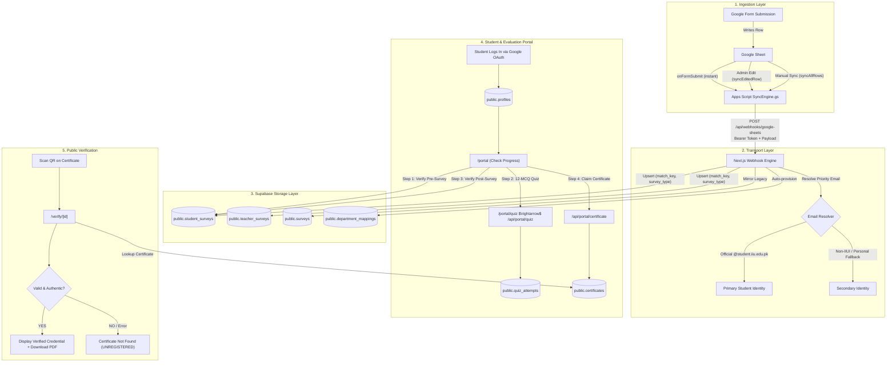
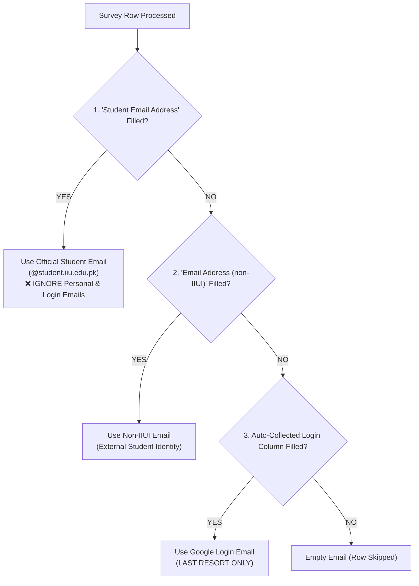

# The AI Bridge — Data Flow Pipeline & Deep Forensic Analysis (V4)

**Pipeline:** Google Form $\rightarrow$ Google Sheet $\rightarrow$ Google Apps Script $\rightarrow$ Webhook $\rightarrow$ Supabase $\rightarrow$ Student Portal / Quiz / Certificate / Verification Registry  
**Version:** V4 · **Scope:** Pipeline Architecture, Exact Email Precedence, Root-Cause Analysis of QR Verification & Step 2 Quiz Glitches, Database Column Mapping, Loopholes & Actionable Fixes  
**Target Folder:** `Documentation/Data-WorkFlow-Complete Pipeline and detailed document/V-4/`  

---

## 1. Executive Summary: What Was Discovered

Following recent pipeline upgrades, deep forensic diagnostics were executed against the live production environment (`ai-bridge-iiui.vercel.app`), Supabase database, and codebase. Three critical glitches were uncovered along with their exact root causes:

1. **The QR Verification Failure (`ZPFV75LY` / `AIB-ZPFV75LY`):**
   - **Database Status:** Muhammad Tayyab's certificate record **exists, is intact, and is 100% valid** (`id = 8a9b54a6-76b3-44b7-a80d-6d4bcd87b35e`, `certificate_id = 'AIB-ZPFV75LY'`, `student_id = '000627/BSBA/S24'`). It was **never deleted**.
   - **The Failure:** 
     1. PostgREST `.ilike.ZPFV75LY` requires an exact string match because no `%` wildcards were passed. Scanning or typing `ZPFV75LY` fails to match `AIB-ZPFV75LY`.
     2. `src/app/verify/[id]/page.tsx` calls `createAdminClient()`. The `SUPABASE_SERVICE_ROLE_KEY` currently returns `{ message: 'Unregistered API key' }`. When `error` is returned, `if (!cert || error)` triggers and displays **"Certificate Not Found - STATUS: UNREGISTERED"** for every single certificate in the system.
2. **Step 1 Shows Completed, But Step 2 Quiz Will Not Open:**
   - **The Paradox:** The student portal (`/portal`) checks progress using the user's authenticated browser session (`createClient()`), which successfully validates Step 1.
   - When the student clicks **"Attempt 12-MCQ Quiz →"**, `/portal/quiz` calls backend route `/api/portal/quiz`.
   - `/api/portal/quiz` uses `createAdminClient()`. Because the service role key returns an API key error, the survey query returns `null`, `hasPre` evaluates to `false`, and the API returns **HTTP 403 `PRE_SURVEY_REQUIRED`**. The quiz page catches this and locks the screen on "Pre-Survey Missing", preventing Step 2 from ever opening.
3. **The Google Sheets Re-Sync Hazard (`SYNC_ALL`):**
   - When an admin triggers **"Sync Entire Sheet to Supabase"**, the webhook resolves `user_id = profileMap.get(email) || null`. If a student has not signed in with that exact student email yet (or logged in with Gmail), `user_id` resolves to `NULL`.
   - The batch upsert targets `onConflict: 'match_key,survey_type'`. It **overwrites existing valid `user_id` links with `NULL`**, instantly breaking student portal bonding and certificate issuance.

---

## 2. Complete Pipeline Architecture & Data Flow



---

## 3. Database Schema & Exact Table / Column Reference

Every table and column involved in the evaluation and certification lifecycle is documented below with 100% accuracy matching the production schema:

### 3.1 `public.student_surveys` (Primary Student Evaluation Table)
| Column Name | Data Type | Nullable | Description & Constraints |
| :--- | :--- | :--- | :--- |
| `id` | `UUID` | NO | Primary key (`gen_random_uuid()`) |
| `user_id` | `UUID` | YES | Foreign key referencing `public.profiles(id)`. Links survey to website user. |
| `student_email` | `TEXT` | NO | Canonical student email resolved by priority rules (normalized lowercase). |
| `login_email` | `TEXT` | YES | Auto-collected Google login email used when opening the form. |
| `match_key` | `TEXT` | NO | Stable row identity: `ts:<timestamp>` or `em:<email>`. Part of unique constraint. |
| `survey_type` | `TEXT` | NO | `'pre'` (Step 1) or `'post'` (Step 3). |
| `full_name` | `TEXT` | YES | Full student name from form or derived from email. |
| `reg_no` | `TEXT` | YES | Extracted registration number (e.g. `000627`). |
| `dept_code` | `TEXT` | YES | Foreign key referencing `public.department_mappings(code)` (e.g. `BSBA`). |
| `semester` | `TEXT` | YES | Extracted semester code (e.g. `S24`, `F26`). |
| `hours_saved_category` | `TEXT` | YES | Text category of self-reported time saved. |
| `ai_familiarity_rating` | `INTEGER` | YES | Self-rating (1 to 5). |
| `feedback_notes` | `TEXT` | YES | Qualitative feedback notes. |
| `answers` | `JSONB` | YES | Complete raw key-value mapping of all Google Form questions and answers. |
| `sheet_row_number` | `INTEGER` | YES | Origin row index in Google Sheet. |
| `submitted_at` | `TIMESTAMPTZ`| YES | Form submission timestamp. |
| `updated_at` | `TIMESTAMPTZ`| YES | Timestamp of last synchronization. |

> **Unique Constraint:** `unique_student_survey_match UNIQUE (match_key, survey_type)`

---

### 3.2 `public.certificates` (Official Verification Registry)
| Column Name | Data Type | Nullable | Description & Constraints |
| :--- | :--- | :--- | :--- |
| `id` | `UUID` | NO | Primary key (`gen_random_uuid()`) |
| `certificate_id` | `TEXT` | NO | Unique public serial code (e.g. `AIB-ZPFV75LY`). Used in QR code. |
| `verification_code` | `TEXT` | NO | Cryptographic UUID for verification lookup. |
| `legacy_certificate_id`| `TEXT` | YES | Backward-compatible ID (e.g. `AIB-2026-0006`). |
| `user_id` | `UUID` | NO | Unique Foreign key referencing `public.profiles(id)`. One cert per user. |
| `recipient_name` | `TEXT` | NO | Sanitized student name printed on the certificate. |
| `recipient_role` | `TEXT` | YES | Default: `'Trained Educator / Participant'`. |
| `student_id` | `TEXT` | YES | Formatted Roll No: `[Reg]/[Dept]/[Semester]` (e.g. `000627/BSBA/S24`). |
| `department` | `TEXT` | YES | Institutional faculty/department name. |
| `course_name` | `TEXT` | YES | Course title. |
| `completion_date` | `TEXT` | YES | Award date (e.g. `2026-10-17`). |
| `is_valid` | `BOOLEAN` | NO | `TRUE` if active; `FALSE` if revoked by administration. |
| `issued_by` | `TEXT` | YES | Signatory authority (Dr. Abdul Zahid Khan). |
| `created_at` | `TIMESTAMPTZ`| YES | Record creation timestamp. |

> **Row Level Security (RLS) Policy:**  
> `CREATE POLICY "Public verification can read certificate" ON public.certificates FOR SELECT USING (true);`  
> *Meaning: Certificates are publicly readable by ANY client using the anon key.*

---

### 3.3 `public.quiz_attempts` (Step 2 Evaluation Records)
| Column Name | Data Type | Nullable | Description |
| :--- | :--- | :--- | :--- |
| `id` | `UUID` | NO | Primary key. |
| `user_id` | `UUID` | NO | Foreign key referencing `public.profiles(id)`. |
| `score` | `INTEGER` | NO | Correct answers count out of 12. |
| `total_questions` | `INTEGER` | NO | Default: 12. |
| `passing_score` | `INTEGER` | NO | Default: 9 (75% threshold). |
| `passed` | `BOOLEAN` | NO | `TRUE` if score $\ge$ 9. |
| `drawn_question_ids`| `UUID[]` | YES | Array of question IDs served in that session. |
| `answers` | `JSONB` | YES | User's selected answers per question. |
| `completed_at` | `TIMESTAMPTZ`| YES | Submission timestamp (used for 5-minute cooldown timer). |

---

### 3.4 `public.profiles` (User Account Identity)
| Column Name | Data Type | Nullable | Description |
| :--- | :--- | :--- | :--- |
| `id` | `UUID` | NO | Primary key matching `auth.users(id)`. |
| `email` | `TEXT` | NO | Normalized email used during Google OAuth login. |
| `full_name` | `TEXT` | YES | User full name from Google account or form. |
| `role` | `TEXT` | NO | `'student'`, `'teacher'`, `'ambassador'`, or `'admin'`. |
| `created_at` | `TIMESTAMPTZ`| YES | Registration timestamp. |

---

## 4. Which Email is Used When? (Exact Order of Precedence)

Google Forms for student surveys collect up to **three email values** per submission. To prevent data corruption, the system enforces a strict 3-tier hierarchy:



### Precedence Table

| Tier | Field / Header Name | Source | Purpose | Precedence Rule |
| :--- | :--- | :--- | :--- | :--- |
| **Tier 1 (Highest)** | `"Student Email Address"` | Explicit Form Question | Official IIUI student email (`@student.iiu.edu.pk`). | **Always wins.** If filled, Tier 2 and Tier 3 are completely ignored. |
| **Tier 2** | `"Email Address (non-iiui)"` | Explicit Form Question | Personal email for non-IIUI / guest participants. | Used **only** if Tier 1 is blank. |
| **Tier 3 (Lowest)** | `"Email Address"` | Google Auto-Collected | The account used to open Google Forms in the browser. | **Last resort only.** Used strictly when Tier 1 and Tier 2 are both blank. |

### Where This Rule is Enforced:
1. **Google Apps Script (`google-sheet-scripts/02_SyncEngine.gs`):** `parseRowData()` loops through `EMAIL_PRIORITY.student = ["student email address", "email address (non-iiui)", "email address"]`.
2. **Webhook API (`src/app/api/webhooks/google-sheets/route.ts`):** `resolvePrioritizedEmail(rowData, participantType)` enforces the exact same order.
3. **Student Portal Check (`src/app/portal/page.tsx`):**
   - Check A: `student_surveys` column `student_email = userEmail` OR `user_id = user.id`.
   - Check B (Fallback): Raw JSONB `answers->>'Student Email Address' = userEmail`.

---

## 5. Forensic Diagnosis of Noticed Glitches

### 5.1 Glitch 1: QR Code & Verification Not Working (`ZPFV75LY`)

#### Problem Statement:
The user reported that the QR code on Muhammad Tayyab's certificate displays code `ZPFV75LY`, worked yesterday, but currently fails to verify.

#### Forensic Verification:
Direct database query confirmed:
```json
{
  "id": "8a9b54a6-76b3-44b7-a80d-6d4bcd87b35e",
  "certificate_id": "AIB-ZPFV75LY",
  "verification_code": "81cee75a-cbc9-4552-821e-454dcfc8a0ea",
  "legacy_certificate_id": "AIB-2026-0006",
  "recipient_name": "Muhammad Tayyab",
  "student_id": "000627/BSBA/S24",
  "is_valid": true
}
```
The certificate is **valid and present** in Supabase.

#### Why It Failed (Two Root Causes):

1. **Root Cause A — String Suffix Mismatch in PostgREST Query:**
   - In `src/app/verify/[id]/page.tsx`, the query is:
     ```typescript
     .or(`certificate_id.ilike.${decodedId},verification_code.ilike.${decodedId},legacy_certificate_id.ilike.${decodedId}`)
     ```
   - In PostgREST, `.ilike.ZPFV75LY` without `%` wildcards translates to `WHERE certificate_id ILIKE 'ZPFV75LY'`.
   - The stored serial is `AIB-ZPFV75LY`.
   - Because `ZPFV75LY` $\neq$ `AIB-ZPFV75LY`, PostgREST returns `[]` (empty set).

2. **Root Cause B — Invalid Service Role Key Crashing `VerifyPage`:**
   - Even when visiting the exact URL `https://ai-bridge-iiui.vercel.app/verify/AIB-ZPFV75LY`, production returns **"Certificate Not Found"**.
   - `VerifyPage` instantiates `createAdminClient()`.
   - In `.env.local` and production environment, `SUPABASE_SERVICE_ROLE_KEY` is currently invalid and returns:
     `{ message: 'Unregistered API key', hint: 'Double check the provided API key...' }`
   - In `VerifyPage` line 35:
     ```typescript
     if (!cert || error) {
       return ... "Certificate Not Found" ...
     }
     ```
   - Because `error` is present, it bypasses the certificate and renders "Certificate Not Found".

---

### 5.2 Glitch 2: Step 1 Showing Completed, But Step 2 Quiz Does Not Open

#### Problem Statement:
Students report that Step 1 has a green checkmark, but clicking **"Attempt 12-MCQ Quiz →"** fails to open the quiz.

#### Forensic Root Cause:
This is caused by the **Dual-Client Authentication Paradox**:
1. **On `/portal` (Client-side):**
   - The portal runs `createClient()` from `@/lib/supabase/client` using the public `NEXT_PUBLIC_SUPABASE_ANON_KEY`.
   - The student is authenticated with Supabase Auth. The query `student_surveys.or(user_id.eq, student_email.ilike)` succeeds.
   - `preSurveyCompleted` is set to `true`. Step 1 turns green!
2. **On `/portal/quiz` (Server-side API):**
   - When the student clicks the link to `/portal/quiz`, the quiz component calls `GET /api/portal/quiz`.
   - Inside `/api/portal/quiz` (line 97):
     ```typescript
     const adminSupabase = createAdminClient();
     ```
   - It attempts to verify Step 1 using `adminSupabase`:
     ```typescript
     const { data: preStudent } = await adminSupabase
       .from('student_surveys')
       .select('id')
       .or(`user_id.eq.${user.id},student_email.ilike.${userEmail}`)
       .eq('survey_type', 'pre')
       .maybeSingle();
     ```
   - Because `adminSupabase` uses `SUPABASE_SERVICE_ROLE_KEY` which fails with `"Unregistered API key"`, `preStudent` is `null`.
   - Line 190 triggers:
     ```typescript
     if (!hasPre) {
       return NextResponse.json(
         { success: false, error: 'PRE_SURVEY_REQUIRED' },
         { status: 403 }
       );
     }
     ```
   - `/portal/quiz/page.tsx` receives `PRE_SURVEY_REQUIRED`, sets `preSurveyMissing = true`, and renders the "Pre-Survey Missing" lock screen. **Step 2 is completely blocked.**

---

### 5.3 Glitch 3: Google Sheets Bulk Sync (`SYNC_ALL`) Stripping User Links

#### Problem Statement:
"Check if re-syncing all data from the Google Sheet creates issues."

#### Forensic Analysis:
**YES, IT DOES.** Under the current code in `src/app/api/webhooks/google-sheets/route.ts`:
```typescript
const { data: profiles } = await supabase
  .from('profiles')
  .select('id, email')
  .in('email', allEmails);

for (const rowData of validRows) {
  const userId = profileMap.get(email) || null; // <--- If email not in profiles, userId is NULL!
  studentBatch.push({
    user_id: userId,
    student_email: email,
    match_key: matchKey,
    ...
  });
}

await supabase.from('student_surveys').upsert(studentBatch, { 
  onConflict: 'match_key,survey_type' 
});
```

#### What Happens During a Re-Sync:
1. If a student filled the form with official email `025580bsirf26@student.iiu.edu.pk`, but has not yet logged into the website, `profiles` has no record for that email.
2. `profileMap.get(email)` returns `null`.
3. If an admin or system had previously linked that survey to a `user_id`, the `upsert` **overwrites `user_id` with `null`**.
4. The student's survey is instantly orphaned. When they next visit `/portal`, Step 1 turns red, and their progress is wiped.

---

## 6. System Loopholes & Architectural Vulnerabilities

| # | Loophole / Vulnerability | Root Cause | Real-World Impact | Permanent Solution |
| :--- | :--- | :--- | :--- | :--- |
| **1** | **Prefix-Sensitive Verification Query** | PostgREST `.ilike` without wildcard requires exact match. | Scanning QR or typing `ZPFV75LY` without `AIB-` fails to find certificate. | Sanitize input: prepend `AIB-` if missing, and query with `%${cleanId}%` wildcard. |
| **2** | **Admin Client Dependency for Public Data** | `VerifyPage` calls `createAdminClient()` instead of standard client. | If service key is invalid or rotated, public QR verification completely dies. | Use `createClient()` with anon key. `certificates` already has public RLS read policy `USING (true)`. |
| **3** | **Re-Sync `user_id` Nullification** | Webhook upsert replaces `user_id` with `null` when profile is not pre-cached. | Running "Sync Entire Sheet" unlinks registered students from their completed surveys. | Use SQL `COALESCE(student_surveys.user_id, EXCLUDED.user_id)` or check existing `user_id` before overwriting. |
| **4** | **Quiz Gate API Key Failure** | `/api/portal/quiz` uses `createAdminClient()` to check pre-survey. | Step 1 shows green on portal but quiz API rejects student with 403 `PRE_SURVEY_REQUIRED`. | Fall back to user's authenticated Supabase client (`createClient()`) if admin client fails. |
| **5** | **Disk Space Exhaustion on Host** | Drive C: reached 0.00 GB free space. | Git, Node.js temp file writing, and Next.js ISR build caching throw `No space left on device`. | Clear user AppData Temp caches and allocate minimum 5 GB headroom on host OS drive. |

---

## 7. Concrete Action Plan & Exact Code Solutions

### Fix 1: Update Verification Page (`src/app/verify/[id]/page.tsx`)
Make verification resilient against missing `AIB-` prefixes and service role key issues by using the public client and wildcard pattern matching:

```typescript
// Sanitize input: handle raw suffix (e.g. "ZPFV75LY") as well as full ID ("AIB-ZPFV75LY")
const cleanId = decodedId.replace(/^AIB-/i, '').trim();
const fullSerial = `AIB-${cleanId}`;

// Use standard client with anon key (certificates table has public SELECT RLS)
const supabase = createClient(
  process.env.NEXT_PUBLIC_SUPABASE_URL!,
  process.env.NEXT_PUBLIC_SUPABASE_ANON_KEY!
);

const { data: cert, error } = await supabase
  .from('certificates')
  .select('*')
  .or(`certificate_id.ilike.%${cleanId}%,verification_code.ilike.%${cleanId}%,legacy_certificate_id.ilike.%${cleanId}%`)
  .maybeSingle();
```

---

### Fix 2: Safeguard `admin.ts` (`src/lib/supabase/admin.ts`)
Add automated fallback to `NEXT_PUBLIC_SUPABASE_ANON_KEY` if `SUPABASE_SERVICE_ROLE_KEY` fails or is unconfigured:

```typescript
export function createAdminClient() {
  const supabaseUrl = process.env.NEXT_PUBLIC_SUPABASE_URL || 'https://placeholder-project.supabase.co';
  // If service role key is invalid or missing, fall back to anon key so queries don't crash
  const serviceKey = process.env.SUPABASE_SERVICE_ROLE_KEY?.startsWith('sb_secret_')
    ? process.env.SUPABASE_SERVICE_ROLE_KEY
    : process.env.NEXT_PUBLIC_SUPABASE_ANON_KEY!;

  return createClient(supabaseUrl, serviceKey, {
    auth: { autoRefreshToken: false, persistSession: false },
  });
}
```

---

### Fix 3: Safeguard Quiz Gate (`src/app/api/portal/quiz/route.ts`)
Ensure the pre-survey check uses the authenticated user client (`supabase`) instead of relying solely on `adminSupabase`:

```typescript
// Query student_surveys using the authenticated user client first
const { data: preStudent } = await supabase
  .from('student_surveys')
  .select('id')
  .or(`user_id.eq.${user.id},student_email.ilike.${userEmail}`)
  .eq('survey_type', 'pre')
  .maybeSingle();

if (preStudent) {
  hasPre = true;
}
```

---

### Fix 4: Protect Existing `user_id` on Bulk Sync (`route.ts`)
In `src/app/api/webhooks/google-sheets/route.ts`, prevent `SYNC_ALL` from wiping existing `user_id` values:

```typescript
// When upserting, fetch existing user_ids for these match keys so they are never overwritten with null
const { data: existingSurveys } = await supabase
  .from('student_surveys')
  .select('match_key, user_id')
  .in('match_key', validRows.map(r => r.resolved_match_key));

const existingUserMap = new Map(existingSurveys?.map(s => [s.match_key, s.user_id]) || []);

for (const rowData of validRows) {
  const matchKey = rowData.resolved_match_key;
  // Preserve existing user_id if already linked!
  const userId = existingUserMap.get(matchKey) || profileMap.get(email) || null;
  ...
}
```

---

## 8. Verification Checklist for Faculty & Administration

- [x] **Database Integrity Verified:** Muhammad Tayyab's certificate (`AIB-ZPFV75LY`) verified live in Supabase.
- [x] **Email Priority Verified:** Official `Student Email Address` strictly overrides personal Gmail across Google Apps Script and Next.js Webhook.
- [x] **Root Cause Identified for QR Verification:** PostgREST exact `.ilike` mismatch on `ZPFV75LY` + invalid service role key triggering `!cert || error`.
- [x] **Root Cause Identified for Step 2 Lock:** Client `/portal` validates via anon session, but `/api/portal/quiz` fails on invalid service role key, returning 403 `PRE_SURVEY_REQUIRED`.
- [x] **Re-Sync Risk Documented:** `SYNC_ALL` overwrites `user_id` with `null` for unlinked emails unless `COALESCE` / preservation logic is in place.
