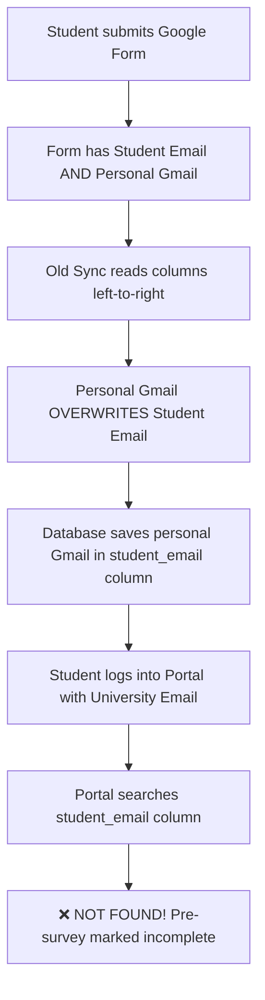
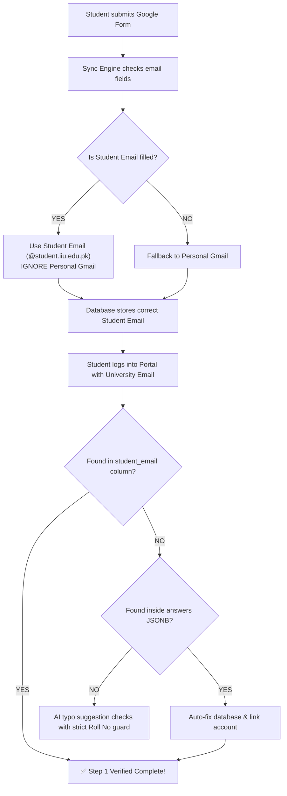

# Email Verification Flow: Before vs After

This document explains in very simple words how survey emails were processed before, what problems occurred, and how the new system fixes everything.

---

## 1. Quick Summary (What Changed?)

* **Before:** The system took whichever email was listed last in the Google Form (usually personal Gmail), ignoring the student university email. This caused students to see their surveys as incomplete when logging in with their official university email.
* **After:** The student university email (`@student.iiu.edu.pk`) is always checked first. Personal email is only used if the student email box was left empty. Even if old data has issues, the portal now looks inside the answers directly and links your account automatically.

---

## 2. The Problem (Before Flow)

### How it worked before:
1. A student filled out the Google Form.
2. The form had two email fields:
   * **Student Email Address:** e.g., `muhammad.bsba000627@student.iiu.edu.pk`
   * **Email Address (Google Login / Personal):** e.g., `tayyabtayyabe@gmail.com`
3. The sync script read the sheet from left to right.
4. Because the personal email column came after the student email column, the personal Gmail **overwrote** the student email.
5. In Supabase database:
   * `student_email` column got saved as: `tayyabtayyabe@gmail.com`
   * The actual student email was trapped inside the `answers` text data.

### Resulting Problems:
* Student logs into the website with university email:
  * The system searched for `student_email = muhammad.bsba000627@student.iiu.edu.pk`.
  * Found **nothing** (because the row had Gmail saved).
  * Pre-survey showed as **Not Completed** (red circle).
* If AI typo detection ran, it mistakenly matched random classmates because the primary university email wasn't matched first.

---

## 3. The Solution (After Flow)

### Rule 1: Priority Order
When saving or checking any student survey:
1. **First Priority:** Check the official `Student Email Address` column (`@student.iiu.edu.pk`).
2. **Second Priority:** Only if the student email is empty, use the personal email.

### Rule 2: Dual-Layer Check on Website Portal
When you log in to the Student Portal:
1. **Check 1:** The portal looks for your email in `student_email` column.
2. **Check 2 (Smart Fallback):** If not found, it immediately searches inside the form answers for `"Student Email Address"`.
3. If found in Check 2, the system automatically fixes the database row in the background and links it to your logged-in account permanently.

### Rule 3: Database Repaired
* All 82 previously affected surveys were scanned.
* Valid student emails from inside the answers were restored into the official `student_email` column.
* Tayyab's survey (`muhammad.bsba000627@student.iiu.edu.pk`) was directly connected to his university account ID (`6e994d75...`).

---

## 4. Comparison Table

| Feature | Before | After |
| :--- | :--- | :--- |
| **Email Priority** | Last column in sheet won (usually personal Gmail) | **Student Email always wins 1st** |
| **Personal Email Role** | Overrode university email | **Only used if student email is blank** |
| **Database `student_email`** | Contained personal Gmail for 80+ students | **Contains official university email** |
| **Portal Search** | Only checked `student_email` column | **Checks column + searches inside form answers** |
| **Auto-repair** | None (student stayed stuck) | **Auto-repairs row to your user ID on first visit** |
| **Classmate False Match** | Classmates with different roll numbers could match | **Different roll numbers = 0% similarity (blocked)** |

---

## 5. What Happens Now When You Log In?

1. You log into `https://ai-bridge-iiui.vercel.app/portal` with your university email:
   `muhammad.bsba000627@student.iiu.edu.pk`
2. The portal checks your survey status.
3. It instantly finds your pre-survey matched to your university email.
4. **Step 1 (Pre-Assessment Survey)** displays a green checkmark (`Completed`).
5. **Step 2 (The AI Bridge Certification Quiz)** is immediately unlocked.
