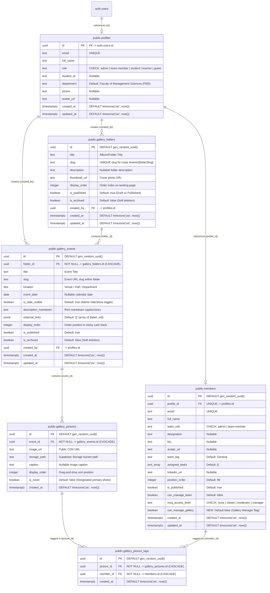

# Event Gallery System Specification

**Target Location:** `Documentation/Event-Gallery/EVENT_GALLERY_SPECIFICATION.md`  
**Base Schema Source:** `supabase/Sql-Updated-Code.sql`  
**System Status:** Approved Specification & Database Architecture  
**Specification Version:** v1.1 (Updated: Clean Vertical Scroll Stack & Mobile Photo Carousel)  
**UI/UX Pattern:** 2-Tier Collection Architecture with Clean Vertical Scroll Card Layout  

---

## 1. Executive Summary & Domain Model

The **Event Gallery** module provides a dynamic, media-rich documentation stream for *The AI Bridge* platform. It replaces static campaign mockups with a structured repository for workshops, faculty training sessions, campus drives, and institutional SDG milestones.

### Structural Paradigm (2-Tier Folders):
- **Folders (Albums/Collections):** Top-level category cards displayed on the main gallery page (`/events`), grouping events by initiative, phase, or academic cohort (e.g., *"Faculty Training Series"*, *"Campus Awareness Drive"*).
- **Events (Single Card per Event):** Individual sessions located strictly within a folder. Each event has a title, venue, optional/hideable date, external recap links, a rich Markdown caption/description, and an ordered photo set.
- **Vertical Scroll Card Layout:** In the folder view (`/events/[folderSlug]`), events render as clean, distinct cards in a standard vertical scroll stream with gentle hover elevation, providing an intuitive, uncluttered browsing experience across desktop and mobile.
- **Rich Rendered Markdown:** Each event has a single comprehensive caption/story written in Markdown by managers and rendered cleanly as formatted HTML (bold, italic, bulleted lists, links) without exposing raw Markdown markers.
- **Team Member Tagging (Multi-Person):** For every picture in an event, managers can tag multiple team members from `public.members`. Tagged members (with their avatar and name) appear on the photo in the public card and interactive lightbox.

---

## 2. Integrated Entity Relationship Diagram (ERD)

The diagram below shows the exact integration of the new Event Gallery tables into the existing database architecture documented in `supabase/Sql-Updated-Code.sql`:



---

## 3. Database Schema & Data Dictionary

All table definitions, types, constraints, and default values are matched directly with the syntax of `Sql-Updated-Code.sql`.

### 3.1. `public.gallery_folders`
Top-level category collection grouping events.

| Column | PostgreSQL Type | Nullable | Default | Constraints & Relationships | Description |
|---|---|---|---|---|---|
| `id` | `uuid` | `NO` | `gen_random_uuid()` | `PRIMARY KEY` | Unique ID |
| `title` | `text` | `NO` | — | — | Folder title (e.g. *"Campus Awareness Drive"*) |
| `slug` | `text` | `NO` | — | `UNIQUE` | Unique URL path segment |
| `description` | `text` | `YES` | `NULL` | — | Overview narrative for the folder |
| `thumbnail_url` | `text` | `NO` | — | — | Cover image URL |
| `display_order` | `integer` | `NO` | `0` | — | Sorting index for gallery landing page |
| `is_published` | `boolean` | `NO` | `true` | — | Visibility control (`true` = live) |
| `is_archived` | `boolean` | `NO` | `false` | — | Soft deletion flag |
| `created_by` | `uuid` | `YES` | `NULL` | `FOREIGN KEY REFERENCES public.profiles(id)` | Author user profile |
| `created_at` | `timestamptz` | `NO` | `timezone('utc'::text, now())` | — | Creation timestamp |
| `updated_at` | `timestamptz` | `NO` | `timezone('utc'::text, now())` | — | Last update timestamp |

---

### 3.2. `public.gallery_events`
The core event unit presented as a distinct card inside a folder.

| Column | PostgreSQL Type | Nullable | Default | Constraints & Relationships | Description |
|---|---|---|---|---|---|
| `id` | `uuid` | `NO` | `gen_random_uuid()` | `PRIMARY KEY` | Unique event ID |
| `folder_id` | `uuid` | `NO` | — | `FOREIGN KEY REFERENCES public.gallery_folders(id) ON DELETE CASCADE` | Parent folder |
| `title` | `text` | `NO` | — | — | Event title |
| `slug` | `text` | `NO` | — | `UNIQUE (folder_id, slug)` | Slug scoped to parent folder |
| `location` | `text` | `NO` | — | — | Event venue / room / campus |
| `event_date` | `date` | `YES` | `NULL` | — | Date of event occurrence |
| `is_date_visible` | `boolean` | `NO` | `true` | — | **Toggle to hide date from public cards** |
| `description_markdown` | `text` | `NO` | `''::text` | — | Full formatted caption/story |
| **`external_links`** | `jsonb` | `NO` | `'[]'::jsonb` | — | External URLs: `[{"label": "...", "url": "..."}]` |
| `display_order` | `integer` | `NO` | `0` | — | Sticky stack order sequence |
| `is_published` | `boolean` | `NO` | `true` | — | Public visibility switch |
| `is_archived` | `boolean` | `NO` | `false` | — | Soft deletion flag |
| `created_by` | `uuid` | `YES` | `NULL` | `FOREIGN KEY REFERENCES public.profiles(id)` | Author user profile |
| `created_at` | `timestamptz` | `NO` | `timezone('utc'::text, now())` | — | Creation timestamp |
| `updated_at` | `timestamptz` | `NO` | `timezone('utc'::text, now())` | — | Last update timestamp |

---

### 3.3. `public.gallery_pictures`
Individual photographs belonging to an event.

| Column | PostgreSQL Type | Nullable | Default | Constraints & Relationships | Description |
|---|---|---|---|---|---|
| `id` | `uuid` | `NO` | `gen_random_uuid()` | `PRIMARY KEY` | Unique image record ID |
| `event_id` | `uuid` | `NO` | — | `FOREIGN KEY REFERENCES public.gallery_events(id) ON DELETE CASCADE` | Parent event |
| `image_url` | `text` | `NO` | — | — | Public CDN image address |
| `storage_path` | `text` | `NO` | — | — | Supabase Storage path (`event-gallery/...`) |
| `caption` | `text` | `YES` | `NULL` | — | Optional picture caption |
| `display_order` | `integer` | `NO` | `0` | — | Drag-and-drop sort index |
| `is_cover` | `boolean` | `NO` | `false` | — | Primary cover banner flag |
| `created_at` | `timestamptz` | `NO` | `timezone('utc'::text, now())` | — | Upload timestamp |

---

### 3.4. `public.gallery_picture_tags` (NEW)
Junction table enabling multiple team members to be tagged in each photo.

| Column | PostgreSQL Type | Nullable | Default | Constraints & Relationships | Description |
|---|---|---|---|---|---|
| `id` | `uuid` | `NO` | `gen_random_uuid()` | `PRIMARY KEY` | Unique tag record ID |
| `picture_id` | `uuid` | `NO` | — | `FOREIGN KEY REFERENCES public.gallery_pictures(id) ON DELETE CASCADE` | Reference to the photo |
| `member_id` | `uuid` | `NO` | — | `FOREIGN KEY REFERENCES public.members(id) ON DELETE CASCADE` | Reference to tagged team member |
| `created_at` | `timestamptz` | `NO` | `timezone('utc'::text, now())` | — | Tagging timestamp |

*Note: Enforces `UNIQUE (picture_id, member_id)` so a member cannot be tagged twice in the same photo.*

---

### 3.5. RBAC Schema Migration for `public.members`
To support the Event Gallery Manager role within the existing team architecture:

```sql
-- Extend existing members table with gallery management permission
ALTER TABLE public.members 
ADD COLUMN IF NOT EXISTS can_manage_gallery boolean NOT NULL DEFAULT false;
```

---

## 4. Complete SQL Migration DDL

This script follows the exact conventions, constraints, and UTC timestamps established in `Sql-Updated-Code.sql`:

```sql
-- ============================================================================
-- EVENT GALLERY DATABASE SCHEMA MIGRATION
-- Compatible with Supabase & AI-Bridge Existing Database Architecture
-- ============================================================================

-- 1. Extend members table with gallery management capability
ALTER TABLE public.members 
ADD COLUMN IF NOT EXISTS can_manage_gallery boolean NOT NULL DEFAULT false;

-- 2. Create gallery_folders table
CREATE TABLE public.gallery_folders (
  id uuid NOT NULL DEFAULT gen_random_uuid(),
  title text NOT NULL,
  slug text NOT NULL,
  description text,
  thumbnail_url text NOT NULL,
  display_order integer NOT NULL DEFAULT 0,
  is_published boolean NOT NULL DEFAULT true,
  is_archived boolean NOT NULL DEFAULT false,
  created_by uuid,
  created_at timestamp with time zone NOT NULL DEFAULT timezone('utc'::text, now()),
  updated_at timestamp with time zone NOT NULL DEFAULT timezone('utc'::text, now()),
  CONSTRAINT gallery_folders_pkey PRIMARY KEY (id),
  CONSTRAINT gallery_folders_slug_key UNIQUE (slug),
  CONSTRAINT gallery_folders_created_by_fkey FOREIGN KEY (created_by) REFERENCES public.profiles(id)
);

-- 3. Create gallery_events table
CREATE TABLE public.gallery_events (
  id uuid NOT NULL DEFAULT gen_random_uuid(),
  folder_id uuid NOT NULL,
  title text NOT NULL,
  slug text NOT NULL,
  location text NOT NULL,
  event_date date,
  is_date_visible boolean NOT NULL DEFAULT true,
  description_markdown text NOT NULL DEFAULT ''::text,
  external_links jsonb NOT NULL DEFAULT '[]'::jsonb,
  display_order integer NOT NULL DEFAULT 0,
  is_published boolean NOT NULL DEFAULT true,
  is_archived boolean NOT NULL DEFAULT false,
  created_by uuid,
  created_at timestamp with time zone NOT NULL DEFAULT timezone('utc'::text, now()),
  updated_at timestamp with time zone NOT NULL DEFAULT timezone('utc'::text, now()),
  CONSTRAINT gallery_events_pkey PRIMARY KEY (id),
  CONSTRAINT gallery_events_folder_id_fkey FOREIGN KEY (folder_id) REFERENCES public.gallery_folders(id) ON DELETE CASCADE,
  CONSTRAINT gallery_events_created_by_fkey FOREIGN KEY (created_by) REFERENCES public.profiles(id),
  CONSTRAINT gallery_events_folder_slug_key UNIQUE (folder_id, slug)
);

-- 4. Create gallery_pictures table
CREATE TABLE public.gallery_pictures (
  id uuid NOT NULL DEFAULT gen_random_uuid(),
  event_id uuid NOT NULL,
  image_url text NOT NULL,
  storage_path text NOT NULL,
  caption text,
  display_order integer NOT NULL DEFAULT 0,
  is_cover boolean NOT NULL DEFAULT false,
  created_at timestamp with time zone NOT NULL DEFAULT timezone('utc'::text, now()),
  CONSTRAINT gallery_pictures_pkey PRIMARY KEY (id),
  CONSTRAINT gallery_pictures_event_id_fkey FOREIGN KEY (event_id) REFERENCES public.gallery_events(id) ON DELETE CASCADE
);

-- 5. Create gallery_picture_tags table (Multi-member tagging per picture)
CREATE TABLE public.gallery_picture_tags (
  id uuid NOT NULL DEFAULT gen_random_uuid(),
  picture_id uuid NOT NULL,
  member_id uuid NOT NULL,
  created_at timestamp with time zone NOT NULL DEFAULT timezone('utc'::text, now()),
  CONSTRAINT gallery_picture_tags_pkey PRIMARY KEY (id),
  CONSTRAINT gallery_picture_tags_picture_id_fkey FOREIGN KEY (picture_id) REFERENCES public.gallery_pictures(id) ON DELETE CASCADE,
  CONSTRAINT gallery_picture_tags_member_id_fkey FOREIGN KEY (member_id) REFERENCES public.members(id) ON DELETE CASCADE,
  CONSTRAINT gallery_picture_tags_unique_tag UNIQUE (picture_id, member_id)
);

-- 6. Performance Indexes
CREATE INDEX IF NOT EXISTS idx_gallery_folders_published ON public.gallery_folders(is_published, is_archived, display_order);
CREATE INDEX IF NOT EXISTS idx_gallery_events_folder ON public.gallery_events(folder_id, is_published, is_archived, display_order);
CREATE INDEX IF NOT EXISTS idx_gallery_pictures_event ON public.gallery_pictures(event_id, display_order);
CREATE INDEX IF NOT EXISTS idx_gallery_picture_tags_picture ON public.gallery_picture_tags(picture_id);
CREATE INDEX IF NOT EXISTS idx_gallery_picture_tags_member ON public.gallery_picture_tags(member_id);
```

---

## 5. Row-Level Security (RLS) & Access Control

Aligned with `profiles.role` and `members.can_manage_gallery`:

```sql
-- Enable RLS on all gallery tables
ALTER TABLE public.gallery_folders ENABLE ROW LEVEL SECURITY;
ALTER TABLE public.gallery_events ENABLE ROW LEVEL SECURITY;
ALTER TABLE public.gallery_pictures ENABLE ROW LEVEL SECURITY;
ALTER TABLE public.gallery_picture_tags ENABLE ROW LEVEL SECURITY;

-- Helper security function: checks if active session belongs to an Admin or Gallery Manager
CREATE OR REPLACE FUNCTION public.can_manage_event_gallery()
RETURNS boolean AS $$
BEGIN
  RETURN EXISTS (
    SELECT 1 FROM public.profiles p
    WHERE p.id = auth.uid() AND p.role = 'admin'
  ) OR EXISTS (
    SELECT 1 FROM public.members m
    WHERE m.profile_id = auth.uid() AND m.can_manage_gallery = true
  );
END;
$$ LANGUAGE plpgsql SECURITY DEFINER;

-- ----------------------------------------------------------------------------
-- Public Read Policies (Only active, published, and unarchived rows)
-- ----------------------------------------------------------------------------
CREATE POLICY "Public read published folders"
ON public.gallery_folders FOR SELECT
USING (is_published = true AND is_archived = false);

CREATE POLICY "Public read published events"
ON public.gallery_events FOR SELECT
USING (
  is_published = true 
  AND is_archived = false
  AND folder_id IN (
    SELECT f.id FROM public.gallery_folders f 
    WHERE f.is_published = true AND f.is_archived = false
  )
);

CREATE POLICY "Public read pictures of published events"
ON public.gallery_pictures FOR SELECT
USING (
  event_id IN (
    SELECT e.id FROM public.gallery_events e 
    JOIN public.gallery_folders f ON f.id = e.folder_id
    WHERE e.is_published = true 
      AND e.is_archived = false 
      AND f.is_published = true 
      AND f.is_archived = false
  )
);

CREATE POLICY "Public read picture tags of published events"
ON public.gallery_picture_tags FOR SELECT
USING (
  picture_id IN (
    SELECT p.id FROM public.gallery_pictures p
    JOIN public.gallery_events e ON e.id = p.event_id
    JOIN public.gallery_folders f ON f.id = e.folder_id
    WHERE e.is_published = true 
      AND e.is_archived = false 
      AND f.is_published = true 
      AND f.is_archived = false
  )
);

-- ----------------------------------------------------------------------------
-- Admin & Manager Write Policies (Full CRUD)
-- ----------------------------------------------------------------------------
CREATE POLICY "Managers manage folders"
ON public.gallery_folders FOR ALL
USING (public.can_manage_event_gallery())
WITH CHECK (public.can_manage_event_gallery());

CREATE POLICY "Managers manage events"
ON public.gallery_events FOR ALL
USING (public.can_manage_event_gallery())
WITH CHECK (public.can_manage_event_gallery());

CREATE POLICY "Managers manage pictures"
ON public.gallery_pictures FOR ALL
USING (public.can_manage_event_gallery())
WITH CHECK (public.can_manage_event_gallery());

CREATE POLICY "Managers manage picture tags"
ON public.gallery_picture_tags FOR ALL
USING (public.can_manage_event_gallery())
WITH CHECK (public.can_manage_event_gallery());
```

---

## 6. UI / UX Design & Implementation Architecture

### 6.1. Public Navigation & Page Hierarchy

```
/events (Gallery Landing Page: Folder Grid)
   │
   └───► /events/[folderSlug] (Folder Page: Vertical Scroll Event Cards)
            │
            └───► Fullscreen Lightbox Modal (Triggered by clicking any photo)
```

### 6.2. The Vertical Scroll Card Layout UX Pattern (Folder View)
Inside `/events/[folderSlug]`:
- **Clean Vertical Stream:** Each event card renders in standard document flow within an uncluttered `space-y-10` container.
- **Natural Scrolling:**
  - Visitors scroll smoothly through each documented session without viewport pinning or overlapping cards.
  - Cards feature a subtle top emerald accent bar, clean border, and subtle elevation transition (`shadow-sm hover:shadow-md`).
- **Mobile Photo Enhancements:**
  - High-visibility photo count pill (`X Photos • Tap to open`) overlaid on the cover image.
  - Horizontal swipeable photo carousel strip on mobile devices (`snap-x`) allowing quick visual discovery of all event photos.
  - Dedicated full-width "View All Photos in Fullscreen" action button.
- **Anatomy of an Event Card:**
  1. **Top Badge Bar:**
     - **Location Pill:** MapPin icon + Location string.
     - **Date Pill:** Calendar icon + formatted date (**strictly hidden if `is_date_visible = false`**).
     - **External Link Buttons:** If `external_links` contains items (e.g. YouTube recap, LinkedIn post), render small clickable outbound chips.
  2. **Event Header:** Clear title (`text-2xl font-extrabold text-slate-900`).
  3. **Rich Markdown Caption:**
     - Parsed via `react-markdown` with Tailwind's `@tailwindcss/typography` (`prose prose-slate max-w-none`).
     - Renders formatted headings, bold text, italics, blockquotes, and lists without exposing raw Markdown syntax (e.g., `**bold**` is rendered as **bold**).
  4. **Multi-Picture Showcase & Team Member Recognition:**
     - Displays an organized grid or horizontal scroll strip of event pictures.
     - Primary cover image is given visual priority.
     - An overlay badge on trailing images (e.g., `+5 more photos`) indicates additional media.
     - **Interactive Lightbox with Tagged Members:** Clicking any photo triggers a modal overlay with zoom, swipe gestures, and keyboard navigation.
     - **"In This Photo" Pill Tray:** In the lightbox footer (and under thumbnail previews), tagged team members are displayed as compact avatar chips + names. Clicking a tagged member links to their bio on `/team`.

---

### 6.3. Admin & Event Gallery Manager Experience (`/dashboard/gallery`)

Accessible to Superadmins (`profiles.role = 'admin'`) and authorized team members (`members.can_manage_gallery = true`).

1. **Folder Management:**
   - Create, edit, publish/draft toggle, and reorder folders.
   - Upload folder cover thumbnails via Supabase Storage (`event-gallery/thumbnails`).

2. **Event Editor Form:**
   - Title and Location input fields.
   - Event Date selector with an adjacent **"Show Date on Public Page"** toggle switch (controls `is_date_visible`).
   - Split-pane or tabbed Markdown Editor (Write / Preview) with full rich formatting support.
   - External links repeater (Label + URL).

3. **Drag-and-Drop Picture Manager & Team Tagging:**
   - **Batch Upload:** Multi-image selection with client-side compression using `src/lib/imageCompression.ts` before transmission to Supabase Storage.
   - **Interactive Drag-and-Drop Grid:** Reorder pictures visually by dragging thumbnails; dynamically updates `display_order`.
   - **"Set as Cover" Button:** Single-click badge to designate an image as `is_cover = true`.
   - **Multi-Person Team Member Tagging:**
     - Each photo card features a **"Tag Members"** button.
     - Clicking opens a searchable dropdown modal populated from `public.members` (showing avatar, full name, and designation).
     - Manager can check/uncheck multiple team members per photo.
     - Selected individuals render as dismissible chips under the photo thumbnail.
   - **Photo Deletion:** Safely removes the picture record, cascades tag deletions, and purges the file from Supabase Storage.

---

## 7. Implementation Checklist

- [x] **Database Migration File:** Created `supabase/017_event_gallery.sql` defining `gallery_folders`, `gallery_events`, `gallery_pictures`, `gallery_picture_tags`, RLS policies, and `members.can_manage_gallery`.
- [x] **Storage Bucket Setup:** Configured SQL in migration 017 for `event-gallery` bucket with public read and authenticated manager upload policies.
- [x] **Public Gallery Routes:**
  - [x] Updated `src/app/events/page.tsx` with dynamic folder cards grid, search filter, and seed fallback.
  - [x] Created dynamic route `src/app/events/[folderSlug]/page.tsx` implementing the **Sticky Card Stack** component.
  - [x] Implemented fullscreen `GalleryLightbox.tsx` with keyboard, touch swipe controls, and "In this photo" team tags.
  - [x] Implemented safe `MarkdownView.tsx` component rendering bold, italic, links, lists, and quotes without exposing raw markdown syntax.
  - [x] Strict date visibility toggle enforcement (date pill hidden when `is_date_visible = false`).
- [x] **Admin Dashboard Routes & Controls:**
  - [x] Created `src/components/dashboard/GalleryManager.tsx` managing folders, events, batch photos, and team member tagging.
  - [x] Created dedicated route `src/app/dashboard/gallery/page.tsx` with role & permission verification.
  - [x] Integrated `Event Gallery` tab inside the main `src/app/dashboard/page.tsx`.

---

## 8. Image Performance Strategy

Events can carry many high-resolution photos. The following layered strategy is applied to keep the gallery fast at all scales.

### Recommended Combined Approach

```
Upload → Compress → Store → Serve blurred placeholder → Swap full image on load
                                     ↓
                      Sticky Card shows Cover Photo ONLY
                                     ↓
                     Lightbox lazily loads remaining photos
```

### Strategy Layers

| # | Strategy | What It Does | Pros | Cons |
|---|---|---|---|---|
| 1 | **Compress on Upload** | Admin-side compression via `src/lib/imageCompression.ts` before Supabase Storage upload | Smaller source files benefit all visitors forever; reduces storage cost | Slight delay during admin upload; risk of quality loss if threshold too aggressive |
| 2 | **Blur Placeholder → Full Image** | Tiny low-quality thumbnail shown instantly; swapped to full image once loaded (`placeholder="blur"` in NextJS `<Image>`) | Page feels instant; no blank flicker; professional UX | Requires storing/generating a blur data URL per image |
| 3 | **Cover Photo Only on Card** | Sticky event card loads **only the designated `is_cover` photo**; remaining photos load exclusively when lightbox is opened | Folder scroll view stays very fast regardless of photo count per event; one network request per event card | User must click to see full album; slightly reduces passive browsing |
| 4 | **Lazy Loading (Viewport-Based)** | Images use native `loading="lazy"` — only load when scrolled into view | Zero cost; browser-native; no setup needed | Slight pop-in on first appearance; below-fold images may be missed by SEO bots |
| 5 | **Paginated Lightbox Gallery** | Inside the lightbox, photos are loaded in batches (e.g., 12 at a time); subsequent batches load on navigation | DOM stays small; no performance penalty for 100+ photo events | Slightly more complex state management |
| 6 | **CDN + Responsive `srcSet`** | Supabase Image Transform serves different resolutions (mobile vs. desktop) via CDN edge cache | Fastest possible delivery globally; mobile gets smaller payload | Supabase Image Transform has usage limits on free plan; requires `srcSet` configuration |

> [!IMPORTANT]
> Strategies **1, 2, 3, and 4** are the baseline and must all be implemented. Strategies 5 and 6 are applied progressively as event photo counts grow.
