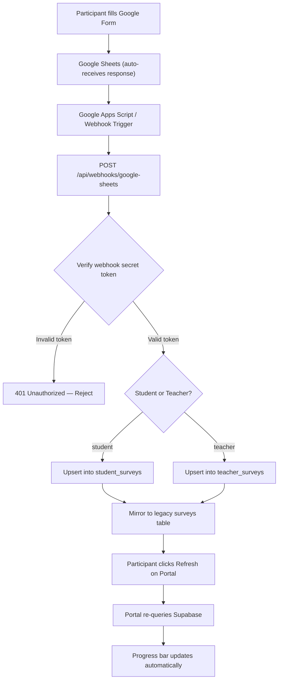
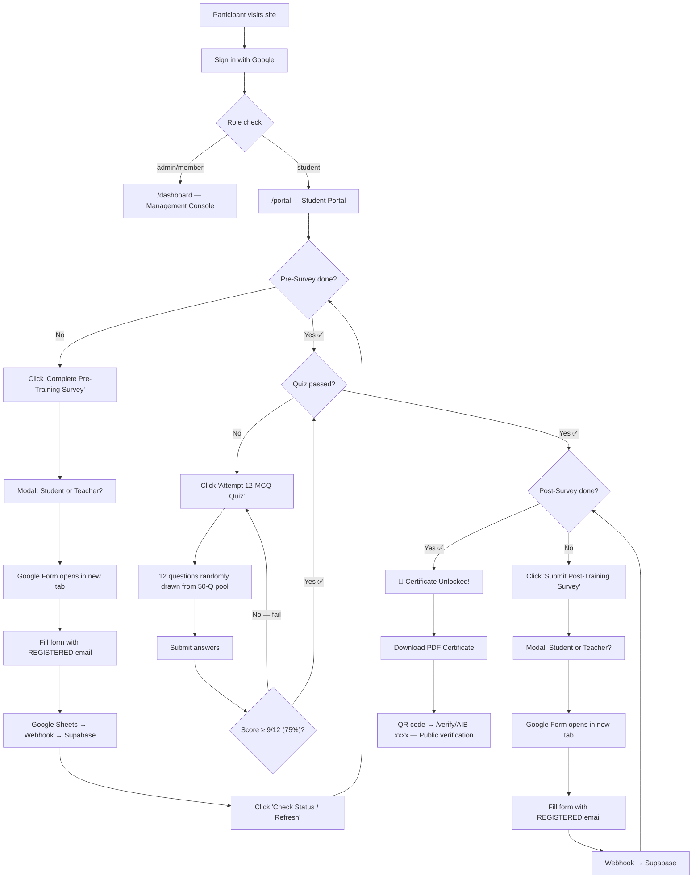
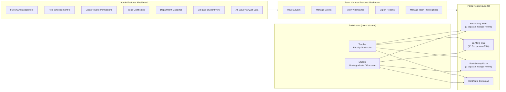
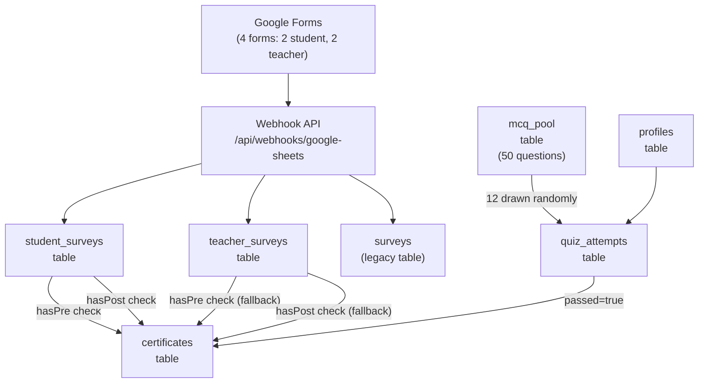

# Quiz & Survey Workflow — Complete Analysis Report
**AI Bridge · IIUI FMS · Hum Hain Pakistan SDG Youth Campaign**

> **Scope of this document:** Full workflow of the 3-step certification lifecycle, every rule encoded in the codebase, how the Google Forms / Supabase data pipeline works, and a clear breakdown of what each role (Student, Teacher, Admin, Team Member) can see and do.

---

## Table of Contents

1. [Big Picture — The 3-Step Lifecycle](#1-big-picture)
2. [Who Are the Participants? (Student vs Teacher Forms)](#2-student-vs-teacher)
3. [Step 1 — Pre-Training Survey](#3-step-1-pre-survey)
4. [Step 2 — The 12-MCQ Quiz](#4-step-2-quiz)
   - [Quiz Overview & Thresholds](#4-step-2-quiz)
   - [Database Structure of Quiz Questions (`mcq_pool`)](#database-structure-of-quiz-questions-mcq_pool-table)
   - [How to Update, Edit, or Add Quiz Questions](#how-to-update-edit-or-add-quiz-questions)
5. [Step 3 — Post-Training Survey](#5-step-3-post-survey)
6. [Certificate Unlock Rules](#6-certificate)
7. [Data Flow — Google Forms → Supabase](#7-data-flow)
8. [Roles & What Each Can Do](#8-roles)
9. [Database Tables & Rules (RLS)](#9-database)
10. [Security Guard (Middleware Rules)](#10-middleware)
11. [Admin Simulation Mode](#11-simulation)
12. [Summary Diagrams](#12-diagrams)

---

## 1. Big Picture — The 3-Step Lifecycle

Every participant (student **or** teacher) must complete exactly **3 steps in order** to earn a verified certificate.

```
┌─────────────────────────────────────────────────────────────────────────┐
│                 PARTICIPANT CERTIFICATION LIFECYCLE                      │
│                                                                          │
│  STEP 1          STEP 2              STEP 3           REWARD             │
│  Pre-Survey  →   12-MCQ Quiz    →   Post-Survey  →   Certificate        │
│  (Google Form)   (Portal Quiz)       (Google Form)    (PDF + QR Code)   │
│                                                                          │
│  Unlocks Step 2  Unlocks Step 3  Unlocks Certificate                    │
└─────────────────────────────────────────────────────────────────────────┘
```

> **Rule:** Steps are strictly sequential. You **cannot** skip Step 1 or attempt the quiz without finishing the pre-survey. You **cannot** access the post-survey until the quiz is passed.

---

## 2. Who Are the Participants? (Student vs Teacher)

This is a **key design point** — the forms are **different** for students and teachers. The UI always asks you to pick your role before opening any Google Form.

| Feature | Student | Teacher |
|---|---|---|
| **Role label** | Undergraduate / Graduate / Research | Faculty / Instructor / Lecturer |
| **Stored in database table** | `student_surveys` | `teacher_surveys` |
| **Pre-Survey Google Form** | `forms.gle/YZNQSZXUKJVn5o1i7` | `forms.gle/RmHp9N6VuN88Xc279` |
| **Post-Survey Google Form** | `forms.gle/grZEaAsnbYjCsJg68` | `forms.gle/BS42ao9pRR1JYfTM9` |
| **Pre-Survey measures** | Reading volume, assignment bottlenecks, baseline AI literacy | Curriculum prep challenges, lecture notes hours, AI integration expectations |
| **Post-Survey measures** | Hours saved/week, comprehension boost, workshop feedback | Weekly prep hours saved, pedagogical enhancement, curriculum impact |

### Why two separate forms?

The portal checks **both** tables when verifying your progress. If a student accidentally fills the teacher form (or vice versa), the system still finds and counts it. This is the **cross-table fallback rule**:

```
Check student_surveys → if not found → Check teacher_surveys → if not found → Check legacy surveys table
```

---

## 3. Step 1 — Pre-Training Survey

### What the participant does
1. Log into the portal → `/portal`
2. Click **"Complete Pre-Training Survey →"**
3. A modal pops up asking: **"Are you a Student or Teacher?"**
4. Click their role → Google Form opens in a **new tab**
5. Fill the form using their **registered account email** (very important!)
6. Submit the form

### The Email Matching Rule ⚠️

> **The most important rule in Step 1:**  
> The email entered in the Google Form **must exactly match** the email used to log into the portal. If they are different, the system will not detect the submission.

The portal shows a hint: *"Please fill the survey using the same email address registered on your account (user@example.com)"*

### What happens after submission

The Google Form submission flows through this pipeline:

```
Google Form → Google Sheets → Webhook → Supabase (student_surveys or teacher_surveys table)
```

The portal has a **"Check Status / Refresh"** button. When clicked, it re-queries Supabase to see if the submission arrived. The portal shows a toast message:
- ✅ "Pre-Survey verified! Step 2 is unlocked." — if found
- ℹ️ "No pre-survey found yet for your account email." — if not found

### Step 1 Status Check Logic (Code Rule)

The portal checks for a matching pre-survey in this exact order:
1. `student_surveys` table where `student_email = user_email AND survey_type = 'pre'`
2. `teacher_surveys` table where `teacher_email = user_email AND survey_type = 'pre'`
3. Legacy `surveys` table where `respondent_email = user_email AND survey_type = 'pre'`

If any one matches → Step 1 is marked **complete** → Step 2 unlocks.

---

## 4. Step 2 — The 12-MCQ Quiz

### Quiz Overview

| Property | Value |
|---|---|
| **Route** | `/portal/quiz` (linked from portal once Step 1 done) |
| **Total question pool** | 50 MCQs stored in `mcq_pool` table |
| **Questions drawn per attempt** | 12 (randomly selected from the pool) |
| **Passing threshold** | **9 out of 12 correct = 75%** |
| **Stored in** | `quiz_attempts` table |

### MCQ Categories in the Pool

The 50 questions cover these topics:

| Category | Description |
|---|---|
| NotebookLM Foundations | Basic features, source grounding, file formats, citations |
| Audio Overviews | Podcast feature, customization, flipped classroom |
| Structured Outputs | Study guides, FAQs, timelines, briefing documents |
| AI Foundations | Hallucination, context window, Gemini model, source grounding |
| Educational Applications | Multilingual use, Islamic texts, responsible use |
| AI Ethics & Integrity | Privacy, academic integrity, PII protection |
| SDG Literacy | SDG 4, SDG 8, SDG 10, SDG 17 |
| Prompt Crafting | Few-shot prompting, prompt structure, focus techniques |
| The AI Bridge Platform | Certification steps, passing score, certificate download |
| Project Governance | Team structure, Dr. Abdul Zahid Khan's role, milestones |
| Project Metrics | 3-5 hours/week goal, zero-cost model, 3 courses target |

### Quiz Rules (Enforced in Database Schema)

- `passing_score` is stored as `9` (integer) in every attempt record
- `total_questions` is stored as `12`
- `passed = true` only if `score >= 9`
- The quiz draws from **active questions only** (`is_active = true` in `mcq_pool`)
- `correct_option_index` is **never exposed** to the student during the quiz — only used server-side to calculate the score
- Each attempt is a **separate row** in `quiz_attempts` (multiple attempts allowed)
- The portal only checks for **passed = true** attempts to unlock Step 3

### Quiz Attempt Database Record

```
quiz_attempts table:
- id               → unique attempt ID
- user_id          → which user attempted
- drawn_question_ids → the 12 question IDs randomly picked
- user_answers     → { question_id: selected_option_index }
- score            → e.g. 10 (out of 12)
- total_questions  → always 12
- passing_score    → always 9
- passed           → true/false
- started_at       → when they opened the quiz
- completed_at     → when they submitted
```

### What happens after passing

The portal queries:
```
quiz_attempts WHERE user_id = current_user AND passed = true ORDER BY completed_at DESC LIMIT 1
```
If a passing attempt is found:
- Quiz shows as ✅ **"Passed (score/12)"**
- Step 3 (Post-Survey) unlocks

---

### Database Structure of Quiz Questions (`mcq_pool` Table)

Quiz questions are stored centrally in the PostgreSQL/Supabase table named `public.mcq_pool`.

#### Table Schema Definition

```sql
CREATE TABLE IF NOT EXISTS public.mcq_pool (
    id UUID PRIMARY KEY DEFAULT gen_random_uuid(),
    question_text TEXT NOT NULL,
    options JSONB NOT NULL,
    correct_option_index INT NOT NULL CHECK (correct_option_index BETWEEN 0 AND 3),
    explanation TEXT,
    category TEXT NOT NULL DEFAULT 'NotebookLM & AI Foundations',
    difficulty TEXT DEFAULT 'intermediate' CHECK (difficulty IN ('easy', 'intermediate', 'advanced')),
    is_active BOOLEAN NOT NULL DEFAULT true,
    created_at TIMESTAMPTZ NOT NULL DEFAULT timezone('utc'::text, now())
);
```

#### Field-by-Field Breakdown

| Field Name | Data Type | Constraint / Default | Description |
|---|---|---|---|
| `id` | `UUID` | Primary Key, `gen_random_uuid()` | Unique identifier for each question. Used in `drawn_question_ids`. |
| `question_text` | `TEXT` | `NOT NULL` | The full statement/prompt of the MCQ presented to the user. |
| `options` | `JSONB` | `NOT NULL` | JSON array containing exactly 4 string options: `["Option A", "Option B", "Option C", "Option D"]`. |
| `correct_option_index` | `INTEGER` | `NOT NULL`, `CHECK (0 TO 3)` | Zero-based index of the correct answer (`0` = Option A, `1` = Option B, `2` = Option C, `3` = Option D). |
| `explanation` | `TEXT` | Optional (`NULL` allowed) | Explanation or reference rationale shown during review or audits. |
| `category` | `TEXT` | `NOT NULL`, default: `'NotebookLM & AI Foundations'` | Topic grouping (e.g. `NotebookLM Foundations`, `Audio Overviews`, `SDG Literacy`, `Prompt Crafting`). |
| `difficulty` | `TEXT` | `CHECK ('easy', 'intermediate', 'advanced')` | Difficulty level classification. |
| `is_active` | `BOOLEAN` | `NOT NULL DEFAULT true` | Controls whether this question is eligible to be drawn into live quizzes. |
| `created_at` | `TIMESTAMPTZ` | `DEFAULT now()` | Timestamp when the question was added. |

---

### How to Update, Edit, or Add Quiz Questions

You can update or add quiz questions using any of the following 3 methods:

#### Method 1: Via Supabase Dashboard (GUI / No Code) — Recommended for Quick Edits
1. Open your **Supabase Project Dashboard**.
2. Click **Table Editor** on the left navigation bar.
3. Select the **`mcq_pool`** table.
4. **To Edit:** Double-click on any cell (`question_text`, `options`, `correct_option_index`, `category`, `difficulty`, or `is_active`) and edit directly. Press Enter to save.
5. **To Add a New Question:** Click **Insert Row** at the top right, fill in the values, and click **Save**.
   - Note for `options`: Enter valid JSON array format, for example:
     ```json
     ["First Choice", "Second Choice", "Third Choice", "Fourth Choice"]
     ```
6. **To Deactivate a Question:** Simply toggle `is_active` to `false` instead of deleting.

---

#### Method 2: Via Supabase SQL Editor (Direct SQL Queries)

Open the **SQL Editor** in Supabase and run standard SQL statements:

##### A. Adding a New Question
```sql
INSERT INTO public.mcq_pool (
  question_text, 
  options, 
  correct_option_index, 
  explanation, 
  category, 
  difficulty,
  is_active
) VALUES (
  'What is the primary benefit of source grounding in NotebookLM?',
  '["It searches the entire public web", "Responses are strictly constrained to user-uploaded documents with citations", "It generates random computer code", "It translates audio to sheet music"]'::jsonb,
  1,
  'Source grounding ensures the AI only uses uploaded reference materials with citations.',
  'NotebookLM Foundations',
  'easy',
  true
);
```

##### B. Updating an Existing Question Text or Options
```sql
UPDATE public.mcq_pool
SET 
  question_text = 'Updated wording of the question here?',
  options = '["Updated Choice A", "Updated Choice B", "Updated Choice C", "Updated Choice D"]'::jsonb,
  correct_option_index = 2,
  explanation = 'Updated explanation text'
WHERE id = 'PASTE_QUESTION_UUID_HERE';
```

##### C. Safe Deactivation (Best Practice instead of Deleting)
```sql
-- Deactivate a question so it will never be drawn into new quizzes
UPDATE public.mcq_pool
SET is_active = false
WHERE id = 'PASTE_QUESTION_UUID_HERE';
```

> **Important Best Practice:** Never run `DELETE FROM public.mcq_pool` for questions that have already been attempted, because existing student attempt records in `quiz_attempts.drawn_question_ids` reference those IDs. Always set `is_active = false` instead.

---

#### Method 3: Via Version-Controlled Seed Script (`supabase/002_seed.sql`)

1. Open the project file: [`supabase/002_seed.sql`](file:///D:/000627-BSBA-S24/Other%20Material/web%20development/AI-Bridge/supabase/002_seed.sql).
2. Add or modify the question rows under the `INSERT INTO public.mcq_pool (...) VALUES` block.
3. Run the updated script in the Supabase SQL editor to sync the question pool across deployments.

---

## 5. Step 3 — Post-Training Survey

### What the participant does
1. After passing the quiz, the Post-Survey card activates on `/portal`
2. Click **"Submit Post-Training Survey →"**
3. Same modal — pick **Student** or **Teacher**
4. Google Form opens in new tab
5. Fill with the **same registered email**
6. Submit

### Same email-matching rule applies

> Use the exact same email as your portal account. The webhook auto-links the submission.

### What Step 3 measures

- **For Students:** Hours saved per week, confidence boost, feedback on workshop modules
- **For Teachers:** Actual weekly prep hours saved, pedagogical enhancement, curriculum augmentation

### Same cross-table lookup logic applies

The system checks `student_surveys → teacher_surveys → legacy surveys` for `survey_type = 'post'`.

---

## 6. Certificate Unlock Rules

### The Certificate Condition (3 Gates)

All **3** of the following must be true for the certificate to unlock:

```
Gate 1: Pre-Survey found in DB (student OR teacher table)
   AND
Gate 2: quiz_attempts has at least one row where passed = true AND user_id = current user
   AND
Gate 3: Post-Survey found in DB (student OR teacher table)
```

**Code rule:**
```typescript
if (cert || (hasPre && quiz && hasPost)) {
  setCertificateReady(true);
}
```

The system also checks if a `certificates` row already exists directly for the user — this handles cases where admin manually issues a certificate.

### Certificate Contents (database)

| Field | Example Value |
|---|---|
| `certificate_id` | AIB-2025-0001 |
| `verification_code` | Unique URL-safe slug |
| `recipient_name` | Muhammad Ali |
| `recipient_role` | Trained Educator / Participant |
| `course_name` | The AI Bridge: Source-Grounded AI & NotebookLM Mastery |
| `issued_by` | Dr. Abdul Zahid Khan (Chairperson, TPM Department, FMS IIUI) |
| `qr_code_url` | Link to public verification page |
| `is_valid` | true |

### Certificate Download & Verification
- Participants click **"Download PDF Certificate"** — PDF with embedded QR code
- Anyone can scan the QR code → goes to `/verify/[certificate_id]` page
- The verify page is **publicly accessible** (no login needed) — a deliberate rule in the RLS policy: `USING (true)`

---

## 7. Data Flow — Google Forms → Supabase

This is the automated pipeline that connects Google Forms to the portal progress tracking:



### Webhook Actions Supported

| Action | What it does |
|---|---|
| `INSERT` | Add a new survey response |
| `UPDATE` | Update an existing response |
| `DELETE` | Remove a response from all 3 tables |
| `SYNC_ALL` | Bulk upsert — up to 100 rows per chunk |

### Email Parsing (Student Emails)

The webhook automatically extracts academic info from IIUI student emails:

| Email Format | Example | Extracted Info |
|---|---|---|
| Modern format: `[Reg][Dept][Semester]@student.iiu.edu.pk` | `025580bsirf26@...` | Reg: 025580, Dept: BSIR, Sem: F26 |
| Older format: `[Name].[Dept][Reg]@student.iiu.edu.pk` | `zain.bsba126@...` | Reg: 126, Dept: BSBA |

This extracted info (reg number, department, semester) is stored in the survey record for analytics.

### Security Rule on Webhook
- The webhook checks for a `SHEETS_WEBHOOK_SECRET` environment variable
- Every incoming request must provide the matching token in either:
  - `Authorization: Bearer <token>` header, or
  - `x-webhook-secret: <token>` header
- Requests without a valid token return **401 Unauthorized**

---

## 8. Roles & What Each Can Do

### The Three Roles

```
UserRole = 'admin' | 'member' | 'student'
```

| Role | Who they are | Portal Access |
|---|---|---|
| `student` | Regular participants (both Students and Teachers in the academic sense) | `/portal` only |
| `member` | FMS SDG Ambassadors | `/dashboard` + `/portal` |
| `admin` | Project Lead / App Dev Lead | `/dashboard` + `/portal` (full control) |

> **Important:** In the code, `'student'` is the database **role** for all regular participants — whether they are academically a "student" or a "teacher". The Student/Teacher distinction only matters for **which Google Form they fill** and **which survey table** their data goes into. Both have the `student` database role.

---

### What a Student/Teacher (role = `student`) Can Do

| Action | Allowed? |
|---|---|
| Log in with Google | ✅ Yes |
| View `/portal` dashboard | ✅ Yes |
| Fill Pre-Survey (student or teacher form) | ✅ Yes |
| Attempt the 12-MCQ Quiz (after pre-survey) | ✅ Yes |
| Fill Post-Survey (after passing quiz) | ✅ Yes |
| Download their own certificate | ✅ Yes |
| View their own quiz attempt scores | ✅ Yes |
| View `/dashboard` (management console) | ❌ No — redirected to `/portal?access_denied=restricted_dashboard` |
| Manage team members | ❌ No |
| View other participants' data | ❌ No |
| Add MCQ questions | ❌ No |
| Export reports | ❌ No |

---

### What a Team Member (role = `member`) Can Do

Members are FMS SDG Ambassadors. Their permissions are **granular** — the admin can turn each one on or off individually.

| Permission Toggle | Default | What it lets them do |
|---|---|---|
| `can_view_surveys` | ✅ ON | Read pre/post survey responses |
| `can_export_reports` | ✅ ON (for `analyzing` team) | Download QIP Section H reports |
| `can_manage_events` | ✅ ON (for `awareness` team) | Create/edit events on `/events` page |
| `can_verify_attendance` | ✅ ON (for `workshops` team) | Verify workshop attendance |
| `can_manage_mcqs` | ❌ OFF | Add/edit MCQ questions |
| `can_manage_team` | ❌ OFF by default | Special delegation — see below |

#### The `can_manage_team` Special Permission

This is a **delegation** permission that the super admin can grant to a specific member. If a member has `can_manage_team = true`, they can:

- Add new people to the whitelist (as `member` role only — they cannot grant `admin`)
- Edit names, notes, assigned tasks in whitelist
- Add/delete tasks in the master campaign task pool
- Manage public team profile cards on `/team` page
- Toggle member profile publish/draft status

They **cannot**:
- Grant `admin` role (only super admin can)
- Remove the super admin (`ai.bridge.iiui.fms@gmail.com`) from the whitelist
- Change permissions of other members directly
- View the role selector dropdown (it's hidden — shows "Role: Member [Fixed]" instead)

#### Permissions Auto-Assigned by Team Tag

When a member is added to the whitelist with a `team_tag`, permissions are automatically set:

| team_tag | `can_manage_events` | `can_verify_attendance` | `can_export_reports` |
|---|---|---|---|
| `awareness` | ✅ | ❌ | ❌ |
| `workshops` | ❌ | ✅ | ❌ |
| `analyzing` | ❌ | ❌ | ✅ |
| `general` | ❌ | ❌ | ❌ |

---

### What an Admin Can Do

The admin has **full unrestricted access** to everything. There are two types:

#### Super Admin (hardcoded email)
- Email: `ai.bridge.iiui.fms@gmail.com`
- This email is **hardcoded** in the system as the absolute top authority
- Cannot be removed from the whitelist (code refuses with an error)
- Automatically gets `admin` role on first sign-in (even without a whitelist entry)

#### Admin Role (role = `admin`)
- Any profile with `role = 'admin'` in the `profiles` table
- Same capabilities as super admin for practical purposes

| Action | Admin Can Do? |
|---|---|
| Access `/dashboard` | ✅ Full access |
| View all participant data | ✅ Yes |
| View all quiz attempts (all users) | ✅ Yes |
| View all survey responses | ✅ Yes |
| Add/edit MCQ questions | ✅ Yes |
| Add people to role whitelist | ✅ Yes |
| Grant `admin` OR `member` role | ✅ Yes (only admin can grant `admin`) |
| Grant `can_manage_team` to a member | ✅ Yes |
| Remove anyone from whitelist | ✅ Yes (except super admin) |
| Create/delete campaign tasks | ✅ Yes |
| Manage public team profiles on `/team` | ✅ Yes |
| Add/edit/delete department mappings | ✅ Yes |
| Issue certificates manually | ✅ Yes |
| Simulate Student View | ✅ Yes (special "Simulate Student View" button) |
| Export QIP Section H Report | ✅ Yes |
| View survey audit logs | ✅ Yes |

---

## 9. Database Tables & Rules (RLS)

Row Level Security (RLS) is enabled on all tables. Here is what each policy means in plain English:

### `profiles` table
| Who | Can Read | Can Write |
|---|---|---|
| Own user | Own row only | Own row only |
| `member` | All rows | ❌ No |
| `admin` | All rows | All rows (full control) |

### `mcq_pool` table
| Who | Can Read | Can Write |
|---|---|---|
| Any authenticated user | Active questions only (`is_active = true`) | ❌ No |
| `admin` | All questions | Yes (add/edit/delete) |

> **Note:** The `correct_option_index` field is accessible to authenticated users (since they need it for quiz grading), but it is only exposed server-side during submission evaluation — not sent to the browser during quiz display.

### `quiz_attempts` table
| Who | Can Read | Can Write |
|---|---|---|
| Own user | Own attempts only | Own attempts only (insert/view) |
| `member` | All attempts | ❌ No |
| `admin` | All attempts | All rows |

### `surveys` / `student_surveys` / `teacher_surveys` tables
| Who | Can Read | Can Write |
|---|---|---|
| Own user | Own responses | Own responses |
| `member` | All responses | ❌ No |
| `admin` | All responses | All rows |

### `certificates` table
| Who | Can Read | Can Write |
|---|---|---|
| **Anyone (public)** | All certificates | ❌ No — needed for QR code verification |
| Own user | Own certificate | ❌ No |
| `admin` | All certificates | Full control |

### `role_whitelist` table
| Who | Can Read | Can Write |
|---|---|---|
| `member` | All entries | ❌ No |
| `admin` | All entries | Full control |

### `survey_audit_logs` table
| Who | Can Read | Can Write |
|---|---|---|
| `member` | All logs | ❌ No |
| `admin` | All logs | Full control |
| Server (API) | — | Can insert (for automatic logging) |

---

## 10. Security Guard (Middleware Rules)

The Next.js middleware runs on **every page request** and enforces these rules:

### Rule 1: `/dashboard` is admin/member only
```
If visiting /dashboard:
  → Not logged in? → Redirect to /login?redirect=/dashboard
  → Logged in but role is 'student'? → Redirect to /portal?access_denied=restricted_dashboard
  → role is 'admin' or 'member'? → Allow access ✅
```

### Rule 2: `/portal` requires login
```
If visiting /portal (any sub-page):
  → Not logged in? → Redirect to /login?redirect=/portal
  → Logged in? → Allow access ✅
```

### Rule 3: Auto-redirect from `/login` when already logged in
```
If visiting /login while already logged in:
  → role is 'admin' or 'member'? → Redirect to /dashboard
  → role is 'student'? → Redirect to /portal
```

### Rule 4: Role Assignment on First Login
When a new user signs in with Google for the first time, a database trigger (`on_auth_user_created`) fires and:
1. Checks `role_whitelist` for the email
2. If found → assigns the whitelisted role (`admin` or `member`)
3. If the email is `ai.bridge.iiui.fms@gmail.com` → assigns `admin`
4. Otherwise → assigns `student`
5. If role is `member` → automatically creates a `member_permissions` row with defaults based on `team_tag`
6. Auto-links any previously submitted Google Form surveys to this new user account

---

## 11. Admin Simulation Mode

The admin can click **"Simulate Student View"** in the dashboard. This:
1. Sets `localStorage.setItem('aib_simulation_mode', 'student')`
2. Redirects to `/portal?view_as=student`
3. Shows a yellow banner: *"Admin Simulation Mode Active — You are previewing this portal as a Student"*
4. Shows the real role in the banner (e.g., "Real Role: ADMIN")
5. Admin can click **"Exit Simulation & Return to Dashboard →"** to go back

This lets admins see exactly what participants see without changing their actual role.

---

## 12. Summary Diagrams

### Complete Participant Journey



---

### Role Access Summary



---

### Data Tables Involved in Quiz Workflow



---

## Quick Reference: All Rules at a Glance

| Rule | Where enforced | Details |
|---|---|---|
| Steps are sequential | `portal/page.tsx` | Step 2 locked until Step 1 done; Step 3 locked until Step 2 done |
| Quiz needs 75% to pass | Database (`passing_score = 9`) | 9 correct out of 12 drawn MCQs |
| 12 questions drawn from 50-Q pool | `mcq_pool` table | Only `is_active = true` questions eligible |
| Correct answers hidden from browser | RLS + API design | `correct_option_index` evaluated server-side only |
| Email must match registered account | Portal UI hint + webhook matching | Webhook matches by email; mismatch = survey not found |
| Multiple quiz attempts allowed | No restriction | Each attempt is a separate row; portal checks for any `passed = true` |
| Students cannot access /dashboard | Middleware (`supabase/middleware.ts`) | Redirected to `/portal?access_denied=restricted_dashboard` |
| Certificate is publicly verifiable | RLS policy `USING (true)` | `/verify/[id]` page works without login |
| Super admin cannot be removed | API + frontend check | Error returned if trying to remove `ai.bridge.iiui.fms@gmail.com` |
| Members can only add other `member`s | API check in roles route | `finalRole = access.role === 'admin' ? target_role : 'member'` |
| Survey auto-links on signup | Database trigger (`handle_new_user`) | Existing survey records get `user_id` populated when user registers |
| Webhook requires secret token | API header check | `SHEETS_WEBHOOK_SECRET` env var; 401 if wrong/missing |
| Cross-table fallback for survey check | `portal/page.tsx` | Checks student_surveys → teacher_surveys → legacy surveys |

---

*Report generated from full codebase analysis — October 2026*  
*Source files analyzed: `portal/page.tsx`, `portal/pre-survey/page.tsx`, `portal/post-survey/page.tsx`, `components/SurveySelectionModal.tsx`, `middleware.ts`, `lib/supabase/middleware.ts`, `lib/access.ts`, `lib/ambassador-access.ts`, `api/admin/roles/route.ts`, `api/webhooks/google-sheets/route.ts`, `types/database.ts`, `supabase/001_schema.sql`, `supabase/002_seed.sql`, `app/dashboard/page.tsx`*
