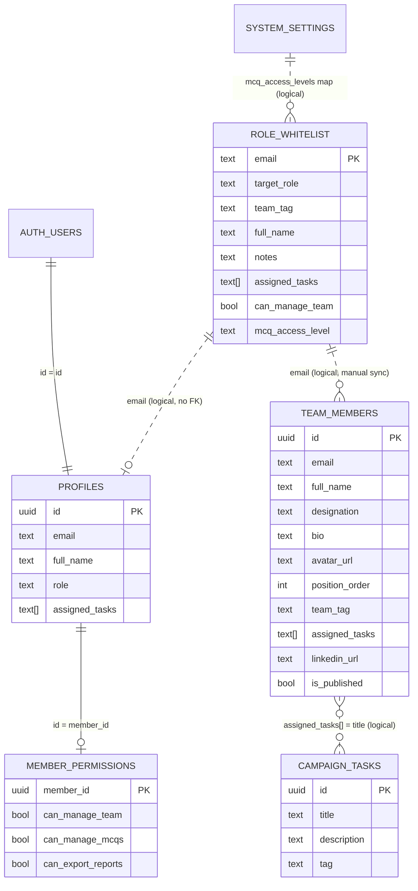

# Whitelist & Team Member Public Display — Analysis

Scope: how the **role whitelist** (`role_whitelist`) and the **public team page** (`/team`) work, which tables/columns feed the displayed text, and how to improve it.

## 1. Data Flow (summary)

```
Admin Dashboard
      │  (upsert)
      ▼
role_whitelist  ──trigger──►  profiles (+ member_permissions)   ← internal access control
      │
      │  (manual "1-Click Sync" from /api/team POST)
      ▼
team_members                                                    ← public display source
      │
      ▼
GET /api/team  ──►  /team page  (public, reads is_published = true only)
```

- **Whitelist** = source of truth for a user's *role*, *team tag* and *assigned tasks* (access control).
- **team_members** = a **separate copy** used for the *public* page; it is NOT auto-synced after the first import.
- The two are linked only by **email as a de-facto key (no foreign key)**.

## 2. Tables Used

| Table | Purpose | Key columns |
|---|---|---|
| `role_whitelist` | Whitelisted emails, role, team, tasks | `email` (PK), `target_role`, `team_tag`, `full_name`, `notes`, `assigned_tasks[]`, `can_manage_team`, `mcq_access_level` |
| `profiles` | Registered users (auth) | `id` (PK), `email` (unique), `full_name`, `role`, `assigned_tasks[]`, `avatar_url` |
| `member_permissions` | Per-member granular rights | `member_id` (PK → `profiles.id`), `can_manage_team`, `can_manage_mcqs`, … |
| `team_members` | **Public** roster | `id`, `email`, `full_name`, `designation`, `bio`, `avatar_url`, `position_order`, `team_tag`, `assigned_tasks[]`, `linkedin_url`, `is_published` |
| `campaign_tasks` | Master task pool | `id`, `title`, `description`, `tag` |
| `system_settings` | Misc config | `key`, `value` (holds `mcq_access_levels` email→level map) |

## 3. ERD



> Dotted lines = **logical joins** (matched by `email` string or `text[]` title, not enforced by a DB foreign key).

## 4. Public Text → Source Mapping

All text on `/team` comes from **`team_members`** (via `GET /api/team`, filtered by `is_published = true`).

| Displayed on page | Source table.column | Notes |
|---|---|---|
| Member name | `team_members.full_name` | |
| Designation (subtitle) | `team_members.designation` | |
| Photo | `team_members.avatar_url` | storage bucket `team-avatars` |
| Bio paragraph | `team_members.bio` | |
| Responsibility chips | `team_members.assigned_tasks[]` | shown 2–all depending on tier |
| Team badge text | `team_members.team_tag` | |
| Badge **colour** | **hardcoded** `getTagBadge()` in the page | string-matching, not DB |
| Email link | `team_members.email` | personal emails shown publicly |
| LinkedIn | `team_members.linkedin_url` | |
| Tier placement ("Lead / Leads / Ambassadors") | **hardcoded** from `position_order` (1, 2–4, >4) | |
| Section headings & intro text | **hardcoded** in the page | e.g. "Project Leads & Technical Architects" |
| Badge "Project Lead & Principal Mentor" | **hardcoded** for `position_order === 1` | |

**Whitelist → team_members is filled by `POST /api/team` (`sync_from_whitelist`), which currently maps:**

| team_members column | Comes from (whitelist) |
|---|---|
| `full_name` | `role_whitelist.full_name` (fallback: email prefix) |
| `designation` | **`role_whitelist.notes`** (fallback hardcoded string) |
| `bio` | **`role_whitelist.notes`** |
| `team_tag` | `role_whitelist.team_tag` (fallback: first `assigned_tasks`) |
| `assigned_tasks` | `role_whitelist.assigned_tasks` |
| `position_order` | auto-incremented |

## 5. Issues & How to Improve

1. **Admin `notes` are leaked publicly.** `designation` and `bio` are both filled from `role_whitelist.notes` (an *internal* admin field, e.g. "App Development Team Lead & Super Admin"). Fix: add explicit public columns (`public_title`, `public_bio`) to `team_members` and never map `notes` into them.
2. **No real link between whitelist and public roster.** They connect only by `email` text, and there is **no FK** and **no sync trigger**, so edits in the whitelist silently drift from the public page. Fix: add `profile_id UUID REFERENCES profiles(id)` (or unique `email`) to `team_members`, and add a trigger/route to keep them in sync.
3. **Tier logic & headings are hardcoded.** Layout is driven by magic `position_order` ranges (1, 2–4, >4) plus literal headings. Fix: add a `tier` (or `role_group`) column and store the section title in DB (e.g. `team_sections` table) so admins control it.
4. **Badge colours are hardcoded string matches** in `getTagBadge()`. Fix: add a `team_tags` lookup table (`tag`, `label`, `color_class`) and join, so new teams work without code changes.
5. **Duplicated source of truth.** `full_name` / `assigned_tasks` live in both `role_whitelist` and `profiles` (kept in sync by triggers) and again in `team_members`. Fix: keep one source (profiles) and expose a read-only public **view** instead of a third copy.
6. **Privacy — personal emails exposed.** `team_members.email` (student IDs) renders as a `mailto:` link publicly. Fix: add `public_contact_email` and hide/omit personal addresses.
7. **Ordering weaknesses.** `position_order` has no uniqueness/ordering guarantee for concurrent admin edits. Fix: use fractional/`sort_index` ordering and validate on save.
8. **Public endpoint uses the admin client** (`GET /api/team` uses `createAdminClient`, bypassing RLS). It filters `is_published = true` correctly, but relying on the service role for a public read widens blast radius. Fix: read via an anon client + RLS policy (`is_published = true`) — the policy already exists.

**Priority:** (1) stop leaking `notes`, then (3) move tiers/headings to DB, then (2) add the real FK + sync, then (4) tag-colour lookup.
