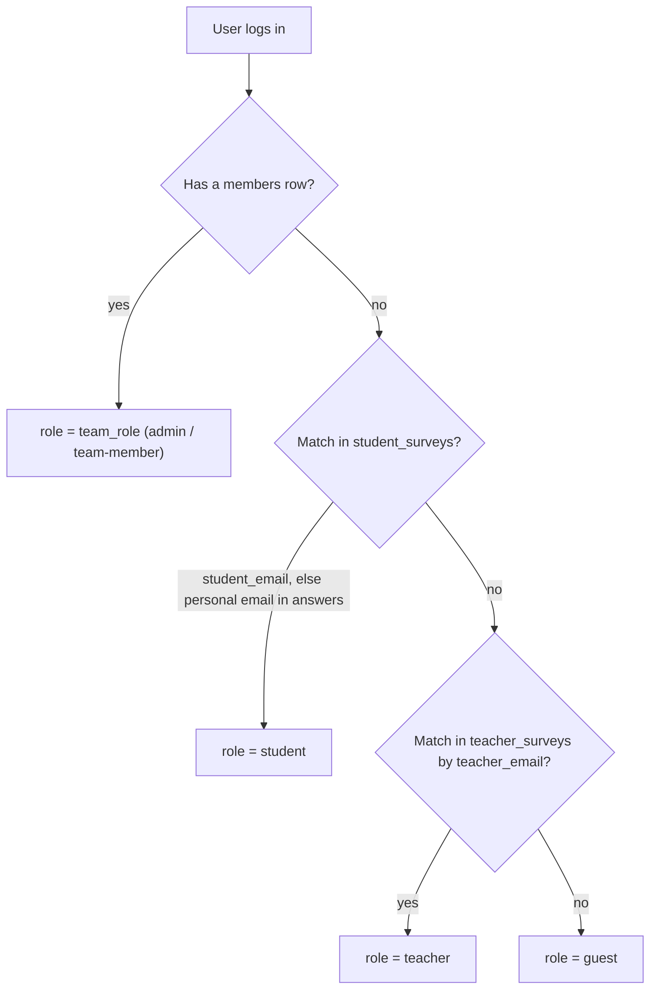
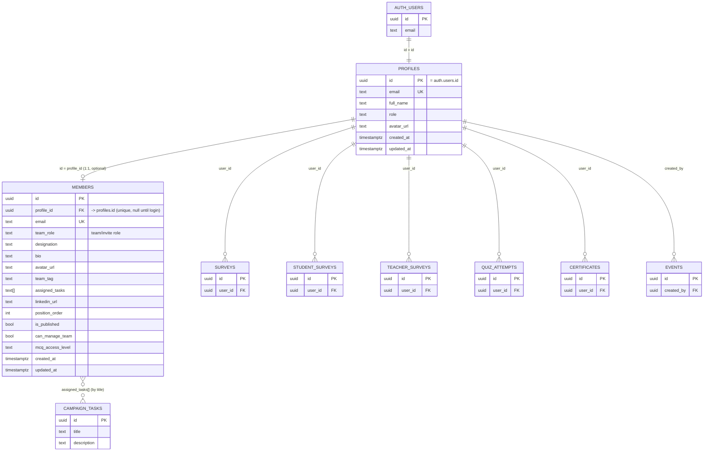

# Proposed Data Structure (Minimized)

**Goal:** fewer tables, no duplicated data, one clear source of truth, easy to read.
**Result:** the current **6 tables → 3 tables**.

## The idea (in one line)

> Keep **`profiles`** as the single identity/access row per user (it is already the hub every other table points to), and merge **`role_whitelist` + `member_permissions` + `team_members`** into one new **`members`** table that stores the team roster, public profile, and permissions.

Today the same person is copied across `role_whitelist` → `profiles` → `member_permissions` → `team_members`. Three of those collapse into **`members`**; `profiles` stays.

## Proposed Tables

### 1. `profiles` — identity + access (KEEP, unchanged role)
One row per registered user; already referenced by 7 other tables.

| Column | Type | Meaning |
|---|---|---|
| `id` | uuid PK → `auth.users(id)` | same id as the login |
| `email` | text UNIQUE | |
| `full_name` | text | |
| `role` | text (`student`/`teacher`/`guest`/`admin`/`team-member`) | system/access role, auto-detected (see below) |
| `avatar_url` | text | login photo |
| `created_at` / `updated_at` | timestamptz | |

### 2. `members` — team roster + public profile + permissions (NEW)
Merges `role_whitelist`, `member_permissions`, and `team_members` into one row.

| Column | Type | Meaning |
|---|---|---|
| `id` | uuid PK | |
| `profile_id` | uuid UNIQUE, nullable → `profiles(id)` | set once the person registers |
| `email` | text UNIQUE | lets us pre-add people **before** they register |
| `team_role` | text | invite role, applied to `profiles.role` on first login |
| `designation` | text | public subtitle |
| `bio` | text | public bio |
| `avatar_url` | text | team photo (may differ from login photo) |
| `team_tag` | text | badge label |
| `assigned_tasks` | text[] | public responsibility chips |
| `linkedin_url` | text | social link |
| `position_order` | int | display order |
| `is_published` | bool | show on public page |
| `can_manage_team` | bool | permission (folded from `member_permissions`) |
| `mcq_access_level` | text | replaces the `system_settings` JSON map |
| `created_at` / `updated_at` | timestamptz | |

### 3. `campaign_tasks` — the task pool (KEEP, small)
`id, title, description` — the `tag` column is **dropped** (team grouping now lives on `members.team_tag`). `members.assigned_tasks` references it by title.

## Role Design (two roles, on purpose)

We keep **two** role fields. They are **not** duplicates — each does a different job:

| Field | What it is | Example values | Who sets it |
|---|---|---|---|
| `members.team_role` | Team / invite role. Given the moment a person is added as a member, **even before they register**. | `admin`, `team-member` | Admin, when adding the member |
| `profiles.role` | System / access role used by RLS. | `student`, `teacher`, `guest`*, `admin`, `team-member` | Auto — see **Role Assignment System** below |

\* `guest` = reserved for the future.

**Why both:** late joiners can be added to `members` right away and get the correct access the instant they log in, while `profiles.role` stays free to grow into future **student / teacher / guest** detection.

## Role Assignment System (`profiles.role`)

`profiles.role` is filled **automatically** — the admin never types it. One rule is used **everywhere**: for the role *and* for the pre/post survey check.

Resolution order (first match wins):

| # | Check | Result role |
|---|---|---|
| 1 | A `members` row exists for this email | use `members.team_role` (`admin` / `team-member`) |
| 2 | Email found in `student_surveys` | `student` |
| 3 | Email found in `teacher_surveys` | `teacher` |
| 4 | Found in no form | `guest` |

**Email-matching rules (applied in checks 2 & 3):**
1. **Official email wins.** For students match `student_surveys.student_email` first; the **personal email** is used **only when the student-email cell is empty**.
2. **Never** match the *"Email address (survey)"* column.
3. **Teachers**: match `teacher_surveys.teacher_email` — the **institutional** email.
4. **One rule, over-all** — the same logic drives role detection *and* the pre/post survey completion checks (email compared lower-cased, spaces stripped).

> **Where the fallback happens:** `student_surveys.student_email` is `NOT NULL`, so the sheet→DB step already stores the official email — or the personal one when the official cell was empty. For old rows the same fallback re-checks the form answers (`answers`), exactly as the portal does today.

> `admin` always comes from `members.team_role`, never from the survey tables.

## Foreign Keys — How They Link

**Outgoing (these tables → other):**

| FK | References | On delete |
|---|---|---|
| `profiles.id` | `auth.users(id)` | CASCADE |
| `members.profile_id` | `profiles(id)` | CASCADE (nullable until login) |

**Incoming to `profiles` (unchanged — these 6 tables keep working as-is):**

| Table | Column | On delete |
|---|---|---|
| `surveys` | `user_id` | CASCADE |
| `student_surveys` | `user_id` | SET NULL |
| `teacher_surveys` | `user_id` | SET NULL |
| `quiz_attempts` | `user_id` | CASCADE |
| `certificates` | `user_id` | CASCADE |
| `events` | `created_by` | SET NULL |

> **`survey_audit_logs` is dropped entirely.**

**Logical links (not FKs):**
- `members.email` ↔ `profiles.email` — used only to attach the member row to the profile on first login.
- `members.assigned_tasks[]` ↔ `campaign_tasks.title` — matched by title.

## New ERD

### How to read it (short)

- `AUTH_USERS ||--|| PROFILES` — one login = exactly one profile (same `id`).
- `PROFILES ||--o| MEMBERS` — a profile has **at most one** member row (only staff/ambassadors have one); the login is what links them.
- `PROFILES ||--o{ X` — one user can own **many** rows in `X` (their surveys, quiz attempts, certificate…). These 6 tables are **unchanged**.
- `MEMBERS }o..o{ CAMPAIGN_TASKS` (**dotted**) — many-to-many via the `assigned_tasks` text array, matched by task **title**. Not a real FK.

## Old → New Mapping

| Current table | Becomes |
|---|---|
| `profiles` | **kept** as-is (identity + access hub) |
| `role_whitelist` | merged into **`members`** (invite = row with `role` and `profile_id = null`) |
| `member_permissions` | folded into **`members`** as boolean columns |
| `team_members` | merged into **`members`** (public columns) |
| `system_settings.mcq_access_levels` | column `mcq_access_level` on **`members`** |
| `campaign_tasks` | **kept** as-is |

**Public page query becomes:** `SELECT * FROM members WHERE is_published = true ORDER BY position_order` — no sync step, no email-string joins.

## Pros

- **6 tables → 3.** Less to understand; the old whitelist↔roster sync disappears.
- **No risky FK migration:** `profiles` stays the hub, so the 6 tables that reference it are untouched.
- **One source of truth for team data** → public `designation`/`bio` are explicit columns, no `notes` leaking.
- **Real keys** (`profile_id`) replace email-string matching.
- **Simpler RLS**: one public policy on `members` (`is_published = true`); no admin-client workaround.
- Adding a member or editing their public text is a **single row write**.
- **Late joiners handled:** add a member before they register; `team_role` is applied automatically on first login.

## Cons — and how to solve each

| Con (problem) | Solution (fix) |
|---|---|
| We now have **two people tables** (`profiles` and `members`), so the same person's data can get out of sync. | Add a **trigger**: when a login is made in `profiles`, find the matching `members` row by email and set its `profile_id`. Always edit the team/public text only in `members`. |
| `members` is a **big table** that does three jobs at once (team info + public text + permission). | It's fine for now. If it gets messy later, show only the public columns as a **view** (`member_public`) instead of splitting the table. |
| Permissions are **columns**, so adding a new permission means changing the database. | Only two are left. If you need more later, put them in one `permissions` list column instead of adding new columns. |
| `assigned_tasks` saves **task names as text**, so the names are repeated from `campaign_tasks`. | Save **task ids** (`task_ids`) that point to `campaign_tasks.id`, or add a small `member_tasks` link table. |
| **Tag colours** are still written inside the code, not the database. | Add a small `team_tags` table (tag, label, colour) and read the colour from it. |

> Note: there is **no edit system** in the app (and none is planned), so audit trails are not needed — dropping `survey_audit_logs` loses nothing.

## Verdict

Keep **`profiles` + `members` + `campaign_tasks`**. It removes the three redundant team tables and all cross-table copy logic **without** touching the 6 tables that already depend on `profiles` (and drops `survey_audit_logs`). Simplest, safest, and still easy to understand.
